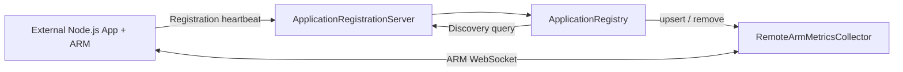
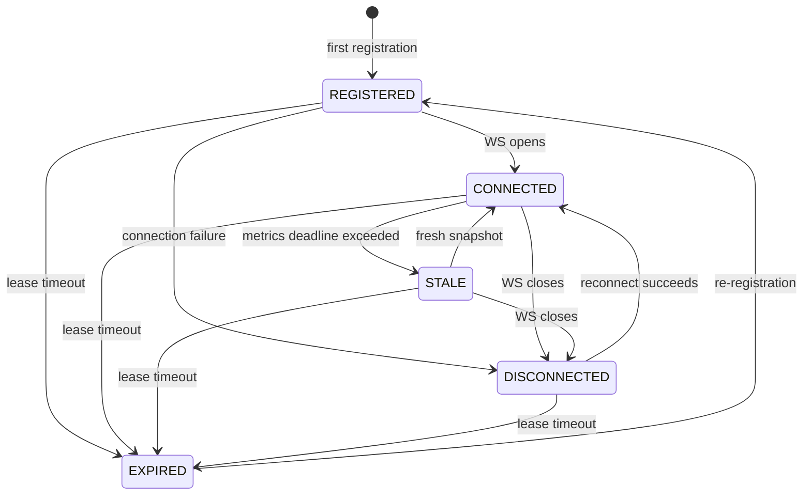

# Application Discovery & Lifecycle State — Supervisor

## 1. Mục tiêu

Supervisor theo dõi các **Node.js applications tự khởi động và tự đăng ký** mà
không phải liệt kê sẵn trong `ProcessManager.initialize()`. Registry phân biệt:

- **Discovery/monitoring status:** Registration lease + WebSocket + độ mới metrics
- **OS process status:** Chỉ xác định được bằng một cơ chế ProcessManager/probe đáng tin cậy

Một ứng dụng tự đăng ký vẫn là **monitor-only**. Mất WebSocket hoặc hết hạn
lease **không chứng minh** process đã chết và **không tự kích hoạt restart**.

## 2. Architecture



## 3. Discovery state model

| State | Ý nghĩa |
|---|---|
| `REGISTERED` | Registration hợp lệ, còn lease; chưa có kết nối WS thành công |
| `CONNECTED` | WS đang mở và chưa quá ngưỡng freshness; metrics ban đầu có thể chưa đến |
| `STALE` | WS vẫn mở nhưng không nhận snapshot mới trong thời gian `freshnessMs` |
| `DISCONNECTED` | WS đã đóng hoặc gặp lỗi; vẫn còn registration lease |
| `EXPIRED` | Lease không được gia hạn kịp, Supervisor ngừng subscribe; process có thể vẫn chạy |

`EXPIRED` ưu tiên cao hơn mọi trạng thái kết nối.
Việc `register()` lặp lại sẽ gia hạn lease, không tái tạo kết nối WS nếu
endpoint/token không đổi. Một instance hết hạn có thể đăng ký lại; Supervisor
sẽ kết nối trở lại với ARM.

### State transitions



Không có state `RUNNING`/`STOPPED` cho external applications;
`processStatus: "UNKNOWN"` được trả về một cách tường minh. Đây không
phải là `LifecycleStatus` nội bộ của `ReliabilityManager`.

## 4. API

Mọi request yêu cầu `Authorization: Bearer <SUPERVISOR_REGISTRATION_TOKEN>`.
Registration Server chỉ bind `127.0.0.1` theo mặc định.

| Method | Path | Mục đích |
|---|---|---|
| `POST` | `/applications/register` | Đăng ký hoặc gia hạn lease |
| `POST` | `/applications/unregister` | Hủy theo dõi instance |
| `GET` | `/applications` | Liệt kê các instance chưa hết hạn |
| `GET` | `/applications?status=STALE` | Lọc theo discovery status |
| `GET` | `/applications?applicationId=payment` | Lọc theo application |
| `GET` | `/applications?includeExpired=true` | Bao gồm các instance đã hết hạn |
| `GET` | `/applications/payment/instances/instance-a` | Tra cứu chi tiết instance |
| `GET` | `/applications/transitions` | 200 chuyển trạng thái gần nhất |

`GET /applications?status=EXPIRED` cũng hiển thị expired records.
Mỗi instance chứa `status`, `statusChangedAt`, `processStatus`,
`registeredAt`, `lastSeenAt`, `expiresAt`, `management` và các
trường đăng ký. API trả thêm `monitoring` và `fresh`.

Ví dụ:

```json
{
  "id": "payment/instance-a",
  "applicationId": "payment",
  "instanceId": "instance-a",
  "status": "STALE",
  "processStatus": "UNKNOWN",
  "management": "monitor-only"
}
```

## 5. Timings và retention

- App tự đăng ký định kỳ mỗi **15 giây** (client mặc định).
- Lease mặc định **45 giây**, có thể cấu hình trong `ApplicationRegistry`.
- Snapshot freshness mặc định **15 giây** trong `RemoteArmMetricsCollector`.
- Registry re-evaluate trạng thái mỗi **1 giây** và khi có event WS.
- `EXPIRED` ngừng WebSocket subscription, nhưng record được giữ thêm
  **5 phút** (cấu hình `expiredRetentionMs`) để truy vấn và debug,
  sau đó purge.
- State transition history giới hạn **200 events**, trong memory.

Sau khi Supervisor restart, registry in-memory và transition history bị mất.
ApplicationRegistrationClient tự đăng ký lại trong chu kỳ heartbeat tiếp
theo. Các process bên ngoài không bị kill.

## 6. Developer contracts

- `ApplicationRegistry.register()`: validate, upsert instance, renew lease
- `ApplicationRegistry.refreshStates()`: evaluate expiry + stale snapshots
- `ApplicationRegistry.list(query)`: filter status/applicationId/expired
- `ApplicationRegistry.recentTransitions()`: bounded history
- `RemoteArmMetricsCollector.isFresh(id)`: verifies connected + fresh metrics
- `ApplicationRegistrationServer`: HTTP routing/discovery requests

Logic được tách thành các method có tên theo
[`CODING_STANDARDS.md`](CODING_STANDARDS.md): `resolveStatus`,
`updateStatus`, `matchesDiscoveryQuery`, `parseDiscoveryQuery`,
`handleApplicationDetail`.

## 7. Local reproduction

```bash
git switch arm-supervisor
npm install
npm run build
npm test
```

Terminal A:

```bash
SUPERVISOR_REGISTRATION_TOKEN=development-secret npm run dev:registration
```

Terminal B:

```bash
SUPERVISOR_REGISTRATION_TOKEN=development-secret PORT=3101 npm run dev
```

Terminal C:

```bash
curl -H "Authorization: Bearer development-secret" \
  "http://127.0.0.1:3200/applications"

curl -H "Authorization: Bearer development-secret" \
  "http://127.0.0.1:3200/applications/transitions"
```

## 8. Giới hạn / ngoài phạm vi

- Chưa có OS discovery cho những process **không tự đăng ký**.
- Chưa có quản lý process lifecycle cho instance bên ngoài.
- Chưa có discovery liên host; địa chỉ WS chỉ hỗ trợ loopback để giới
  hạn SSRF. Remote hosts cần xác thực endpoint, TLS và explicit allowlist.
- Chưa persistent registry, audit log, distributed leadership hoặc
  automatic restart khi telemetry mất.
- Một shared Bearer token được dùng ở Registration API phiên bản đầu;
  production nên có per-app identity và authorization.
