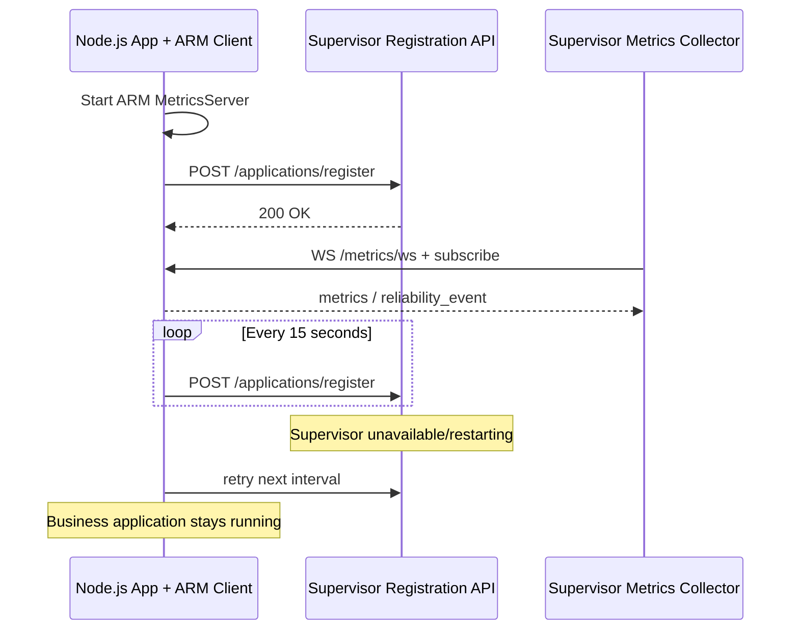

# ApplicationRegistrationClient — ARM Client → Supervisor

## Mục tiêu

Node.js application tích hợp `base-arm-app` có thể **tự đăng ký** với
Supervisor và gia hạn đăng ký theo chu kỳ. Supervisor chủ động kết nối tới
`MetricsServer` qua `/metrics/ws` để nhận metrics và reliability events.

Registration **không cấp quyền stop/restart** process cho Supervisor.
App vẫn chạy khi Supervisor chết hoặc bị restart.



## Public API

```ts
import {
  ApplicationRegistrationClient,
  type RegistrationClientOptions,
} from 'base-arm-app';
```

`RegistrationClientOptions`:

| Field | Required | Meaning |
|---|---|---|
| `applicationId` | yes | Logical service name (e.g. `orders-api`) |
| `instanceId` | yes | Unique identity per running instance (e.g. `pid-1234`) |
| `metricsUrl` | yes | App's ARM `ws://127.0.0.1:3101/metrics/ws` |
| `supervisorUrl` | yes | Supervisor Registration API (typically `http://127.0.0.1:3200`) |
| `token` | yes | Shared Registration API Bearer token |
| `intervalMs` | no | Default 15,000 ms (minimum 1,000 ms) |
| `requestTimeoutMs` | no | Default 5,000 ms (minimum 100 ms) |

### Methods

- `register(): Promise<void>` — one registration attempt
- `start(onError?): void` — immediate attempt and recurring heartbeat/retry; idempotent
- `stop(): void` — stop heartbeat only; **does not stop the app**
- `unregister(): Promise<void>` — stop heartbeat, request removal; safe for explicit decommissioning

## Integrate in a Node.js application

After `MetricsServer.start()` succeeds:

```ts
import {
  ApplicationRegistrationClient, MetricsRegistry,
  NodeMetricsCollector, ReliabilityManager, MetricsServer,
} from 'base-arm-app';

const registry = new MetricsRegistry();
const collector = new NodeMetricsCollector(registry, 2000);
const manager = new ReliabilityManager(registry);
const metricsServer = new MetricsServer(registry, {
  port: 3101,
  authToken: process.env.ARM_METRICS_TOKEN,
}, manager);

// register components with manager before start()
collector.start();
await manager.start();
await metricsServer.start();

function createRegistrationClient(): ApplicationRegistrationClient | undefined {
  const token = process.env.SUPERVISOR_REGISTRATION_TOKEN;
  if (!token) return undefined;

  return new ApplicationRegistrationClient({
    applicationId: 'orders-api',
    instanceId: process.env.ARM_INSTANCE_ID ?? `pid-${process.pid}`,
    metricsUrl: 'ws://127.0.0.1:3101/metrics/ws',
    supervisorUrl: process.env.SUPERVISOR_URL ?? 'http://127.0.0.1:3200',
    token,
  });
}

const registration = createRegistrationClient();
registration?.start(error => console.warn('Supervisor registration failed:', error));

async function shutdown(): Promise<void> {
  registration?.stop();
  collector.stop();
  await manager.stop();
  await metricsServer.stop();
}
```

This minimal snippet omits signal handlers and business component implementations.
The existing example is in `examples/nodejs-api/src/index.ts`.

## Run both branches locally

Supervisor: checkout `arm-supervisor`, set
`SUPERVISOR_REGISTRATION_TOKEN=development-secret` then
`npm run dev:registration`.

App: checkout `arm-client`, set the **same** registration token and
`PORT=3101`, then `npm run dev`.

Verify with:

```bash
curl -H 'Authorization: Bearer development-secret' \
  http://127.0.0.1:3200/applications
```

For Windows PowerShell use `$env:SUPERVISOR_REGISTRATION_TOKEN='development-secret'`
rather than inline Bash environment assignments.

## Security and lifecycle

- Registration token authenticates the **registration request**; ARM
  `MetricsServer` may have a **separate** `ARM_METRICS_TOKEN` used when
  Supervisor connects through WebSocket.
- Supervisor's current implementation accepts **loopback metrics URLs** only.
  For multi-host scenarios change endpoint policy in Supervisor with explicit
  allowlisting, authentication and TLS before deploying remotely.
- Client accepts HTTPS Supervisor endpoints or loopback HTTP. Do not send
  tokens over plaintext HTTP to non-loopback hosts.
- Use a stable unique `instanceId` during one process lifetime.
- `start()` retries a failed registration on the next tick; it must never
  crash/stop business logic merely because Supervisor is unavailable.
- Begin registration only **after ARM MetricsServer is listening**.
- On ordinary application shutdown, `stop()` is non-blocking. Optionally
  call `await unregister()` when deliberately removing an instance, but
  avoid delaying shutdown indefinitely if Supervisor is offline.
- The Supervisor registration lease currently defaults to 45 seconds.
  Register more often than the lease duration (default client interval 15s).
- This module has no `ProcessManager`, remote metrics collector, process
  recovery, or Supervisor server dependencies.

## Packaging

```bash
git switch arm-client
npm install
npm run pack:client
cd packages/library && npm pack
```

The resulting `base-arm-app-0.1.0.tgz` includes the
`ApplicationRegistrationClient` public export. Copy that tarball to a
consumer project's `vendor/` and install via `npm install`.

## Testing

`tests/application-registration-client.test.ts` covers registration,
Bearer token, unregister, retry on HTTP failure, idempotent start/stop,
and invalid endpoint configuration.
