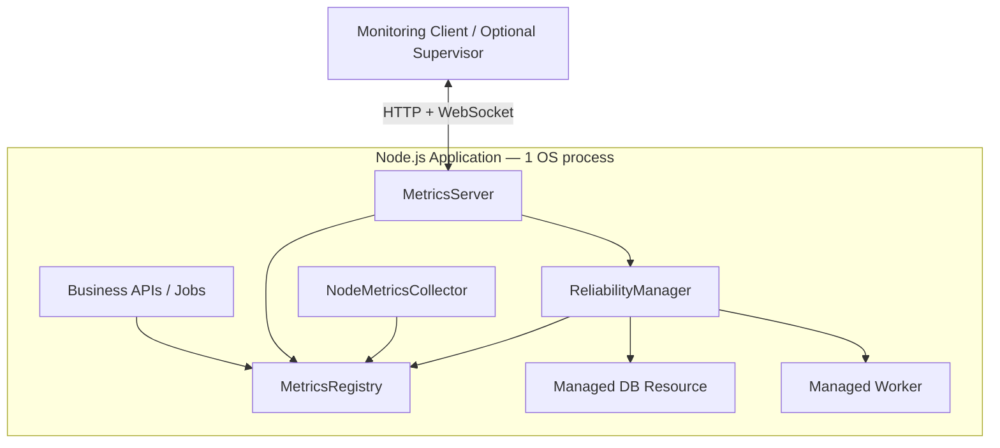
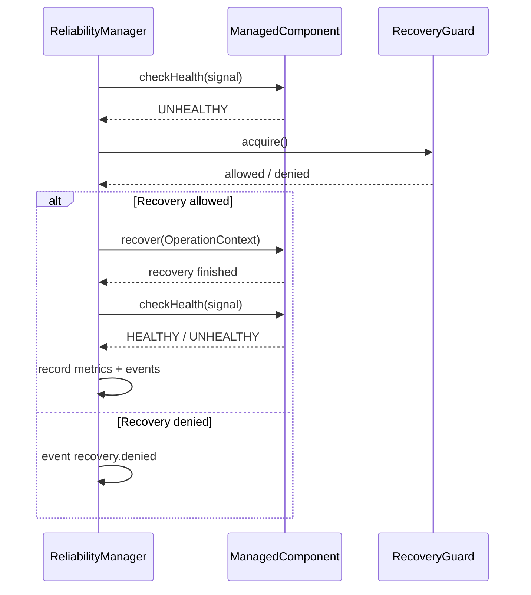

# ARM Client Library — Feature Review & Node.js Integration Guide

> **Repository:** `base-arm-app` · **Branch:** `arm-client` · **Package:** `base-arm-app` · **Scope:** in-process Node.js reliability, monitoring and component recovery.
>
> Tài liệu được đối chiếu với source trên nhánh `arm-client` ngày 09/11/2026. Các ví dụ dưới đây dành cho Node.js + TypeScript (ESM / `NodeNext`).

## 1. Bản chất và phạm vi

ARM Client là thư viện **chạy bên trong cùng process Node.js** với ứng dụng tích hợp nó. Library không tạo process mới và không thay thế business framework (Express, Fastify, NestJS, LoopBack...). Các công việc chính:

- Theo dõi runtime metrics của **process hiện tại** và metrics do ứng dụng tự ghi.
- Quản lý vòng đời, kiểm tra health và recovery cho **ManagedComponent** (database, WebSocket, message consumer, worker resource...).
- Phát hành metrics, readiness, trạng thái component và reliability events qua HTTP/WebSocket.
- Giới hạn recovery bằng retry/backoff, retry budget, circuit breaker, timeout và operation fencing.

**Không bao gồm trong `arm-client`:** `ProcessManager`, detached process supervision, application discovery, self-registration với Supervisor, remote metrics collector, tự khởi động lại Node.js process. Các chức năng Supervisor nằm ở nhánh `arm-supervisor` và phải được tích hợp riêng nếu cần.



## 2. Feature Matrix — hiện trạng implementation

| Nhóm | Feature | API / Class | Ghi chú |
|---|---|---|---|
| Runtime telemetry | CPU của Node.js process, uptime, RSS, heap, event-loop delay | `NodeMetricsCollector.start/stop/sample` | `process.cpu.percent_of_one_core` là % một lõi, **không** phải tổng CPU của host |
| Host telemetry | Total/free memory, số logical cores | `NodeMetricsCollector` | Là thông tin **host**, không phản ánh mức dùng của process khác |
| Custom metrics | `gauge`, `increment`, `record`, `get`, `snapshot` | `MetricsRegistry` | Lưu giá trị hiện tại, **không** phải time-series database; giới hạn cardinality mặc định 1.000 |
| Component lifecycle | Start/stop các component đã đăng ký | `ReliabilityManager.register/start/stop` | Đăng ký trước `start()`; startup tuần tự; stop theo thứ tự ngược |
| Health monitoring | `HEALTHY`, `DEGRADED`, `UNHEALTHY`, `UNKNOWN` | `ManagedComponent.checkHealth`, `ReliabilityManager.checkAll` | Interval và timeout cấu hình được |
| Readiness | Aggregate critical components | `ReliabilityManager.readiness()` | `ready=true` khi các critical component đang `RUNNING`, `HEALTHY`, không có pending operation |
| Recovery | Retry theo backoff + xác minh health sau recovery | `ManagedComponent.recover`, `ReliabilityManager.recover` | Recovery áp dụng cho component, không phải Node.js process |
| Recovery protection | Budget trong rolling window, circuit breaker, half-open probe | `RecoveryGuard` | Giảm nguy cơ recovery liên tục |
| Operation safety | Timeout, abort signal, generation fencing, pending-operation isolation | `OperationManager`, `OperationContext` | Timeout **không hủy được** Promise/side effect nếu component không hợp tác |
| Resource adapter | Dựng session mới, health-check rồi swap; đóng session cũ | `ReconnectableResource` | Dùng cho DB pool, WS connection hoặc broker resource |
| Reliability events | Lifecycle, health, recovery, timeout, shutdown | `ReliabilityManager.on('event', ...)`, `recentEvents()` | Event history bounded, mặc định 200 |
| REST metrics | Metrics, component states, readiness, events | `MetricsServer` | Có Bearer auth cấu hình được |
| WebSocket metrics | Snapshot, filtered subscription, reliability events | `/metrics/ws` | Protocol `arm.metrics.v1`; broadcast interval mặc định 5s; subscription limit mặc định 100 |
| Graceful shutdown | Stop ngược thứ tự, ghi nhận blocked operations | `ReliabilityManager.stop()` | Trả `{ clean, blockedComponents }` |

### Metrics có sẵn

- `process.uptime_seconds`
- `process.memory.rss_bytes`
- `process.memory.heap_used_bytes`
- `process.memory.heap_total_bytes`
- `process.cpu.percent_of_one_core`
- `runtime.event_loop.mean_delay_ms`
- `host.memory.total_bytes`
- `host.memory.free_bytes`
- `host.cpu.logical_cores`
- `arm.component.<id>.health` (`HEALTHY=2`, `DEGRADED=1`, `UNHEALTHY=0`, `UNKNOWN=-1`)
- `arm.component.<id>.running`, `arm.component.<id>.recovery_attempts`, `arm.component.<id>.operation_pending`
- `arm.component.<id>.recovery_budget_used`, `arm.component.<id>.circuit_open`, `arm.component.<id>.recovery_retry_after_ms`
- Khi recovery diễn ra: `arm.component.<id>.last_recovery_duration_ms`, `arm.recovery.success_total`, `arm.recovery.failure_total`.

## 3. Public API của package

```ts
import {
  MetricsRegistry,
  NodeMetricsCollector,
  ReliabilityManager,
  MetricsServer,
  ReconnectableResource,
  OperationManager,
  RecoveryGuard,
  PermanentRecoveryError,
  type ManagedComponent,
  type OperationContext,
  type RecoveryPolicy,
  type HealthResult,
  type MetricsServerOptions,
} from 'base-arm-app';
```

`MetricsRegistry` và `ReliabilityManager` là các object nền tảng. `NodeMetricsCollector` và `MetricsServer` là hai thành phần tùy chọn nhưng nên bật trong môi trường quan sát thực tế. Không nên tạo nhiều `NodeMetricsCollector` cho cùng một registry nếu không có mục đích riêng.

## 4. Build local và cài đặt vào project

### 4.1 Build từ nhánh Client (tại repository ARM)

```bash
git switch arm-client
git pull origin arm-client
npm install
npm run pack:client
cd packages/library
npm pack
```

Đầu ra mong đợi: `base-arm-app-0.1.0.tgz` chứa `dist/index.js`, `dist/index.d.ts` và các module được đóng gói. `npm pack` ở đây chỉ tạo file local, **không publish npm**.

> **Lưu ý:** Đây là lệnh build đã khai báo trong repository; cần chạy `npm run build`, `npm test` và test import package trên máy của bạn trước khi phát hành cho các ứng dụng khác. Tài liệu không khẳng định pipeline đã được kiểm chứng trên mọi OS.

### 4.2 Cài vào Node.js application

```text
my-node-app/
├── vendor/
│   └── base-arm-app-0.1.0.tgz
├── src/
│   ├── integrations/arm/
│   │   ├── worker-component.ts
│   │   └── arm-runtime.ts
│   └── main.ts
├── package.json
└── tsconfig.json
```

```bash
npm install ./vendor/base-arm-app-0.1.0.tgz
```

Khuyến nghị giữ file `.tgz` có version trong `vendor/` hoặc artifact repository và commit lockfile. Khi build bản mới, cập nhật artifact và reinstall. **Không cần clone nguyên source ARM vào application**. Nếu bạn chỉ có ZIP của thư mục `dist`, ZIP đó phải được chuẩn hóa thành một npm package có `package.json` + entry point; `npm install` không thể cài một ZIP bất kỳ như npm package trực tiếp.

## 5. Ví dụ tích hợp có phân tách trách nhiệm

### 5.1 ManagedComponent: bảo vệ một worker nội bộ

`src/integrations/arm/worker-component.ts`

```ts
import type { ManagedComponent, OperationContext, HealthResult }
  from 'base-arm-app';

export class WorkerComponent implements ManagedComponent {
  readonly id = 'job-worker';
  private timer?: NodeJS.Timeout;
  private lastJobAt?: number;

  async start(context?: OperationContext): Promise<void> {
    this.assertAllowed(context);
    this.startWorkerLoop();
  }

  async stop(): Promise<void> {
    this.stopWorkerLoop();
  }

  async checkHealth(): Promise<HealthResult> {
    return {
      status: this.timer ? 'HEALTHY' : 'UNHEALTHY',
      reason: this.timer ? undefined : 'Worker timer is not running',
      checkedAt: new Date().toISOString(),
    };
  }

  async recover(context?: OperationContext): Promise<void> {
    this.assertAllowed(context);
    this.stopWorkerLoop();
    this.assertAllowed(context);
    this.startWorkerLoop();
  }

  private assertAllowed(context?: OperationContext): void {
    context?.assertCurrent();
  }

  private startWorkerLoop(): void {
    if (this.timer) return;
    this.timer = setInterval(() => {
      this.lastJobAt = Date.now();
      // Thực hiện một bước xử lý ngắn. Với tác vụ async thực tế,
      // bổ sung kiểm soát overlap và cancellation riêng.
    }, 1000);
  }

  private stopWorkerLoop(): void {
    if (!this.timer) return;
    clearInterval(this.timer);
    this.timer = undefined;
  }
}
```

Đây là worker demo dùng timer, không phải job queue production. Khi thao tác với database hoặc tác động bên ngoài sau `await`, phải kiểm tra `context.assertCurrent()` ngay trước khi commit thay đổi. `AbortSignal` cần được truyền xuống driver/API có hỗ trợ cancellation.

### 5.2 Bootstrap ARM (một điểm khởi tạo duy nhất)

`src/integrations/arm/arm-runtime.ts`

```ts
import {
  MetricsRegistry,
  NodeMetricsCollector,
  ReliabilityManager,
  MetricsServer,
  type ManagedComponent,
  type RecoveryPolicy,
} from 'base-arm-app';
import { WorkerComponent } from './worker-component.js';

const workerRecovery: RecoveryPolicy = {
  enabled: true,
  maxAttempts: 3,
  baseDelayMs: 500,
  maxDelayMs: 5000,
  timeoutMs: 2000,
  budgetMaxAttempts: 10,
  budgetWindowMs: 60_000,
  circuitFailureThreshold: 3,
  circuitCooldownMs: 30_000,
};

export class ArmRuntime {
  readonly metrics = new MetricsRegistry();
  private readonly manager = new ReliabilityManager(this.metrics, {
    checkIntervalMs: 2000,
    healthTimeoutMs: 1000,
    shutdownGraceMs: 3000,
  });
  private readonly nodeMetrics = new NodeMetricsCollector(this.metrics, 2000);
  private readonly metricsServer = new MetricsServer(this.metrics, {
    host: '127.0.0.1',
    port: Number(process.env.ARM_PORT ?? 3100),
    authToken: process.env.ARM_METRICS_TOKEN,
    broadcastIntervalMs: 2000,
  }, this.manager);

  private started = false;

  constructor() {
    this.registerComponents();
    this.manager.on('event', event => console.log('[ARM event]', event));
  }

  private registerComponents(): void {
    this.registerCriticalComponent(new WorkerComponent(), workerRecovery);
  }

  private registerCriticalComponent(
    component: ManagedComponent,
    recovery: RecoveryPolicy,
  ): void {
    this.manager.register({ component, critical: true, recovery });
  }

  async start(): Promise<void> {
    if (this.started) return;
    await this.manager.start();
    this.nodeMetrics.start();
    try {
      await this.metricsServer.start();
      this.started = true;
    } catch (error) {
      this.nodeMetrics.stop();
      await this.manager.stop();
      throw error;
    }
  }

  recordCompletedJob(): void {
    this.metrics.increment('app.jobs.completed_total');
  }

  getReadiness() {
    return this.manager.readiness();
  }

  async stop(): Promise<void> {
    if (!this.started) return;
    this.started = false;
    this.nodeMetrics.stop();
    await this.metricsServer.stop();
    const result = await this.manager.stop();
    if (!result.clean) {
      console.error('ARM shutdown incomplete', result.blockedComponents);
    }
  }
}
```

**Vòng đời:** register các component trước khi gọi `manager.start()`; sau khi gọi `stop()` hãy xem instance ARM này là terminal, không tự giả định có thể `start()` lại trên cùng object. Nếu ứng dụng đã có HTTP server, có thể mount hoặc proxy các endpoint ARM thay vì expose thêm port, nhưng package hiện cung cấp một `MetricsServer` độc lập.

### 5.3 Application entrypoint

`src/main.ts`

```ts
import { ArmRuntime } from './integrations/arm/arm-runtime.js';

const arm = new ArmRuntime();
await arm.start();

console.log('Application started', arm.getReadiness());
arm.recordCompletedJob(); // demo custom metric

let stopping = false;
async function gracefulShutdown(): Promise<void> {
  if (stopping) return;
  stopping = true;
  await arm.stop();
}

for (const signal of ['SIGINT', 'SIGTERM'] as const) {
  process.once(signal, () => {
    void gracefulShutdown()
      .then(() => { process.exitCode = 0; })
      .catch(error => { console.error(error); process.exitCode = 1; });
  });
}
```

Ở ứng dụng production, đóng server nhận request mới trước, sau đó drain jobs và các resource theo thứ tự phù hợp. Ví dụ trên tập trung vào ARM, không thay thế shutdown orchestration toàn ứng dụng.

## 6. HTTP và WebSocket để giám sát

### REST

| Request | Ý nghĩa |
|---|---|
| `GET /metrics` | Snapshot metrics hiện tại |
| `GET /metrics/:name` | Một metric theo tên |
| `GET /reliability/components` | Status và recovery guard của component |
| `GET /reliability/ready` | Trả `200` khi ready, `503` nếu chưa ready |
| `GET /reliability/events?since=0` | Các reliability events sau sequence đã cho |

```bash
curl -H 'Authorization: Bearer YOUR_TOKEN' \
  http://127.0.0.1:3100/reliability/ready

curl -H 'Authorization: Bearer YOUR_TOKEN' \
  http://127.0.0.1:3100/metrics
```

Nếu `ARM_METRICS_TOKEN` không cấu hình, `MetricsServer` không yêu cầu Bearer token. Vì vậy **chỉ bind loopback**, và cấu hình auth + network controls trước khi expose ra host/network bên ngoài.

### WebSocket

Endpoint: `ws://127.0.0.1:3100/metrics/ws`. Khi kết nối, server gửi `{ "type": "connected", "protocol": "arm.metrics.v1" }`.

Client gửi:

```json
{ "action": "subscribe" }
```

hoặc lọc metrics:

```json
{ "action": "subscribe", "names": ["process.memory.rss_bytes", "app.jobs.completed_total"] }
```

Theo dõi reliability events:

```json
{ "action": "subscribe_events" }
```

Các action khác: `snapshot`, `unsubscribe`, `unsubscribe_events`. Response chính: `snapshot`, `metrics`, `events`, `reliability_event`, `error`. Nếu có auth, WebSocket handshake phải gửi header `Authorization: Bearer <token>`; Browser WebSocket API thuần không hỗ trợ custom Authorization header, vì vậy cần kiến trúc auth phù hợp khi client chạy trong browser.

## 7. Recovery flow và các nguyên tắc vận hành



**Không nhầm lẫn các khái niệm:**

- *Health check* đánh giá trạng thái nghiệp vụ/resource; một process vẫn chạy bình thường có thể có component `UNHEALTHY`.
- *Readiness* hiện phụ thuộc các component `critical`.
- *Recovery* được thực hiện nếu `recovery.enabled`, component có `recover()` và recovery policy cho phép.
- *Timeout* chỉ abort signal / chặn commit stale operations khi implement đúng `OperationContext`; không thể buộc ngắt một Promise tùy ý.
- *Shutdown* có thể `clean=false` nếu còn uncooperative operation.
- *Process-level restart* nên được giao cho Supervisor, systemd, Docker hoặc Kubernetes, không phải ARM Client.

## 8. Tích hợp ARM với Supervisor (tùy chọn)

`arm-client` có thể expose `/metrics/ws` để một Supervisor kết nối và nhận telemetry. Nhưng package `arm-client` **không** tự gửi registration heartbeat tới Supervisor. Logic `ApplicationRegistrationClient` hiện nằm trong nhánh `arm-supervisor`.

Nếu muốn **App tự đăng ký theo Cách B**, cần chọn một trong hai hướng phát triển tiếp theo: trích riêng registration client thành package dùng chung, hoặc bổ sung một adapter registration nhỏ cho ARM Client với public API ổn định. Tránh copy cả ProcessManager và Supervisor server vào package client chỉ để có registration.

## 9. Checklist tích hợp và kiểm thử

- [ ] Build ARM local, kiểm tra `.tgz` chứa JS, `.d.ts` và runtime dependencies.
- [ ] Import `base-arm-app` trong application TypeScript mà không cần source ARM.
- [ ] Tạo một `MetricsRegistry` cho các metrics cần chia sẻ.
- [ ] Register các `ManagedComponent` trước `ReliabilityManager.start()`.
- [ ] Kiểm tra các policy: timeout, retry, budget, circuit breaker.
- [ ] Dùng `context.signal` và `context.assertCurrent()` với resource side effects.
- [ ] Bật `NodeMetricsCollector`, xác minh các metrics thực tế xuất hiện.
- [ ] Xác thực `GET /reliability/ready` và `GET /metrics`.
- [ ] Kiểm tra `subscribe` và `subscribe_events` qua WebSocket.
- [ ] Mô phỏng component unhealthy và recovery thành công/thất bại.
- [ ] Mô phỏng graceful shutdown, kiểm tra `clean`/`blockedComponents`.
- [ ] Không expose telemetry endpoint không xác thực trên mạng công khai.
- [ ] Nếu triển khai Supervisor, kiểm tra kết nối metrics riêng biệt với đăng ký động.

## 10. Known limitations và roadmap được khuyến nghị

1. **Packaging:** `npm pack` cần được kiểm chứng bằng smoke test thực sự từ một consumer project và cả type checking. Chưa có CI publish/versioning.
2. **Metrics history:** `MetricsRegistry` là snapshot store, chưa có persistence/time-series aggregation.
3. **Health coverage:** mỗi adapter phải triển khai health checks đúng bản chất resource; ARM không tự phát hiện mọi lỗi nghiệp vụ.
4. **Recovery isolation:** một async operation không hợp tác cancellation có thể tiếp tục chạy sau timeout; xem `OperationContext`.
5. **Process failure:** ARM Client không thể tự phục hồi chính process đã chết.
6. **Supervisor registration:** client-side self-registration chưa nằm trong public API nhánh Client; cần một package/adapter chung để tránh coupling hai nhánh.
7. **Security:** REST/WS server sử dụng Bearer token đơn giản, mặc định loopback; chưa phải đầy đủ mTLS/RBAC/rate limiting cho internet exposure.

### Tài liệu source liên quan

- `packages/library/src/index.ts` — public exports
- `packages/core/src/reliability.ts` — lifecycle/health/recovery
- `packages/core/src/metrics.ts` — metrics collector/registry
- `packages/core/src/operations.ts` — cancellation/fencing
- `packages/core/src/recovery-policy.ts` — circuit/retry budget
- `packages/adapters/src/reconnectable-resource.ts` — resource swapping
- `packages/adapter-http/src/server.ts` — REST/WS
- `scripts/build-client-package.mjs` — local package build
- `docs/CODING_STANDARDS.md` — coding conventions

---

**Trạng thái review:** Các class, method, config và giới hạn được đối chiếu với source branch `arm-client`; ví dụ integration trong tài liệu chưa được thực thi/test trực tiếp ở consumer app.