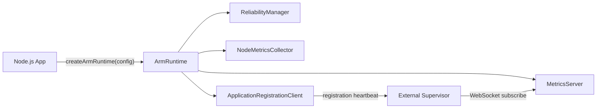

# ARM Runtime — Configuration-Driven Integration

## Goal

A Node.js app should configure ARM once and call `await arm.start()`.
The ARM library owns the lifecycle of its in-process components, runtime
metrics collection, HTTP/WebSocket metrics server and optional Supervisor
registration.



## Minimal Node.js integration

```ts
import { createArmRuntime } from 'base-arm-app';

const arm = createArmRuntime({
  metrics: {
    collectionIntervalMs: 2000,
    server: {
      host: '127.0.0.1',
      port: 3101,
      authToken: process.env.ARM_METRICS_TOKEN,
      broadcastIntervalMs: 2000,
    },
  },
  reliability: {
    checkIntervalMs: 2000,
    healthTimeoutMs: 1000,
    shutdownGraceMs: 3000,
  },
  supervisor: process.env.SUPERVISOR_REGISTRATION_TOKEN
    ? {
        applicationId: 'payment-service',
        instanceId: process.env.ARM_INSTANCE_ID ?? `pid-${process.pid}`,
        supervisorUrl: process.env.SUPERVISOR_URL ?? 'http://127.0.0.1:3200',
        token: process.env.SUPERVISOR_REGISTRATION_TOKEN,
        intervalMs: 15000,
        onError: error => console.warn('[ARM Registration]', error),
      }
    : undefined,
});

await arm.start();
arm.metrics.increment('app.jobs.completed_total');

process.once('SIGTERM', () => {
  void arm.stop().then(() => process.exit(0)).catch(() => process.exit(1));
});
```

The library does not install signal handlers or call `process.exit()`.
The host application owns process shutdown. `supervisor` is optional.

## ManagedComponent registration

```ts
import {
  createArmRuntime,
  type ManagedComponent,
  type RecoveryPolicy,
} from 'base-arm-app';

const worker: ManagedComponent = {
  id: 'payment-worker',
  async start(context) { /* open resource, honor context?.signal */ },
  async stop(context) { /* close resource */ },
  async checkHealth(signal) {
    return { status: 'HEALTHY', checkedAt: new Date().toISOString() };
  },
  async recover(context) { /* recreate resource and check context?.assertCurrent() */ },
};

const policy: RecoveryPolicy = {
  enabled: true,
  maxAttempts: 3,
  baseDelayMs: 500,
  maxDelayMs: 5000,
  timeoutMs: 2000,
};

const arm = createArmRuntime({
  components: [{ component: worker, critical: true, recovery: policy }],
  metrics: { server: { port: 3101 } },
});
await arm.start();
```

`ManagedComponent` methods are business-specific and must be implemented by
the consumer. ARM cannot infer how to reconnect an arbitrary DB/queue/worker.

## Configuration reference

| Property | Description |
|---|---|
| `components` | Array of `ComponentRegistration`; registered before ARM starts |
| `reliability` | `ReliabilityOptions` (check interval, health timeout, shutdown grace etc.) |
| `metrics.maxMetrics` | In-memory registry capacity (default 1000) |
| `metrics.collectionIntervalMs` | Node process metrics collection frequency (default 5000 ms) |
| `metrics.server` | Existing `MetricsServerOptions` (`host`, `port`, `authToken`, broadcast interval) |
| `supervisor.applicationId` | Application identity |
| `supervisor.instanceId` | Unique identity for this running instance |
| `supervisor.supervisorUrl` | Supervisor registration HTTP endpoint |
| `supervisor.token` | Registration bearer token; separate from metrics WS token |
| `supervisor.intervalMs` | Registration heartbeat interval, default 15000 ms |
| `supervisor.requestTimeoutMs` | Registration request timeout |
| `supervisor.metricsUrl` | Optional advertised WS endpoint override |
| `supervisor.onError` | Non-fatal registration failure callback |

If `metrics.server.host` defaults to `127.0.0.1` and
`metrics.server.port` is a fixed positive port, `metricsUrl` is
automatically derived as `ws://127.0.0.1:<port>/metrics/ws`.
For non-loopback binding or ephemeral port 0, supply the externally
reachable `metricsUrl` explicitly.

**Current Supervisor supports loopback targets only**. Do not assume remote
hosts, Docker network namespaces or Kubernetes pods can reach a localhost
URL advertised by an app in another network namespace. Such deployments
require a hardened Supervisor endpoint policy, routing and TLS.

## Lifecycle contract

1. `createArmRuntime(config)` validates settings and registers components.
   It does not open sockets or start collectors.
2. `await arm.start()` starts `ReliabilityManager`, `NodeMetricsCollector`,
   `MetricsServer` and finally `ApplicationRegistrationClient`.
3. Registration is non-blocking; the app operates if Supervisor is down.
   Registration retries are handled internally.
4. `arm.status` exposes `CREATED`, `STARTING`, `RUNNING`, `STOPPING`,
   `STOPPED`, `FAILED`.
5. `arm.readiness()` returns the existing manager readiness of critical components.
6. `await arm.stop()` stops registration heartbeat, collector, telemetry server
   and managed components, returning `ShutdownResult`.
7. `start()` and `stop()` are idempotent for concurrent/repeated calls.
   **An ArmRuntime instance is one-shot**: after shutdown/failure, create a
   new instance rather than restart it.

The runtime does **not** manage OS processes. A Supervisor or service manager
handles restarts after an actual process exit. Losing metrics WebSocket is not
proof that the process exited.

## Existing APIs remain available

Consumers may still construct `MetricsRegistry`, `ReliabilityManager`,
`MetricsServer`, `NodeMetricsCollector` and
`ApplicationRegistrationClient` directly for advanced or custom setups.

## Local verification

```bash
git switch arm-client
npm install
npm run build
npm test
npm run pack:client
cd packages/library && npm pack
```

See `tests/arm-runtime.test.ts` for startup, registration, retry,
readiness, shutdown and invalid-configuration examples.

## Coding rules

Following `docs/CODING_STANDARDS.md`, flow orchestration remains readable:
`registerComponents()`, `validateSupervisorConfiguration()`,
`startSupervisorRegistration()`, `cleanupAfterFailedStart()` and
`stopInternal()` encapsulate the small pieces. Do not hide side effects
inside a config object or install global handlers from a reusable library.
