# ARM SUPERVISOR — ARCHITECTURE & LIFECYCLE CHECKPOINT

> **Checkpoint ID:** ARM-SUPERVISOR-POST-DYNAMIC-ENDPOINTS  
> **Date:** 2026-11-11  
> **Repository:** https://github.com/vutuantrung/base-arm-app  
> **Branch:** `arm-supervisor`  
> **Source HEAD at inspection:** `08a201884c44357ef85b178e15699381bb2ae567`  
> **Scope:** Source-based technical snapshot following Phases 1–9, ChildEnvironmentBuilder, Dynamic Port Allocation and Service Discovery.  
> **Verification:** Source and paths reviewed on GitHub. **Build, unit/integration tests, and production runtime were not executed as part of this checkpoint.** A feature present in source is not equivalent to a passed production acceptance test.

## 0. Quick navigation

1. [System boundaries](#1-system-boundaries)
2. [Lifecycle catalog](#2-lifecycle-catalog)
3. [Feature inventory](#3-feature-inventory)
4. [API inventory](#4-api-inventory)
5. [Connections and topology](#5-connections-and-topology)
6. [End-to-end workflows](#6-end-to-end-workflows)
7. [State and configuration storage](#7-state-and-configuration-storage)
8. [Constraints, risks, verification](#8-constraints-risks-and-verification)
9. [Resume instructions](#9-resume-instructions-for-the-next-conversation)

## 1. System boundaries

### 1.1 Major responsibilities

| Boundary | Ownership | Main implementation |
|---|---|---|
| Package installation | Validates ZIP, manifest, extracts and installs immutable releases | `DeploymentManager`, `ApplicationPackageValidator`, `ApplicationInstaller`, `ApplicationStorage` |
| Release selection | Chooses active release and tracks history/rollback | `ApplicationLifecycleManager`, `ApplicationReleaseManager`, `ReleaseHistoryStore` |
| OS process lifecycle | Spawns, stops, adopts, verifies PID identity; persists PID and port | `ProcessManager` |
| Child environment | Filters Supervisor environment, validates app keys, adds runtime/injection keys | `ChildEnvironmentBuilder` |
| Dynamic HTTP endpoint | Allocates local port when app has no PORT; records assigned port | `DynamicPortAllocator`, `ProcessManager` |
| Managed application monitor | Desired state, exit observation, bounded restart, readiness | `ApplicationRuntimeMonitor`, `RuntimeStateStore` |
| Safe rollout | Journals stop/activate/start/verify/rollback | `SafeRolloutManager`, `RolloutJournal` |
| HTTP Blue/Green | Dedicated slot processes, proxy traffic switch, drain old slot | `BlueGreenDeploymentManager`, `BlueGreenHttpProxy` |
| ARM automatic injection | Preloads in-process runtime from Supervisor, never modifies ZIP | `ArmRuntimeInjector`, `bootstrap.mjs`, `bridge-bootstrap.mjs` |
| ARM client SDK | Metrics, component health/recovery, HTTP/WS metrics, registration | `ArmRuntime`, `ReliabilityManager`, `MetricsServer`, `ApplicationRegistrationClient` |
| ARM discovery | Registration leases, metrics connection/freshness, monitor-only | `ApplicationRegistrationServer`, `ApplicationRegistry`, `RemoteArmMetricsCollector` |
| Peer HTTP discovery | Read-only reachable endpoint lookup for applications on same network namespace | `ApplicationEndpointDiscovery`, Management API discovery routes |
| Admin API | Authenticated management and deployment HTTP API | `ApplicationManagementApi`, `examples/supervisor/src/management-api.ts` |

### 1.2 Fundamental invariants

- **App ZIP is immutable after installation**; Supervisor's runtime preload is injected at process start, not by modifying child dependencies.
- **Process liveness ≠ readiness ≠ ARM discovery connectedness.** PID verification, HTTP readiness, metrics freshness and business health are distinct claims.
- **The Supervisor owns actual child process launch**. The application must cooperate by reading `process.env.PORT` to bind a Supervisor-assigned HTTP port.
- **A process adopted after Supervisor restart keeps its assigned endpoint**. It is not silently re-injected or restarted.
- **Peer discovery is limited to localhost HTTP connections in the same network namespace**; it is not cross-pod Kubernetes DNS.
- **Blue/Green proxy exposes a stable address** while slot backend ports can be dynamic.
- **Management token and discovery token have different privileges.** The Phase 9 registration and metrics tokens are separate again.

## 2. Lifecycle catalog

### 2.1 Application package / installation lifecycle (Phase 1)

**States (conceptual; not a dedicated enum):**

`ZIP_RECEIVED → VALIDATING → STAGING → INSTALLING → INSTALLED`; errors result in `REJECTED/FAILED`.

1. ZIP is uploaded by the Management API or provided to CLI.
2. Validate archive size, entry paths, and manifest `schemaVersion: "1.0"`.
3. Manifest contains `applicationId`, `version`, Node.js `runtime.entry` and `nodeVersion`, `install.strategy: "npm-ci"`, `arm`, and `lifecycle` policy.
4. Extract into staging, run installation and finalize release directory / receipt.
5. Upload/install does **not** itself imply an active release or healthy process.

**Relevant interfaces:** `DeploymentManager.installZip`, `ApplicationReleaseManager.installZip`.  
**Safety:** Path traversal checks, runtime compatibility checks, restricted manifest commands and immutable release identity.

### 2.2 Release activation and history lifecycle (Phases 2 and 5)

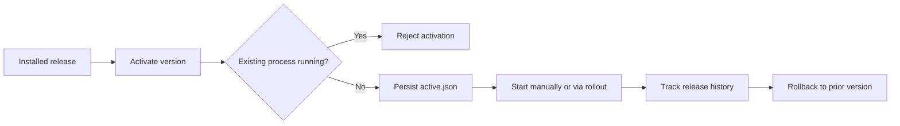

`active.json` stores the selected release. Release history / audit tracks transitions. Activating another version is constrained by process ownership and release existence.

### 2.3 OS process lifecycle (Phases 2–4 + dynamic endpoints)

**Actual `ProcessStatus`:** `RUNNING | STOPPED | UNKNOWN`.

| Event | Behavior |
|---|---|
| `initialize` | Load process specs and durable state, reconcile PID identity; claim recorded ports |
| `start` | Return existing verified child if already running; else allocate/claim port and spawn |
| `spawn` | Apply ChildEnvironmentBuilder, optionally prepend `--import`, persist PID/startTime/port |
| `inspect` | Return PID, status, adopted, port |
| `stop` | SIGTERM verified PID, await exit or fail timeout |
| `restart` | Stop followed by fresh spawn; dynamic port may change |
| `reconcile` | Re-adopt verified Linux PID, reject unsafe identity, clean up definitively dead records |
| `close` | Close Supervisor-side handlers without terminating detached children |

**Important:** `process.kill(pid, 0)` alone is not sufficient for safe PID adoption. Linux implementation compares `/proc/<pid>/stat` process start time. Other platforms do not provide identical adoption guarantees.

### 2.4 Runtime monitor / recovery lifecycle (Phases 3–4)

**Actual `RecoveryState`:** `IDLE | SCHEDULED | RECOVERING | EXHAUSTED | MANUALLY_STOPPED`.

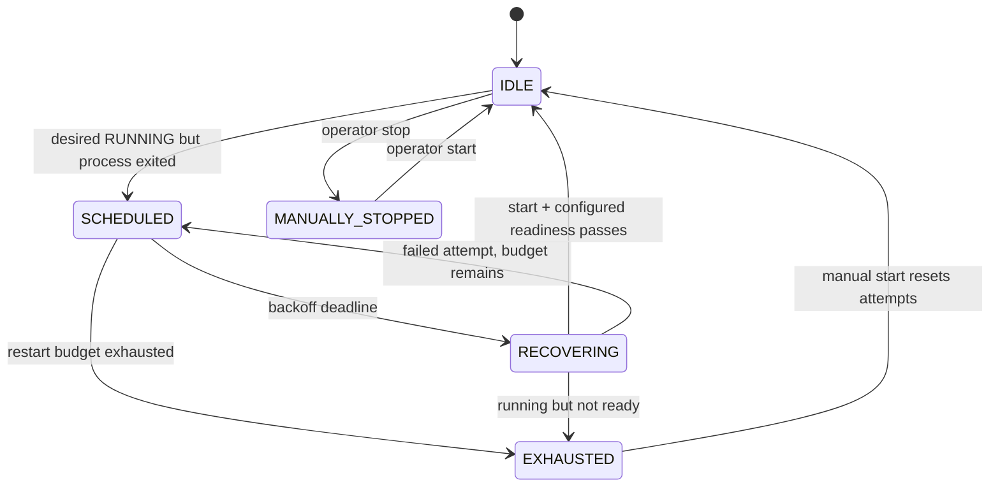

- Backoff begins at 500 ms and increases exponentially (subject to max).
- Restart policy belongs to each manifest: `never | on-failure | always`, with `maxRestarts`.
- Stable-running time resets attempts according to `stableResetMs`.
- Desired state and last exit are persisted via `RuntimeStateStore`.
- If `arm.enabled=false`, `waitForReadiness` returns for `NOT_CONFIGURED`. **A `recovery.succeeded` event can precede an immediate child crash or an unavailable application HTTP port.** Do not treat it as verified app availability.
- Monitor does not interpret ARM metrics WebSocket disconnect alone as process death.
- Typical observable events: `recovery.scheduled`, `recovery.succeeded`, `recovery.failed`, `recovery.exhausted`, `process.completed`, `monitor.error`.

### 2.5 Safe rollout / transactional-style deployment lifecycle (Phase 6)

**Actual `RolloutPhase`:**

`PREPARED → STOPPING_OLD → ACTIVATING_NEW → STARTING_NEW → VERIFYING → SUCCEEDED`

Failure/recovery transitions: `ROLLING_BACK → ROLLED_BACK`, or `NEEDS_ATTENTION` if recovery cannot establish a safe state.

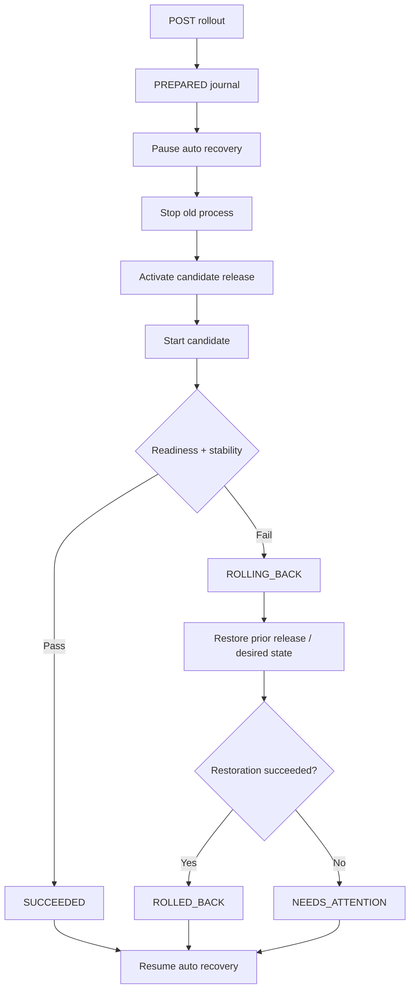

Journal path: `applications/<id>/rollout.json`; startup calls `recoverIncompleteRollouts`. Process-only allowance is an explicit request option, **not proof of business readiness**.

### 2.6 Blue/Green HTTP lifecycle (Phase 7 + dynamic endpoints)

**Actual slots:** `blue | green`. **Persisted state:** `active`, `blue`, `green`, `updatedAt`; each slot record contains `version` and `port`. No dedicated full lifecycle enum.

```mermaid
sequenceDiagram
  participant Operator
  participant Supervisor
  participant Registry as ProcessManager
  participant Candidate as Candidate slot
  participant Proxy
  participant Previous as Previous slot

  Operator->>Supervisor: POST /blue-green/deploy {version}
  Supervisor->>Registry: Prepare inactive slot
  Registry->>Candidate: Spawn with assigned PORT
  Candidate-->>Supervisor: Responds to /health
  Supervisor->>Proxy: Switch active target
  Proxy-->>Operator: New requests routed to candidate
  Supervisor->>Proxy: Drain old in-flight requests
  alt drained
    Supervisor->>Previous: Stop old process
  else not drained
    Note over Supervisor,Previous: Preserve backend; cleanup deferred
  end
  Supervisor-->>Operator: Blue/Green state
```

- New slot may use dynamic port if `ARM_BLUE_PORT`/`ARM_GREEN_PORT` are unset.
- Application-level `PORT` is rejected for Blue/Green because concurrent slots cannot both use one fixed port.
- Stable public HTTP port is `ARM_PROXY_PORT`.
- Proxy restoration checks live process and health before re-routing after Supervisor restart.
- Existing HTTP in-flight requests are allowed to drain. **WebSocket/SSE migration and proxy high availability are not implemented.**

### 2.7 Child environment / port lifecycle

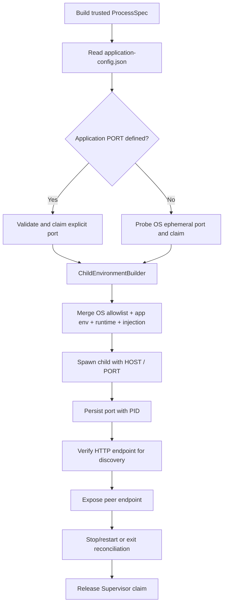

- Config file (optional): `supervisor-data/applications/<id>/application-config.json` with `schemaVersion: 1` and `environment`.
- Singleton: explicit `environment.PORT` wins; missing `PORT` triggers dynamic allocation.
- Application `ARM_*`, `SUPERVISOR_*`, dangerous Node startup keys and `HOST`/`NODE_ENV` are rejected by builder.
- Environment is not inherited wholesale from Supervisor. **Runtime-generated `ARM_DISCOVERY_*` settings are added only when discovery token is configured.**
- Port probe releases its socket **before** child binds: assignment is *advisory*, subject to TOCTOU conflicts. There is not yet a socket-handoff/acknowledged-bind protocol.

### 2.8 ARM Runtime injection lifecycle (Phases 8–9)

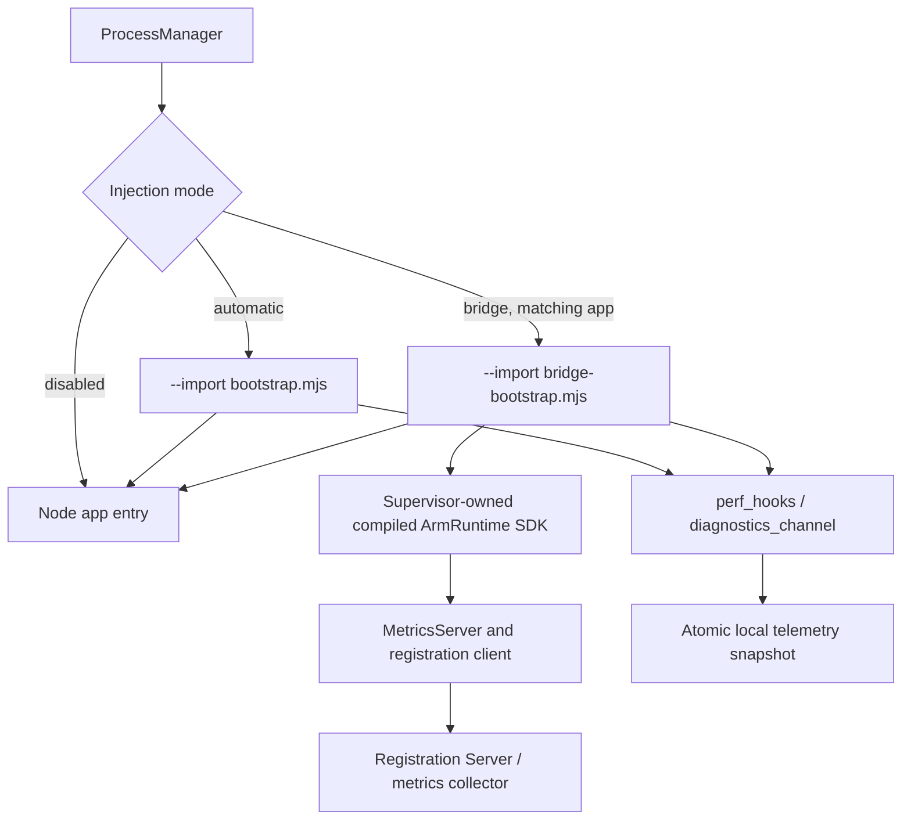

- Injection is configured at **spawn** and cannot be retrofitted into an adopted live process.
- Phase 8 preload emits process memory/event-loop/basic HTTP/exception counters into local snapshots.
- Phase 9 bridge starts the **actual** ARM SDK from `dist/packages/library/src/arm-runtime.js`; SDK must be built.
- Bridge uses one configured application ID, per-slot metrics ports with offsets (+0 singleton, +1 Blue, +2 Green).
- Child with manually embedded ARM SDK (`manifest.arm.enabled=true`) is guarded against competing bridge integration.
- No auto-discovery of business dependencies or business-level health.

### 2.9 ARM Client SDK and managed-component lifecycle

**Actual `ArmRuntimeStatus`:** `CREATED | STARTING | RUNNING | STOPPING | STOPPED | FAILED`.

**Actual component `LifecycleStatus`:** `CREATED | STARTING | RUNNING | RECOVERING | STOPPING | STOPPED | FAILED`.

**HealthStatus:** `HEALTHY | DEGRADED | UNHEALTHY | UNKNOWN`.

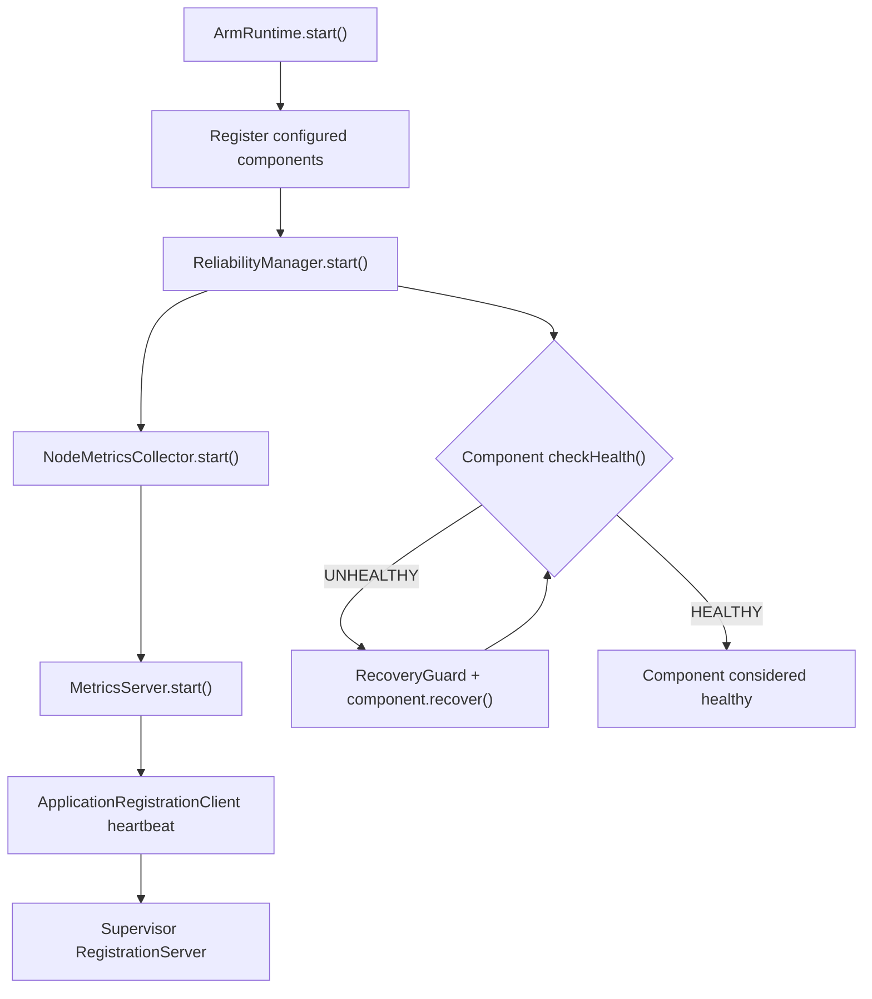

Component recovery can enforce attempts, retry budgets/circuit guards, timeouts and operation fencing. These are **in-process component semantics**, different from Supervisor's OS process restart policy. Injecting SDK without application-defined critical components does **not** make business readiness meaningful.

### 2.10 External ARM registration / metrics discovery lifecycle

**Actual `ApplicationDiscoveryStatus`:**
`REGISTERED | CONNECTED | STALE | DISCONNECTED | EXPIRED`.

- Child or external ARM client posts `applicationId`, `instanceId`, `metricsUrl`.
- Registration Server updates the lease. Registry instructs `RemoteArmMetricsCollector` to connect to the child's local WS metrics URL.
- WS collector subscribes to metric snapshots and reliability events.
- Freshness and lease expiration update discovery status.
- External registration is **monitor-only** and has `processStatus: UNKNOWN`; it never authorizes killing or restarting unowned OS processes.

### 2.11 Peer HTTP endpoint discovery lifecycle

- Child requests `GET /runtime/endpoints/:id` with a dedicated `ARM_DISCOVERY_TOKEN`.
- Supervisor enumerates managed apps, checks PID status and probes HTTP `/health` with a short timeout.
- For singleton, response is its direct assigned port; for Blue/Green, response points to stable proxy public port.
- An HTTP response, **including non-2xx**, confirms an HTTP server answered; it **does not prove readiness or identify the HTTP service cryptographically**.
- Missing/unreachable process does not appear in discovery; caller must re-resolve after peer restart or failed connection.

## 3. Feature inventory

| Feature | Phase | Codebase status | Limitations / notes |
|---|---:|---|---|
| ZIP archive intake, size and path validation | 1 | Implemented in source | Manifest v1.0; Node.js-only |
| Runtime Node.js compatibility validation | 1 | Implemented in source | Minimum version check |
| Staged npm-ci installation / immutable releases | 1 | Implemented in source | Installation needs dependency availability |
| Active release registry | 2 | Implemented in source | Per-app active.json |
| Start/stop/restart/detached child | 2 | Implemented in source | Child stdout/stderr currently ignored |
| Linux PID start-time verification / adoption | 2–4 | Implemented in source | Non-Linux adoption differs |
| ARM metrics registry and node metrics | SDK | Implemented in source | In-process, not a time-series DB |
| Component reliability, health and recover | SDK | Implemented in source | Requires explicit registered components |
| Metrics HTTP and WebSocket subscriptions | SDK | Implemented in source | Auth token required when configured |
| Application registration and WS collection | Discovery | Implemented in source | Monitor-only |
| Restart policy/backoff/max attempts | 3–4 | Implemented in source | Success not equivalent to HTTP readiness |
| Durable desired state and crash recovery | 4 | Implemented in source | Multiple independent JSON files |
| Management REST API and ZIP upload | 5 | Implemented in source | Loopback authenticated |
| Release history, audit, activate, rollback | 5 | Implemented in source | Rollback vs zero downtime are distinct |
| Journaled safe rollout / restart recovery | 6 | Implemented in source | Not a single filesystem transaction |
| HTTP Blue/Green reverse proxy and drain | 7 | Implemented in source | No WS/SSE seamless migration |
| Phase 8 Node preload telemetry | 8 | Implemented in source | Main-thread/built-in HTTP only |
| Phase 9 real ARM SDK runtime bridge | 9 | Implemented in source | One targeted app; compile required |
| Root `.env` / `.env.example` | Post-9 | Implemented in source | Secrets remain process env values |
| ChildEnvironmentBuilder allowlist/isolation | Post-9 | Implemented in source | OS account isolation not provided |
| Per-app configuration JSON | Post-9 | Implemented in source | Operator-managed, no write API |
| Dynamic child HTTP PORT allocation | Post-9 | Implemented in source | Probe–bind race; app must read PORT |
| Port persisted with PID and re-adoption | Post-9 | Implemented in source | Legacy BG port migration path |
| Blue/Green dynamic slot ports | Post-9 | Implemented in source | Proxy port is stable |
| Authenticated peer endpoint discovery | Post-9 | Implemented in source | Same host/netns; no stable singleton alias |
| Per-child stdout/stderr log capture | — | **Not implemented** | `stdio: 'ignore'` |
| Atomic socket reservation / bind-ack | — | **Not implemented** | Dynamic port may be stolen |
| Cross-host / Kubernetes peer discovery | — | **Not implemented** | Loopback only |
| Full multi-app dynamic ARM metrics port leasing | — | **Not implemented** | Phase 9 offsets / one bridge target |
| Cryptographic per-app identity + secret isolation | — | **Not implemented** | Discovery/bridge tokens shared at present |
| Fully automated business dependency readiness | — | **Not implemented** | SDK does not infer DB/queue health |

## 4. API inventory

### 4.1 Management API — default `127.0.0.1:3300`

**Authentication:** `Authorization: Bearer <ARM_MANAGEMENT_TOKEN>`. The two `/runtime/endpoints` GET routes *also* accept `ARM_DISCOVERY_TOKEN` if set. All other admin operations require the management token.

| Method | Path | Operation | Notes |
|---|---|---|---|
| POST | `/deployments/upload` | Upload ZIP to install release | `Content-Type: application/zip`; size limit |
| GET | `/deployments/audit` | Deployment audit | Requires release manager |
| GET | `/applications` | List managed application runtime/recovery status | OS-managed apps |
| GET | `/applications/:id` | Inspect process/recovery state | Includes PID/status/readiness |
| POST | `/applications/:id/start` | Start app and reset retry budget | Optional empty JSON body |
| POST | `/applications/:id/stop` | Stop app intentionally | Prevent automatic recovery |
| POST | `/applications/:id/restart` | Controlled restart | Application may receive a new port |
| POST | `/applications/:id/activate` | Activate release | JSON `{"version":"1.2.3"}` |
| POST | `/applications/:id/rollback` | Rollback release | Release history |
| GET | `/applications/:id/releases` | Installed releases | Release manager |
| GET | `/applications/:id/audit` | Audit for one app | Release manager |
| GET | `/applications/:id/rollout` | Latest safe rollout operation | May return 404 |
| POST | `/applications/:id/rollout` | Start journaled safe rollout | `{"version":"1.2.3","allowProcessOnly":false}` |
| GET | `/blue-green` | Inspect BG state and proxy | Available if configured |
| POST | `/blue-green/deploy` | Deploy BG candidate | `{"version":"1.2.3"}` |
| GET | `/runtime/bridge/applications` | Registered bridge instances + metrics freshness | Bridge enabled |
| GET | `/runtime/instances/:id/telemetry` | Phase 8 snapshot for instance | Injection enabled; stale files possible |
| GET | `/runtime/endpoints` | List reachable local HTTP services | Management **or** discovery bearer |
| GET | `/runtime/endpoints/:id` | Find peer HTTP service | Management **or** discovery bearer |

**Representative commands:**

```bash
export TOKEN='your-management-token'
BASE='http://127.0.0.1:3300'
curl -H "Authorization: Bearer $TOKEN" "$BASE/applications"
curl -H "Authorization: Bearer $TOKEN" "$BASE/blue-green"
curl -X POST -H "Authorization: Bearer $TOKEN" \
  -H 'Content-Type: application/json' \
  -d '{"version":"1.1.0"}' "$BASE/blue-green/deploy"
```

### 4.2 Registration API — default `127.0.0.1:3200`

**Authentication:** `SUPERVISOR_REGISTRATION_TOKEN` in standalone demo, or `ARM_BRIDGE_REGISTRATION_TOKEN` when hosted by the Management daemon for Phase 9.

| Method | Path | Operation |
|---|---|---|
| POST | `/applications/register` | Register / renew app instance with `applicationId`, `instanceId`, `metricsUrl` |
| POST | `/applications/unregister` | Remove registered instance |
| GET | `/applications` | Query registered applications; supports `status`, `applicationId`, `includeExpired` |
| GET | `/applications/transitions` | Recent discovery state transitions |
| GET | `/applications/:applicationId/instances/:instanceId` | Registration detail, collector snapshot/freshness |

**Important:** Registration describes external ARM monitoring, *not* OS process ownership.

### 4.3 ARM SDK Metrics HTTP / WebSocket — per-child metrics port

**Authentication:** `ARM_METRICS_TOKEN` for manual SDK usage or `ARM_BRIDGE_METRICS_TOKEN` for bridged SDK.

| Transport | Path / action | Purpose |
|---|---|---|
| GET | `/metrics` | Metrics snapshot |
| GET | `/metrics/:name` | Individual metric |
| GET | `/reliability/components` | Registered managed component statuses |
| GET | `/reliability/ready` | SDK component readiness (200 or 503) |
| GET | `/reliability/events?since=N` | Reliability event history |
| WS | `/metrics/ws` | Metrics and reliability event feed |
| WS action | `subscribe` | Subscribe to metrics, optionally filtered by names |
| WS action | `snapshot` | Request snapshot |
| WS action | `unsubscribe` | Unsubscribe from metrics |
| WS action | `subscribe_events` | Subscribe to reliability events |
| WS action | `unsubscribe_events` | Stop reliability event subscription |

The MetricsServer advertises protocol `arm.metrics.v1`. ARM SDK metrics port is **not** the application's business HTTP port. Phase 9 bridge currently uses base metrics port plus singleton/Blue/Green offsets, not dynamic metrics port allocation.

### 4.4 Business application HTTP API

The endpoints exposed by `payment-service`, `user-service`, or another uploaded ZIP are **not defined by the ARM Supervisor source**. The Supervisor only requires a usable listening endpoint to enable the dynamic HTTP peer discovery; Phase 7 additionally uses `/health` for slot readiness. Do not mistake arbitrary business endpoints such as `/users` or `/payments` in examples for actual repository-supported APIs.

### 4.5 API authentication / port summary

| Plane | Listener | Auth | Consumers |
|---|---|---|---|
| Control plane | Management port, normally 3300 | Management bearer | Operator / deployment automation |
| Peer discovery plane | Same Management listener, `/runtime/endpoints*` | Restricted discovery **or** management bearer | Child apps / operator |
| ARM registration plane | Registration port, normally 3200 | Registration bearer | ARM SDK |
| ARM metrics plane | One metrics listener per SDK process | Metrics bearer | Metrics collector / diagnostics |
| Business HTTP plane | Dynamic child port | Defined by each app | Other child apps / proxy |
| Blue/Green public plane | Stable proxy port, normally 3400 | Defined by business app | Clients |

## 5. Connections and topology

### 5.1 Logical service connections

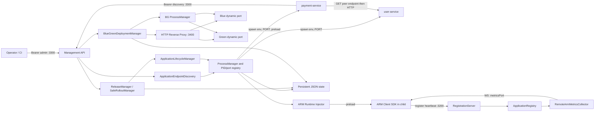

### 5.2 Ports and communication channels

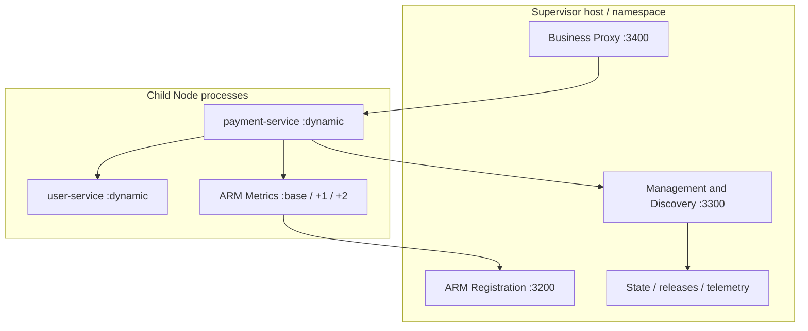

**Transport map:** operator/peer discovery = HTTP; business calls = HTTP; metrics = HTTP + WebSocket; registration = HTTP; process spawning/signals = OS APIs; state = local files. No automatic application TCP/UDP discovery contract exists beyond reported HTTP endpoints.

### 5.3 Durable state relationships

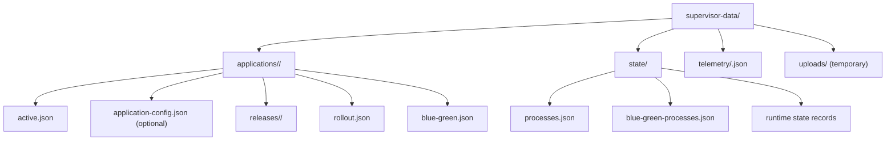

Not all these files form a single transaction. Reconcile and idempotence logic is required when recovery sees partially completed operations.

## 6. End-to-end workflows

### 6.1 Upload ZIP → activate → start

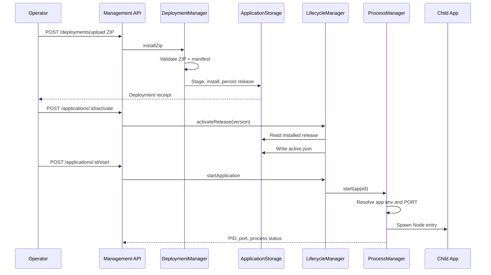

### 6.2 Dynamic ports and peer-to-peer communication

```mermaid
sequenceDiagram
  participant PM as ProcessManager
  participant PA as payment-service
  participant D as Discovery API
  participant U as user-service

  PM->>PM: No configured PORT: allocate
  PM->>U: Spawn with HOST=127.0.0.1, PORT=<assigned>
  PM->>PA: Spawn with HOST=127.0.0.1, PORT=<assigned>
  PA->>D: GET /runtime/endpoints/user-service + discovery bearer
  D->>D: Verify process RUNNING and HTTP reachable
  D-->>PA: http://127.0.0.1:<actual port>
  PA->>U: GET application-defined route
  U-->>PA: Response
  Note over PA,U: After peer restart, port may change; re-query discovery
```

### 6.3 Process crash → restart budget → exhaustion

```mermaid
sequenceDiagram
  participant Child
  participant PM as ProcessManager
  participant MON as RuntimeMonitor
  participant ST as RuntimeStateStore

  Child--xPM: Exit unexpectedly
  PM-->>MON: exit event / reconcile
  MON->>ST: Persist expected RUNNING, exit
  MON->>MON: Calculate exponential backoff
  MON->>ST: SCHEDULED attempt N
  MON->>PM: start(applicationId)
  PM->>Child: Spawn new process, potentially new PORT
  MON->>MON: Readiness verification if configured
  alt Start judged successful
    MON->>ST: IDLE; preserve attempts until stable
  else Startup error
    MON->>ST: SCHEDULED / lastError
  end
  Note over MON,ST: After maxRestarts, EXHAUSTED; manual start resets budget
```

### 6.4 Safe rollout / rollback

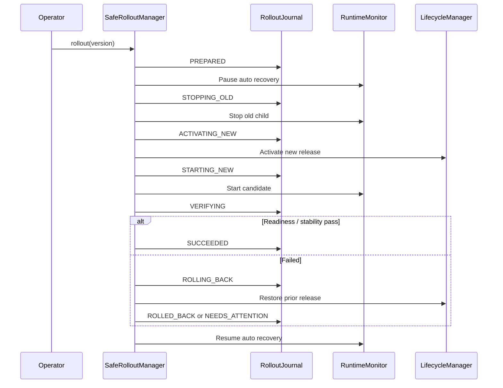

### 6.5 Blue/Green, traffic switch, proxy restore

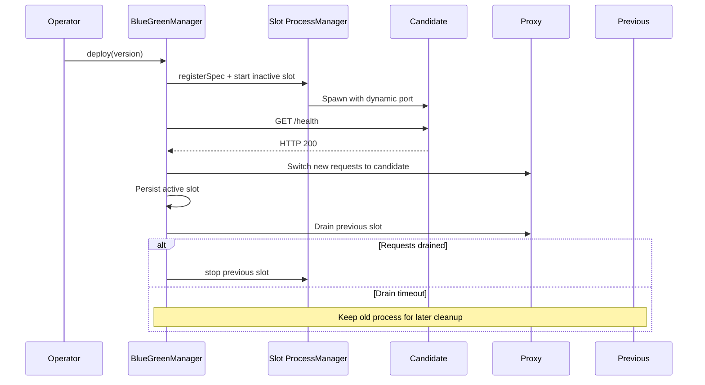

### 6.6 Phase 8/9 auto-injection → ARM registration → metrics

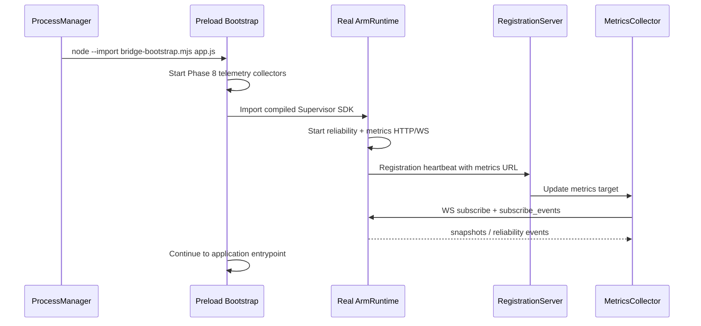

### 6.7 Supervisor restart and re-adoption

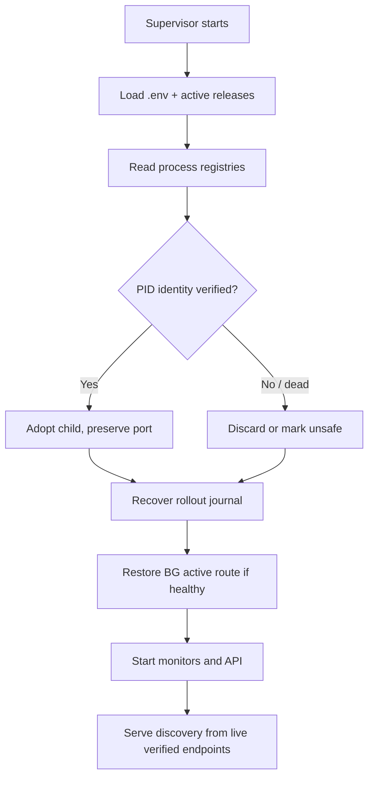

**Distinction:** Supervisor restart is not the same as child restart. Adopted children retain original environment, original injection mode and port until intentionally replaced.

## 7. State and configuration storage

| Location | Owner | Purpose |
|---|---|---|
| `.env` (gitignored) | Operator / deployment | Supervisor ports, tokens, feature flags |
| `.env.example` | Repository | Non-secret documented template |
| `applications/<id>/application-config.json` | Operator | Per-application environment, optional `PORT` |
| `applications/<id>/active.json` | LifecycleManager | Active release |
| `applications/<id>/releases/<version>/` | DeploymentManager | Installed application release |
| `applications/<id>/rollout.json` | RolloutJournal | Recovery checkpoint for safe rollout |
| `applications/<id>/blue-green.json` | BlueGreenManager | Slot versions, ports and active routing |
| `state/processes.json` | Singleton ProcessManager | PID, start identity, port |
| `state/blue-green-processes.json` | Blue/Green ProcessManager | Slot PID, start identity, port |
| Runtime state files under `state/` | RuntimeStateStore | Desired state, attempts, exit and recovery state |
| `telemetry/<instanceId>.json` | Phase 8 preload | Last sampled in-process telemetry |

Configuration precedence at child spawn:
`OS essentials allowlist < applicationEnv < trusted runtime env < ARM injector env`.

A root `.env` variable `PORT` is **not** a valid substitute for an app-specific `environment.PORT`. ChildManagement API requests currently do not provide a documented REST endpoint to write `application-config.json`.

## 8. Constraints, risks and verification

### 8.1 Not yet production-complete

1. **Build and tests not verified here.** Run `npm run build && npm test`; inspect failures before tagging a release.
2. **Child stderr/stdout discarded** by `ProcessManager` (`stdio: 'ignore'`). Startup failures can look like repeated recovery events without logs.
3. **Dynamic port TOCTOU:** probe socket is closed before child bind; possible `EADDRINUSE`. No atomic socket reservation or explicit bound-port acknowledgment.
4. **Discovery HTTP probe not process-authenticated:** a different HTTP process on a reused port could answer. Basic reachability ≠ business readiness.
5. **Singleton discovery endpoint unstable across restart:** callers must retry and re-resolve. No persistent service-level proxy for every singleton yet.
6. **ARM metrics port scheme remains separate and mostly fixed for Phase 9:** business dynamic `PORT` does not mean dynamic ARM metrics listener.
7. **Embedded business readiness is not automatic:** ARM SDK without registered components cannot infer database, queue or payment readiness.
8. **Environment isolation is not OS sandboxing:** child runs under Supervisor OS account and may access files/other local resources. Bridge/discovery credentials are visible to child.
9. **Storage is not a cross-file transactional database:** PID state, active release, rollout and BG routing require careful restart reconciliation.
10. **Blue/Green proxy is single-host HTTP-only:** no HA; long-lived WS/SSE connection migration is not provided.
11. **Single-host loopback network:** not suitable as-is for pods on separate nodes/network namespaces.
12. **No proven multi-Supervisor concurrent writer / lease coordination** for the same durable state root.

### 8.2 Suggested acceptance checklist (not claimed passed)

- [ ] `npm ci` / `npm run build` / `npm test`
- [ ] ZIP upload → release list → activate → start → inspect PID/port
- [ ] Explicit `PORT=3201` from per-app config and dynamic-port fallback
- [ ] Two child apps simultaneously bind unique dynamic ports
- [ ] Child A discovers Child B using discovery token, and cannot use admin endpoint
- [ ] Child B restart, discovery returns updated endpoint, Child A reconnects
- [ ] Supervisor restart adopts same PID + port, no duplicate start
- [ ] Child exit triggers bounded recovery and correctly reports errors/attempts
- [ ] Phase 9 bridge registers child + streams actual metrics
- [ ] Blue/Green deploy twice, switch traffic, drain old, restart Supervisor, restore route
- [ ] Test candidate crash/failed health before and after proxy switch
- [ ] Test dynamic port contention and deliberate wrong-port/hardcoded app
- [ ] Confirm source code and runtime secrets not exposed via diagnostic APIs
- [ ] Confirm whether service business default `PORT` and default `/health` are compatible

### 8.3 Recommended next architecture milestones

**P0:** Child stdout/stderr capture and structured startup/exit diagnostics; process readiness acknowledgment; port bind confirmation and retry behavior.  
**P1:** Per-service stable proxy/address for singleton apps; authenticated endpoint identity; live config reload/versioning.  
**P1:** Dynamic ARM MetricsServer port discovery and a unified multi-application bridge allocator.  
**P2:** Unified durable process-owner/release reconciliation; multi-node deployment/network routing; secret and OS identity isolation.

## 9. Resume instructions for the next conversation

1. Read this checkpoint **as a frozen description of HEAD `08a201884c44357ef85b178e15699381bb2ae567`**. The documentation commit itself may become the later branch HEAD.
2. Fetch current `arm-supervisor` and `arm-client` branch HEADs again before modifying source.
3. Compare later commits with this checkpoint; do not assume phases have been tested solely because a source commit exists.
4. Maintain coding standards in `docs/CODING_STANDARDS.md`, especially Intent-Revealing Methods and Extract Method.
5. Preserve ownership boundaries: uploaded package vs operator app configuration vs Supervisor runtime vs ARM SDK.
6. Treat port/proxy readiness as separate from process liveness, registration connection and business health.
7. When making changes, add focused unit + integration tests, document failures and verify actual build/test outcomes when possible.
8. The next high-value area is **observable child startup + dynamic port bind acknowledgment**, followed by stable service-level routing.

---

## Source index (on branch `arm-supervisor`)

- `packages/adapter-process/src/application-management-api.ts`
- `packages/adapter-process/src/application-registration-server.ts`
- `packages/adapter-http/src/server.ts`
- `packages/adapter-process/src/application-runtime-monitor.ts`
- `packages/adapter-process/src/process-manager.ts`
- `packages/adapter-process/src/child-environment-builder.ts`
- `packages/adapter-process/src/dynamic-port-allocator.ts`
- `packages/adapter-process/src/application-configuration-store.ts`
- `packages/adapter-process/src/application-endpoint-discovery.ts`
- `packages/adapter-process/src/safe-rollout-manager.ts`
- `packages/adapter-process/src/rollout-journal.ts`
- `packages/adapter-process/src/blue-green-deployment-manager.ts`
- `packages/adapter-process/src/blue-green-http-proxy.ts`
- `packages/adapter-process/src/arm-runtime-injector.ts`
- `packages/adapter-process/runtime/bootstrap.mjs`
- `packages/adapter-process/runtime/bridge-bootstrap.mjs`
- `packages/library/src/arm-runtime.ts`
- `packages/core/src/reliability.ts`
- `docs/PHASE_1_APPLICATION_PACKAGE_MANAGEMENT.md` through `docs/PHASE_9_ARM_CLIENT_RUNTIME_BRIDGE.md`
- `docs/DYNAMIC_ENDPOINTS.md`, `docs/CHILD_ENVIRONMENT_BUILDER.md`, `docs/ENV_CONFIGURATION.md`
