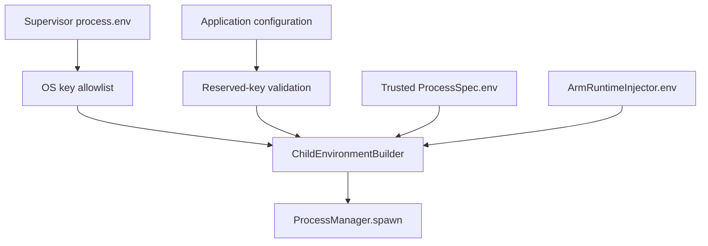

# ChildEnvironmentBuilder — Supervisor-controlled Process Environment

## Why

Prior to this change, ProcessManager used `env: { ...process.env, ...spec.env, ...injectorEnv }`. That caused the root Supervisor `.env` variables such as `PORT=3100` and management secrets to leak into every child process. A child that expected its own default `PORT=3201` could unintentionally listen on the demo's port instead.

## Execution boundary



The builder runs inside `ProcessManager.launch()` for **all** launch/restart paths, including Phase 3/4 recovery, Phase 6 safe rollout and Phase 7 Blue/Green. PID adoption never changes a running process's existing environment.

## Precedence

1. The builder inherits only selected OS essentials (`PATH`, `HOME`, locale/temp variables, Windows process resolution variables).
2. It merges `ProcessSpec.applicationEnv`: business configuration such as `DATABASE_URL`, `PAYMENT_MODE`, `LOG_LEVEL`.
3. It merges trusted `ProcessSpec.env`: Supervisor-generated `NODE_ENV`, `PORT`, `HOST`, `ARM_APPLICATION_ID`, `ARM_INSTANCE_ID` and embedded ARM metrics configuration.
4. It merges `ArmRuntimeInjector.environment()` last: runtime/bridge flags, telemetry settings and credentials.

Application configuration **cannot** write `ARM_*`, `SUPERVISOR_*`, `PORT`, `HOST`, `NODE_ENV`, `NODE_OPTIONS`, `NODE_PATH` or related Node.js runtime control variables. Environment names are validated and embedded NUL characters rejected. Even trusted runtime/injection maps cannot set `NODE_OPTIONS` or `NODE_PATH` via this boundary.

The builder does not automatically import the Supervisor's `DATABASE_URL`, `PORT` or management token.

## Migration notes

The existing `ApplicationLifecycleOptions.env` is now routed through `applicationEnv`, where reserved values are rejected. Normal business settings are unaffected. The options field can be renamed in a later migration, but retains its current public API.

Blue/Green now accepts `BlueGreenOptions.applicationEnv` for business settings, in addition to its existing generated slot ports.

**Singleton port handling:** The singleton manager does not currently assign a business HTTP `PORT`. The application must rely on its own default (for example 3201) or a future deployment-level HTTP port mapping. Setting `PORT` in the root Supervisor `.env` will no longer affect it. This is intentional and resolves accidental port inheritance.

## Scope and remaining threats

- The child does not receive root management credentials simply because they are in the Supervisor `.env`.
- Phase 9 bridge **does** explicitly pass its registration and metrics tokens to targeted child processes. A malicious child can inspect its own environment and obtain those tokens. Per-instance identity and credential isolation remain future work.
- The child still runs as a process under the Supervisor's OS account unless sandboxing is added. Environment filtering is **not a sandbox** and cannot prevent filesystem/process access by itself.
- The current `ProcessSpec.env` is a trusted internal API. Never fill it with fields from uploaded ZIP manifests or untrusted user input. Use `applicationEnv` and validate it.
- For service-specific ports, prefer Supervisor-assigned values in the trusted runtime map rather than a global root `.env`.
- Only newly spawned children use this builder; restart a child deliberately to apply changed configuration.

## Verification

```bash
npm run build
npm test
```

`tests/child-environment-builder.test.ts` checks reserved-key rejection, allowlisted inheritance, precedence, no accidental Supervisor port or secret inheritance, and real spawned-child isolation.
