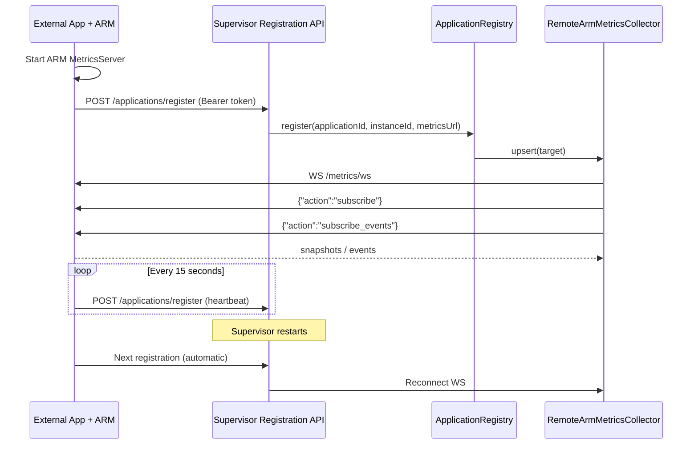

# Dynamic application self-registration (Mode B)

An application that starts outside the Supervisor can register itself for
**metrics and reliability event monitoring** without being spawned by
`ProcessManager`. Registration does not transfer process ownership.

## Runtime flow



## Run locally

1. Update `main` and install dependencies.
2. In terminal A, start the Supervisor registration server:

```bash
SUPERVISOR_REGISTRATION_TOKEN=development-secret npm run dev:registration
```

3. In terminal B, run an ARM-enabled app independently:

```bash
SUPERVISOR_REGISTRATION_TOKEN=development-secret PORT=3101 npm run dev
```

4. Discover the registered app:

```bash
curl -H 'Authorization: Bearer development-secret' \
  http://127.0.0.1:3200/applications
```

The app connects its own ARM MetricsServer at
`ws://127.0.0.1:3101/metrics/ws`. When registering it sends:

```json
{
  "applicationId": "example-app",
  "instanceId": "pid-1234",
  "metricsUrl": "ws://127.0.0.1:3101/metrics/ws"
}
```

For shell environments without inline variables (e.g. PowerShell), configure
`$env:SUPERVISOR_REGISTRATION_TOKEN='development-secret'` and
`$env:PORT='3101'` before running `npm run dev`.

If the app's ARM MetricsServer has an authentication token,
configure the same `ARM_METRICS_TOKEN` in both Supervisor and app.
The Supervisor supplies it in the outgoing WebSocket Authorization header.

## Implementation

- `ApplicationRegistrationClient`: POST registration, retry/heartbeat;
  never stops the Node.js app when Supervisor is unavailable
- `ApplicationRegistrationServer`: Bearer-protected HTTP registration,
  listing, and unregister endpoints
- `ApplicationRegistry`: per-instance in-memory registration and lease expiry
- `RemoteArmMetricsCollector.upsert/remove`: dynamic subscriptions
- `ProcessManager`: unchanged; still only controls explicitly configured apps

## API

| Method | Endpoint | Purpose |
|---|---|---|
| POST | `/applications/register` | Register or refresh an instance |
| GET | `/applications` | List registered instances and latest metrics |
| POST | `/applications/unregister` | Remove an instance from monitoring |

All endpoints require the `Authorization: Bearer <token>` header.

## Safety and current scope

- Registration and metrics target URLs are limited to **local loopback**,
  `ws://127.0.0.1:<port>/metrics/ws` (or IPv6 loopback). This is an
  explicit SSRF safeguard, not a remote-host discovery implementation.
- The registration server binds to 127.0.0.1 by default. Do not expose it
  to the public internet with the shared secret.
- A shared registration token authorizes registration for all instances;
  per-application identities, authorization and mTLS are not yet included.
- Registered external apps are **monitor-only**: Supervisor is not permitted
  to kill/restart them merely because they have self-registered.
- An instance is keyed by `applicationId/instanceId`; use stable,
  unique instance IDs for each running process.
- Registration is held **in memory** and expires after a 45-second lease.
  Automatic re-registration every 15 seconds ensures the Supervisor rebuilds
  registrations after it restarts.
- Losing WS does not imply a process failure. Metrics snapshots may be stale;
  inspect the `fresh` flag rather than inferring the process is dead.
- Startup registration can fail while Supervisor is unavailable. The client
  retries without blocking the business application.
- No remote-host discovery, database persistence, leader election,
  or automatic process recovery is included in this phase.
