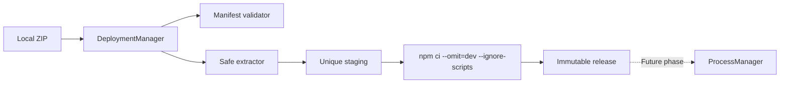

# Phase 1 — Application Package Management (ZIP + Manifest + Installation)

**Branch:** `arm-supervisor`. This phase installs artifacts without running applications. `ProcessManager` remains unchanged.

## Phase Overview

**Why:** ProcessManager accepts static ProcessSpecs but cannot receive packages or install application dependencies.

**Core problem:** Obtain a predictable, validated, versioned Node.js artifact before giving ProcessManager ownership.

**Root causes:** Untrusted archive filenames, inconsistent delivery formats, uncontrolled installation commands and accidental modification of running releases.

**Solution:** A `DeploymentManager` orchestrates manifest validation, bounded ZIP extraction into a unique staging directory, dependency installation and immutable release storage.



## Artifact format

The ZIP must contain files at its root, not an enclosing directory:

```text
payment-service-1.0.0.zip
  app.manifest.json
  package.json
  package-lock.json
  dist/main.js
  vendor/base-arm-app-0.1.0.tgz    # optional; required if lockfile references this local tarball
```

A compiled JavaScript entry is required. Building during deployment and arbitrary shell commands are deliberately disabled in Phase 1.

Example `app.manifest.json`:

```json
{
  "schemaVersion": "1.0",
  "applicationId": "payment-service",
  "version": "1.0.0",
  "runtime": {
    "type": "nodejs",
    "nodeVersion": ">=22",
    "entry": "dist/main.js"
  },
  "install": { "strategy": "npm-ci", "buildRequired": false },
  "arm": { "enabled": true, "metricsPort": 3101 },
  "lifecycle": {
    "autoStart": false,
    "restartPolicy": "on-failure",
    "maxRestarts": 3,
    "stopTimeoutMs": 10000
  }
}
```

The `lifecycle` fields are metadata for future phases; they **do not** start, stop or restart any process now. The Node version comparator in this implementation supports a simple `>=major[.minor[.patch]]` format, checking the major version; complex SemVer ranges are not supported.

## Install an Express + ARM package

```bash
git switch arm-supervisor
npm install
npm run build
npm test
npm run deploy:zip -- /absolute/path/payment-service-1.0.0.zip
```

Set `ARM_DEPLOYMENT_ROOT` if you do not want the default `./supervisor-data`.

The CLI calls:

```ts
import { DeploymentManager } from './packages/adapter-process/src/deployment/deployment-manager.js';

const manager = new DeploymentManager({ storageRoot: './supervisor-data' });
const result = await manager.installZip('/path/payment-service-1.0.0.zip');
console.log(result.release.entry, result.alreadyInstalled);
```

Result layout:

```text
supervisor-data/
  staging/<random-uuid>/
  applications/payment-service/releases/1.0.0/
    app.manifest.json
    package.json
    package-lock.json
    dist/main.js
    node_modules/
    .deployment.json
```

The release metadata records application ID, version, entry, absolute directory, ZIP SHA-256, installation timestamp and validated manifest. The same archive is idempotent; a different archive using the same application ID/version is rejected.

## Files and responsibilities

| File | Responsibility |
|---|---|
| `deployment-types.ts` | Manifest, release and deployment types |
| `application-package-validator.ts` | Validate manifest and entry paths |
| `application-package-extractor.ts` | Parse ZIP, limit extraction, check CRC and filesystem entries |
| `application-installer.ts` | `DependencyInstaller` contract and safe `NpmCiInstaller` |
| `application-storage.ts` | Staging, versioned storage, metadata |
| `deployment-manager.ts` | Installation orchestration and idempotency |
| `examples/supervisor/src/install-package.ts` | Local installer CLI |
| `tests/deployment-phase1.test.ts` | Regression/security tests |

Implementation follows `docs/CODING_STANDARDS.md`: small intent-revealing functions, type checks, no shell command interpolation and a clear orchestration method.

## Security and limitations

- Only use trusted/authorized packages. This phase does not expose an upload API or authentication for one.
- ZIP extraction rejects traversal, absolute paths, backslashes, symlinks/special filesystem entries, duplicate paths, path conflicts, encrypted and ZIP64 packages, unsupported compression and CRC mismatches. It enforces max archive size **50 MiB**, max extracted size **200 MiB** and max **10,000 entries** by default.
- `npm ci --omit=dev --ignore-scripts --no-audit --no-fund` is executed using `spawn()` without shell interpretation, with a default **120 second** timeout.
- `--ignore-scripts` can break native packages requiring postinstall; prepare them through a separate trusted build pipeline.
- The ZIP parser is in-memory and supports regular ZIP archives (stored/deflate), not ZIP64. Production should consider streaming extraction and quotas for npm-created files too.
- Integrity checks do **not** make arbitrary JavaScript safe to execute. Phase 2 must address process isolation, least privilege and artifact provenance.
- One writer must own a deployment storage root. The lock is in-memory only; concurrent Supervisor instances sharing storage are unsupported.
- There is no ProcessManager dynamic spec registration, no authenticated upload endpoint, no automatic process start, no release activation and no rollback yet.

## Testing

`tests/deployment-phase1.test.ts` checks installation, metadata persistence, idempotency, checksum conflicts, path traversal, ZIP symlinks, extraction limits, malformed manifests, staging cleanup and an offline `npm ci` installation.

**Next step:** Phase 2 — install-to-process handoff: dynamic `ProcessSpec` registration, start/stop, manifest-derived environment/ports and readiness verification.
