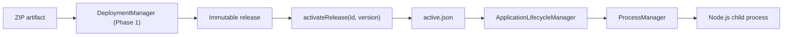

# Phase 2 — Application Process Lifecycle (Release → Process)

**Branch:** `arm-supervisor`

## Phase Overview

**Why:** Phase 1 installs an immutable application release from ZIP, but users still start apps manually.

**Core problem:** Link installed releases to `ProcessManager` without losing safe PID adoption or accidentally starting a duplicate application.

**Root causes:** Previously, `ProcessManager.initialize(specs)` accepted only a static spec list. The Supervisor did not remember which installed release was selected.

**Implementation:** `ApplicationLifecycleManager` selects an installed release, persists `active.json`, constructs `ProcessSpec`, dynamically registers it in `ProcessManager`, then calls `start/stop/restart/inspect`.



## Minimal end-to-end test with payment-service

Use the `payment-service-1.0.0.zip` from Phase 1. Its manifest has `arm.enabled=false`, so process readiness is reported as `NOT_CONFIGURED`; this is expected.

```bash
git switch arm-supervisor
git pull origin arm-supervisor
npm install
npm run build
npm test

# Install (Phase 1)
npm run deploy:zip -- ./supervisor-data/uploads/payment-service-1.0.0.zip

# Select installed release (Phase 2)
npm run app:manage -- activate payment-service 1.0.0

# Start Node.js process
npm run app:manage -- start payment-service

# Inspect PID, runtime status and release
npm run app:manage -- inspect payment-service

# Test the HTTP service (payment-service fixture uses port 3201)
curl http://127.0.0.1:3201/health

# Manage lifecycle
npm run app:manage -- restart payment-service
npm run app:manage -- stop payment-service
npm run app:manage -- list
```

Note: `npm run app:manage --` is correct npm syntax for passing extra CLI arguments.

## Public API

```ts
import { ApplicationLifecycleManager } from './packages/adapter-process/src/application-lifecycle-manager.js';

const lifecycle = new ApplicationLifecycleManager({
  storageRoot: './supervisor-data',
  metricsToken: process.env.ARM_METRICS_TOKEN,
});
await lifecycle.initialize();

await lifecycle.activateRelease('payment-service', '1.0.0');
const started = await lifecycle.startApplication('payment-service');
console.log(started.process.pid, started.process.status, started.readiness);
const status = await lifecycle.inspectApplication('payment-service');
await lifecycle.restartApplication('payment-service');
await lifecycle.stopApplication('payment-service');

lifecycle.close(); // Does NOT kill detached child apps.
```

| Method | Meaning |
|---|---|
| `initialize()` | Load active selections and reconcile persisted process identities |
| `activateRelease(id, version)` | Persist selected release; refuse switching when app runs |
| `startApplication(id)` | Launch selected release or reuse verified running process |
| `stopApplication(id)` | Send SIGTERM, wait up to manifest timeout |
| `restartApplication(id)` | Stop then start using the active release |
| `inspectApplication(id)` | Verify PID and optionally probe ARM readiness |
| `listApplications()` | List active releases with process information |
| `close()` | Release Supervisor event listeners, leave child apps alive |

The `ProcessManager.registerSpec(spec)` method can add a new app after `initialize()` and replace a spec only when the old process is fully stopped. Concurrent operations on the same application are refused.

## Storage & restart safety

```text
supervisor-data/
  applications/
    payment-service/
      active.json
      releases/
        1.0.0/
          .deployment.json
          dist/main.js
  state/
    processes.json
```

`active.json` stores application ID, version and activation timestamp. On Supervisor restart, the manager rebuilds the `ProcessSpec` list from active releases **before** `ProcessManager.initialize()`, enabling Linux PID identity checks and adoption.

Only one Supervisor instance should own the state files. The Phase 1 release files are not overwritten or mutated by Phase 2.

## Readiness semantics

| ARM in manifest | Running process | Readiness |
|---|---|---|
| `enabled: false` | Any | `NOT_CONFIGURED` |
| `enabled: true` | Not `RUNNING` | `UNKNOWN` |
| `enabled: true` | `RUNNING`, HTTP 200 from `/reliability/ready` | `HEALTHY` |
| `enabled: true` | `RUNNING`, HTTP 503 | `UNHEALTHY` |
| `enabled: true` | `RUNNING`, cannot reach readiness URL | `UNKNOWN` |

`startApplication()` confirms process creation and returns a best-effort readiness snapshot; it does **not** wait for ARM health to become `HEALTHY`. Treat process `RUNNING` and ARM readiness as distinct signals.

The probe currently uses `http://127.0.0.1:<arm.metricsPort>/reliability/ready` with optional token from trusted Supervisor environment. It assumes app and Supervisor share the loopback network namespace.

## Scope and known limitations

- Implemented: dynamic specs, active release selection, start, stop, restart, PID inspect, Linux adoption, best-effort ARM HTTP readiness, CLI and tests.
- Not implemented: process exit auto-restart policy (manifest `restartPolicy` is metadata), auto-start on Supervisor restart, background readiness waiting, authenticated deployment control API, remote ZIP download, container isolation, rollout/rollback orchestration.
- `arm.enabled=false` is valid (e.g. the payment-service Phase 1 fixture). Process state is available without ARM telemetry.
- On non-Linux platforms, `ProcessManager` intentionally cannot adopt externally existing processes by PID alone, so existing safety limitations remain.
- Safe process management is not a code sandbox. Only run authorized application packages in this phase.
- ARM-enabling apps should bind the metrics server to the declared `arm.metricsPort` and use the matching metrics token. An invalid token or unavailable endpoint produces readiness `UNKNOWN` rather than a false healthy state.

## Tests

`tests/application-lifecycle-phase2.test.ts` covers release activation, start, duplicate-start safety, restart, stop, rejected live release switching, persisted selection and Linux detached PID adoption across Supervisor restart.

```bash
npm run build
npm test
```

## Next phase

Phase 3: authenticated HTTP management API, process exit policies with bounded restart/backoff, and explicit readiness waiting. Keep deployment, lifecycle and process ownership separate.
