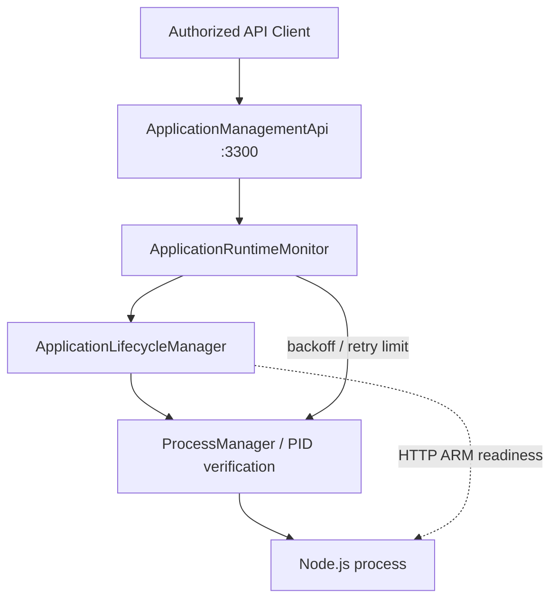

# Phase 3 — Application Runtime Monitoring & Recovery

**Branch:** `arm-supervisor`

## Phase Overview

**Why:** Phase 2 supports manual start/stop/restart of installed applications, but does not monitor unexpected process exits or provide a long-running control endpoint.

**Core problem:** Recover an app if its managed Node.js process unexpectedly exits without confusing telemetry connectivity with process identity.

**Root causes:** Supervisor can observe process state but previously had no bounded recovery loop, recovery intent, readiness waiting or protected management API.

**Solution:** `ApplicationRuntimeMonitor` observes `ProcessManager.inspect()` through `ApplicationLifecycleManager`, maintains desired-run state while the management daemon is alive, schedules bounded exponential-backoff restarts and delegates all process ownership to `ProcessManager`. `ApplicationManagementApi` offers authenticated loopback control.



## Local test — payment-service Phase 1 fixture

The earlier `payment-service-1.0.0.zip` has `arm.enabled=false`, so readiness is `NOT_CONFIGURED`. Its Node HTTP API uses port 3201.

Terminal 1:

```bash
git switch arm-supervisor
git pull origin arm-supervisor
npm install
npm run build
npm test

# Run these once, if the app is not installed or activated:
npm run deploy:zip -- ./supervisor-data/uploads/payment-service-1.0.0.zip
npm run app:manage -- activate payment-service 1.0.0

# Choose a sufficiently long unique token.
export ARM_MANAGEMENT_TOKEN='replace-with-a-long-random-secret'
npm run dev:management
```

Terminal 2:

```bash
TOKEN='replace-with-a-long-random-secret'

curl -H "Authorization: Bearer $TOKEN" http://127.0.0.1:3300/applications

curl -X POST -H "Authorization: Bearer $TOKEN" \
  http://127.0.0.1:3300/applications/payment-service/start

curl -H "Authorization: Bearer $TOKEN" \
  http://127.0.0.1:3300/applications/payment-service

curl http://127.0.0.1:3201/health

curl -X POST -H "Authorization: Bearer $TOKEN" \
  http://127.0.0.1:3300/applications/payment-service/restart

curl -X POST -H "Authorization: Bearer $TOKEN" \
  http://127.0.0.1:3300/applications/payment-service/stop
```

To test recovery with `restartPolicy: "on-failure"` and `maxRestarts: 3`, start the app through the management API, then terminate its *verified, currently managed* PID externally. A restart will be scheduled after the configured backoff, while a `POST /stop` suppresses restart. **Never kill an unrelated PID.**

## HTTP management routes

Every endpoint requires `Authorization: Bearer <ARM_MANAGEMENT_TOKEN>` and binds to loopback only (default `127.0.0.1:3300`).

| Method | Route | Purpose |
|---|---|---|
| GET | `/applications` | List active applications and recovery state |
| GET | `/applications/:id` | Inspect process + ARM readiness + restart attempts |
| POST | `/applications/:id/activate` | Set active release; JSON `{"version":"1.0.0"}` |
| POST | `/applications/:id/start` | Start installed selected release |
| POST | `/applications/:id/stop` | Intentional stop; disables automatic restart |
| POST | `/applications/:id/restart` | Explicit restart; reset recovery counter |

Use `ARM_MANAGEMENT_PORT=3300` to change the port, and `ARM_DEPLOYMENT_ROOT` to choose the same storage directory used by Phase 1.

## Runtime recovery states

`IDLE`, `SCHEDULED`, `RECOVERING`, `EXHAUSTED` and `MANUALLY_STOPPED`.

When `expectedRunning=true` and a previously managed process becomes `STOPPED`, the monitor schedules restart attempts according to the active release manifest:

- `restartPolicy: "never"` or `maxRestarts: 0`: no restarts
- `restartPolicy: "on-failure"` or `"always"`: treat **unexpected process termination** as recoverable
- delay: `min(restartMaxDelayMs, restartBaseDelayMs * 2 ** attempts)`
- total attempts limited by `maxRestarts`, after which state becomes `EXHAUSTED`
- manual stop cancels recovery intent and prevents further restarts until explicitly started again

**Important limitation:** This implementation does not yet distinguish exit code 0 vs nonzero for all detached/adopted processes. Here `on-failure` means unexpected termination while the Supervisor expected the process to run, not a strict nonzero exit-code condition.

`RUNNING` with `UNKNOWN` or `UNHEALTHY` ARM readiness **does not** cause an automatic restart. Only a verified process exit triggers recovery. This avoids two live Node processes competing for the same port/resources.

The monitor is in-memory. On daemon restart, `restoreRunningApplications()` adopts already-running processes as expected-running; a process that exited while Supervisor was down is **not** automatically started because desired-run state is not yet durably persisted.

## Readiness and startup

For ARM-enabled applications, an explicit start or restart polls
`GET http://127.0.0.1:<arm.metricsPort>/reliability/ready` until HTTP 200
or `readinessTimeoutMs` (default 15 seconds). HTTP 503 is not healthy.
Missing/timeout/error remains `UNKNOWN`.

For `arm.enabled=false`, the runtime returns `NOT_CONFIGURED` and does
not wait for the business HTTP port. The `payment-service` fixture therefore
checks the Node.js process lifecycle but **not** application-layer readiness.
A readiness timeout does not forcibly kill a still-running process.

## API & monitoring configuration

```ts
import { ApplicationLifecycleManager } from './packages/adapter-process/src/application-lifecycle-manager.js';
import { ApplicationRuntimeMonitor } from './packages/adapter-process/src/application-runtime-monitor.js';
import { ApplicationManagementApi } from './packages/adapter-process/src/application-management-api.js';

const lifecycle = new ApplicationLifecycleManager({ storageRoot: './supervisor-data' });
await lifecycle.initialize();
const monitor = new ApplicationRuntimeMonitor(lifecycle, {
  intervalMs: 1000,
  readinessTimeoutMs: 15000,
  restartBaseDelayMs: 500,
  restartMaxDelayMs: 30000,
});
await monitor.restoreRunningApplications();
monitor.startMonitoring();
const api = new ApplicationManagementApi(monitor, {
  bearerToken: process.env.ARM_MANAGEMENT_TOKEN!,
  port: 3300,
});
await api.start();

// When stopping Supervisor, do not stop the child apps:
monitor.stopMonitoring();
await api.stop();
monitor.close();
```

## Security and operational limits

- **Local administrative API only.** No public network exposure; reverse proxy and strong authentication/authorization would be required before remote administration.
- Minimum 16 characters for the management bearer token; use a random value and protect environment variables. Registration token and management token have separate roles.
- No arbitrary shell command execution from HTTP requests. Management works only with already-installed and selected release IDs.
- A single long-running management daemon must own process state files. **Do not concurrently use `app:manage` CLI and management daemon** against the same state directory.
- Recovery attempts and desired-run state are not yet persisted, so restart budgets reset when management daemon restarts.
- Auto-start at Supervisor boot, cooldown/jitter, strict exit-code classification, log capture, multi-host isolation, durable restart budget, metrics-based auto-recovery and HTTP package uploads are future enhancements.
- `ProcessManager` retains Linux PID identity checks. On other OSs, adoption remains restricted.
- No app is restarted merely because ARM WS connection drops or readiness is `UNKNOWN`.

## Tests

`tests/application-runtime-phase3.test.ts` exercises recovery, manual stop, disabled policy and management HTTP authentication. Run with:

```bash
npm run build
npm test
```
