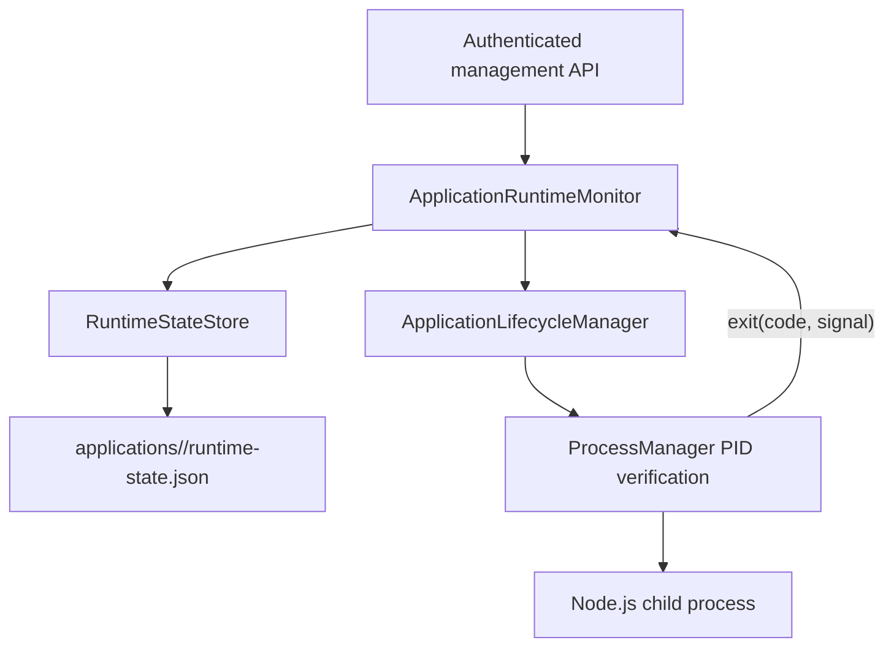

# Phase 4 — Durable Runtime State & Recovery Policies

**Branch:** `arm-supervisor`

## Phase Overview

**Why:** In Phase 3, recovery intent and retry attempts lived only in RAM. A Supervisor restart silently reset restart budgets and forgot which stopped apps had been expected to run.

**Core problem:** Preserve the difference between a manually stopped app, a process that exited unexpectedly, and an app whose restart is scheduled, across Supervisor restarts.

**Root causes:** Non-durable `expectedRunning`, `attempts`, `nextAttemptAt` and exit reason. Restart budgets reset even for fast-crashing processes.

**Solution:** `RuntimeStateStore` persists per-application, release-scoped runtime intent and recovery state. `ApplicationRuntimeMonitor` persists state before process operations and recovery attempts, restores a bounded retry schedule after restart, classifies observed clean exits, and resets the budget only after a stable-running interval.

## Architecture



## Durable record

Saved next to the Phase 2 `active.json`:

```text
supervisor-data/
  applications/
    payment-service/
      active.json
      runtime-state.json
      releases/
        1.0.0/
          .deployment.json
  state/processes.json
```

Example persisted JSON:

```json
{
  "schemaVersion": 1,
  "applicationId": "payment-service",
  "releaseVersion": "1.0.0",
  "desired": "RUNNING",
  "recoveryState": "SCHEDULED",
  "attempts": 1,
  "nextAttemptAt": "2026-11-10T08:00:05.000Z",
  "lastExit": {
    "kind": "SIGNALED",
    "signal": "SIGKILL",
    "observedAt": "2026-11-10T08:00:00.000Z"
  },
  "updatedAt": "2026-11-10T08:00:00.000Z"
}
```

The store validates records and writes through a temporary file followed by rename. It serializes writes per application. A malformed existing record fails restoration rather than silently resetting recovery budgets.

## Recovery behavior

| Situation | Result |
|---|---|
| Management API `/stop` | Persist `desired=STOPPED` before sending SIGTERM; never auto-restart |
| Management API `/start` | Persist `desired=RUNNING` before launching |
| Crash, `on-failure`, code 1 or signal | Schedule bounded restart |
| Observed clean exit (code 0), `on-failure` | Treat as completed; persist `desired=STOPPED`, no restart |
| Clean exit, `always` | Restart, subject to retry budget |
| Crash, `never` | Mark `EXHAUSTED`; no restart |
| Supervisor restarts during backoff | Reload `nextAttemptAt` and resume attempts |
| Supervisor restarts while a process is alive | Adopt verified PID; preserve budget/desired |
| Process stopped while Supervisor offline | If persisted desired is RUNNING, recovery is scheduled after startup |
| PID identity unverified | Do not restart or send signals |
| App health `UNKNOWN` / WS disconnected | Do not infer process death |
| Crash loop | Retry budget persists; after `maxRestarts`, mark EXHAUSTED |
| Stable process | Clear retry counter after `stableResetMs` without another crash |

Backoff remains `min(restartMaxDelayMs, restartBaseDelayMs × 2^attempts)`, with the default cap 30 seconds. The default stable-running reset threshold is 60 seconds. Restart budgets are **consecutive attempts since the last manual reset or stable-running interval**, not lifetime totals.

### Exit classification caveat

`ProcessManager` emits exit code and signal only when it owns the `ChildProcess` object. A process adopted after Supervisor restart may exit without an observable exit code. That case is `UNKNOWN` and is conservatively treated as an unexpected termination if desired state remains RUNNING. This is not a claim to have perfectly reconstructed exit reasons.

The Phase 4 record stores the latest observed exit, if known, and is cleared on a successful process relaunch.

## Using the management daemon

```bash
git switch arm-supervisor
git pull origin arm-supervisor
npm install
npm run build
npm test

export ARM_MANAGEMENT_TOKEN='replace-with-a-long-random-secret'
export ARM_STABLE_RESET_MS=60000
npm run dev:management
```

The Phase 1 `payment-service-1.0.0.zip` may have `restartPolicy: "never"`. To test crash recovery, build a **new release version** with `restartPolicy: "on-failure"` and positive `maxRestarts`, install it and activate it while stopped.

Start an app via the authenticated API, retrieve its verified process PID, and terminate only that test process to simulate an unexpected exit. The daemon writes a `runtime-state.json` file and reuses its retry schedule after restarting. Use the existing Phase 3 HTTP API to inspect `recovery.desired`, `recovery.lastExit`, `recovery.attempts` and `recovery.nextAttemptAt`.

## Source files

- `packages/adapter-process/src/runtime-state-store.ts`: persistent runtime record schema, validation, atomic rename, per-app write ordering
- `packages/adapter-process/src/application-runtime-monitor.ts`: durable desired state, recovery schedule, exit classification, stable reset, restore
- `examples/supervisor/src/management-api.ts`: instantiates RuntimeStateStore and restores before starting the monitoring interval
- `tests/application-runtime-phase4.test.ts`: persisted schedule, recovery across restart, manual stop and observed clean exit tests

## Operational and safety boundaries

- A **single Supervisor daemon** must own the deployment and process state directory. No distributed lock, fsync+directory sync or multi-instance consensus is provided.
- The store uses atomic rename but does not provide power-loss-level transaction guarantees across `runtime-state.json` and `processes.json`.
- Persisting desired state before a process starts intentionally enables recovery from a Supervisor crash during startup, but a failed startup may remain desired RUNNING and follow the bounded restart policy.
- Recovery state is release-scoped; changing the active release resets the corresponding runtime budget.
- No jitter or distributed fleet scheduling is implemented. Use OS-specific process services or containers when stronger isolation is required.
- Phase 4 deliberately does not restart an app merely because it is ARM-unhealthy while its verified process is still running.
- The existing Phase 3 test suite uses its memory-only monitor constructor, which remains valid for isolated testing; production daemon explicitly supplies the durable store.
- A strict system should persist OS process exit events transactionally before the child process disappears, or obtain them from a stronger process supervisor; the current PID adoption adapter cannot always do this.

## Validation commands

```bash
npm run build
npm test
```

The Phase 4 tests cover restoring persisted backoff, keeping a manual stop across Supervisor restart, clean exit code zero and rejection of invalid state. Exercise live `payment-service` recovery before treating the feature as production-ready.

## Next suggested Phase 5

Deployment APIs and controlled rollouts: authenticated upload, active version switch, rollback, audit log and a well-defined release activation transaction.
