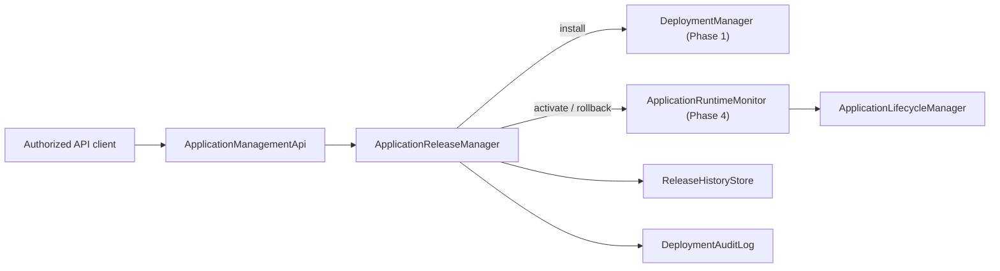

# Phase 5 — Application Deployment API & Release Management

**Branch:** `arm-supervisor`

## Phase Overview

**Why:** Phases 1–4 required a local CLI to install ZIP packages and lacked a unified release history, rollback operation and deployment audit.

**Core problem:** Add a protected control surface for installation and release selection without bypassing safe process lifecycle or accidentally replacing a running Node.js process.

**Solution:** Extend the existing loopback-only `ApplicationManagementApi` with bounded streaming ZIP uploads and release endpoints. `ApplicationReleaseManager` composes Phase 1 `DeploymentManager` with Phase 2/4 `ApplicationRuntimeMonitor`, plus separate `ReleaseHistoryStore` and append-only `DeploymentAuditLog`.



## Quick start

```bash
git switch arm-supervisor
git pull origin arm-supervisor
npm install
npm run build
npm test

export ARM_MANAGEMENT_TOKEN='replace-with-a-long-random-secret'
npm run dev:management
```

From a separate terminal, upload the Phase 1 payment-service package (binary ZIP body, **not** multipart/form-data):

```bash
TOKEN='replace-with-a-long-random-secret'
BASE='http://127.0.0.1:3300'

curl -X POST "$BASE/deployments/upload" \
  -H "Authorization: Bearer $TOKEN" \
  -H "Content-Type: application/zip" \
  --data-binary @./supervisor-data/uploads/payment-service-1.0.0.zip

curl -H "Authorization: Bearer $TOKEN" "$BASE/applications/payment-service/releases"

curl -X POST "$BASE/applications/payment-service/activate" \
  -H "Authorization: Bearer $TOKEN" \
  -H "Content-Type: application/json" \
  -d '{"version":"1.0.0"}'

curl -X POST "$BASE/applications/payment-service/start" \
  -H "Authorization: Bearer $TOKEN"

curl -H "Authorization: Bearer $TOKEN" "$BASE/applications/payment-service"
```

To test switching to version 1.1.0, upload a **distinct valid** 1.1.0 ZIP with matching manifest/package version, then:

```bash
curl -X POST "$BASE/applications/payment-service/stop" -H "Authorization: Bearer $TOKEN"
curl -X POST "$BASE/applications/payment-service/activate" \
  -H "Authorization: Bearer $TOKEN" -H "Content-Type: application/json" \
  -d '{"version":"1.1.0"}'
curl -X POST "$BASE/applications/payment-service/start" -H "Authorization: Bearer $TOKEN"

# Roll back: first stop, then select previously active version; start separately.
curl -X POST "$BASE/applications/payment-service/stop" -H "Authorization: Bearer $TOKEN"
curl -X POST "$BASE/applications/payment-service/rollback" -H "Authorization: Bearer $TOKEN"
curl -X POST "$BASE/applications/payment-service/start" -H "Authorization: Bearer $TOKEN"
```

## HTTP API

All routes require `Authorization: Bearer <ARM_MANAGEMENT_TOKEN>`. The server binds to `127.0.0.1` by default and rejects non-loopback hosts.

| Method | Route | Behavior |
|---|---|---|
| POST | `/deployments/upload` | Install ZIP; body `application/zip`; HTTP 201 |
| GET | `/deployments/audit` | Latest audit entries |
| GET | `/applications/:id/releases` | Installed immutable releases |
| GET | `/applications/:id/audit` | Audit entries scoped to application |
| POST | `/applications/:id/activate` | Select release using JSON `{"version":"1.1.0"}` |
| POST | `/applications/:id/rollback` | Select preceding active release |
| GET | `/applications/:id` | Inspect current process, readiness and recovery |
| POST | `/applications/:id/start` | Start selected version |
| POST | `/applications/:id/stop` | Graceful stop |
| POST | `/applications/:id/restart` | Restart current selected version |

A ZIP upload is streamed to a random temporary directory beneath `supervisor-data/uploads`; its maximum request size defaults to **50 MiB**. Existing Phase 1 ZIP validation applies when `DeploymentManager.installZip()` runs: safe paths, CRC, bounded expansion, manifest checks and `npm ci --ignore-scripts`.

This API does **not** accept multipart forms or arbitrary URL fetches. The deployment endpoint is restricted to already-authorized localhost API clients.

## Release transitions and rollback

The active release remains in `applications/<id>/active.json`, maintained by Phase 2. Phase 5 adds:

```text
supervisor-data/
  audit/deployments.jsonl
  applications/payment-service/
    active.json
    release-history.json
    runtime-state.json
    releases/
      1.0.0/
      1.1.0/
```

`release-history.json` records `ACTIVATE` and `ROLLBACK` transitions with `fromVersion`, `toVersion` and timestamp. Rollback selects the previous version from the latest matching activation transition; the rollback itself is recorded, so another rollback can toggle back to the version it replaced.

**Safety policy:** Release selection is stop-before-switch. The lifecycle layer rejects activation when the previous process is running or its PID is unverified. Neither activate nor rollback implicitly spawns a process, which preserves the Phase 4 intentional-stop policy and prevents a second process from binding to the same port. Start separately after activation.

## Audit trail

`DeploymentAuditLog` appends one JSONL record for each `INSTALL`, `ACTIVATE` and `ROLLBACK` attempt. Records include UUID, timestamp, action, outcome, app/version metadata and concise reason on failure. This is an operational audit for a single Supervisor writer, not a tamper-proof security log.

## Files

| File | Responsibility |
|---|---|
| `application-release-manager.ts` | Deployment and transition orchestration |
| `release-history-store.ts` | Durable release transition history |
| `deployment-audit-log.ts` | Append-only JSONL audit |
| `application-management-api.ts` | Authorized API, bounded ZIP stream, HTTP routing |
| `examples/supervisor/src/management-api.ts` | Wire Phase 5 Release Manager into the long-running daemon |
| `tests/application-release-phase5.test.ts` | Activation / rollback / API upload regression tests |

## Limitations before production

1. **No cross-file transaction**: `active.json`, `runtime-state.json`, `release-history.json` and `deployments.jsonl` are separate files. A crash after activation but before writing history could leave a selected release without a recorded transition. The active release is authoritative; audit/history reconciliation and transactional storage are future work.
2. **No automatic rollout**: This phase performs upload, explicit activation and explicit start. It does not implement blue/green deployments, health-gated rollback or traffic draining.
3. **No HTTP package downloads**: Upload is local API binary streaming only.
4. **Single writer**: Concurrent Supervisor daemons or the standalone `app:manage` CLI must not share the same state files.
5. **No trust isolation**: Uploaded ZIP packages contain executable Node.js code. Authorization limits who can deploy, but cannot sandbox untrusted packages. Use a least-privilege process user or container isolation.
6. **Not an internet-facing API**: Management API is deliberately restricted to loopback. Exposing remotely requires additional authentication, authorization, TLS, rate limiting and audit controls.
7. **No retention/rotation**: Release history and audit log grow over time.
8. Upload permission and generic HTTP error handling remain basic; strict application error types and separate management/deployment roles are future hardening work.

## Verification

```bash
npm run build
npm test
```

Follow these with an end-to-end payment-service ZIP install, activate 1.0.0, start/stop, install 1.1.0, activate and rollback. Verify no duplicate PID and persistent history after restarting Supervisor.
