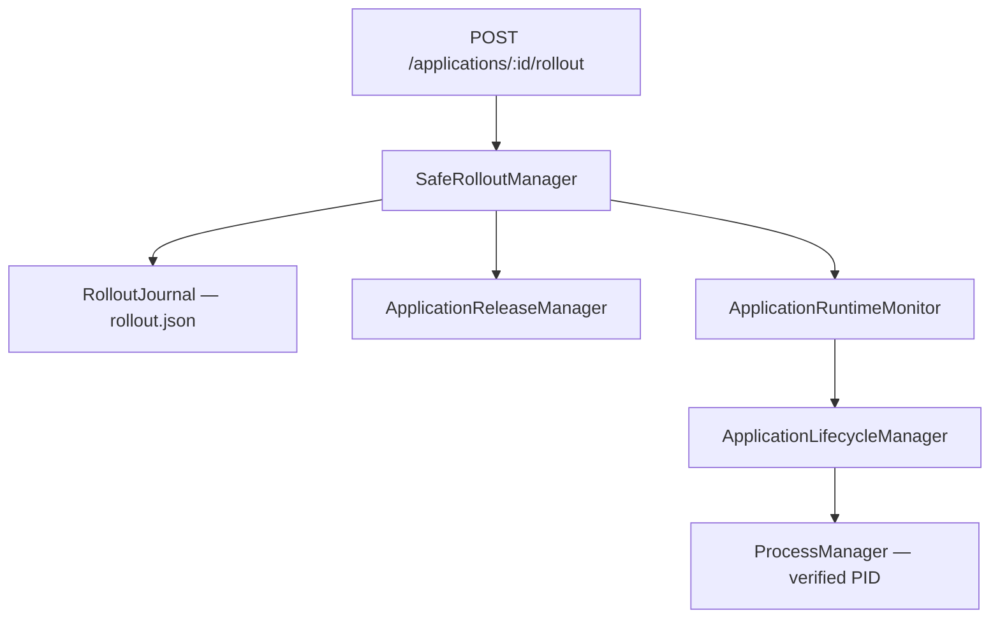
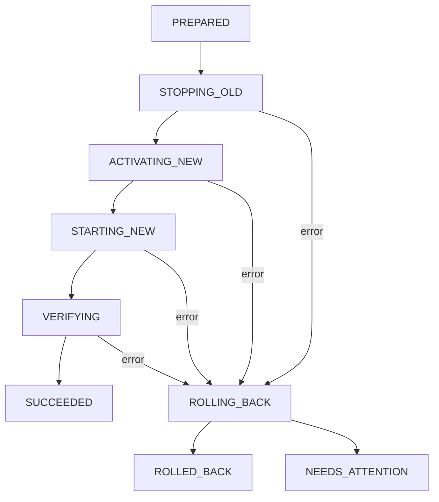

# Phase 6 — Transactional Deployment & Safe Rollout

**Branch:** `arm-supervisor`

## Phase overview

**Why:** Phase 5 supports upload, activate and manual rollback, but switching release requires multiple API calls and cannot automatically recover a failed startup. If Supervisor exits between the calls, its state can be ambiguous.

**Core problem:** Switch an installed application from one release to another while preserving the previous working release and preventing overlapping Node.js processes.

**Root causes:** Release activation, process stop/start, readiness checks, release history, and runtime intent are separate operations without a shared database transaction.

**Solution:** Implement a **compensating transaction (saga)** with an application-scoped rollout journal. It checkpoints progress before each process-changing step, pauses automatic recovery for that application, verifies the new release, and attempts rollback on failure. On Supervisor restart, incomplete journal entries are compensated before the management API is exposed.

This is **not** ACID and **not** zero-downtime. The system retains the deliberate stop-before-switch guarantee.

## Architecture



## Rollout state machine



A rollout requires an **existing selected release** and an already installed target release. The manager records the old version and whether it was running, then performs:

1. Write `PREPARED` to disk; reject another concurrent rollout for the same app.
2. Pause the app's automatic recovery and wait for its current monitor operation.
3. Write `STOPPING_OLD`; stop the previous version if running, using normal safe PID handling.
4. Write `ACTIVATING_NEW`; activate the target release using Phase 5 release management/history.
5. Write `STARTING_NEW`; start the selected process via Phase 4.
6. Write `VERIFYING`; require the process to stay `RUNNING` and, for ARM-enabled apps, readiness `HEALTHY` throughout the stability window.
7. Write `SUCCEEDED`. Re-enable monitoring and return the operation.

If an error occurs, the manager writes `ROLLING_BACK` and attempts to stop the new process, re-activate the old version and restart it **only if it was running before the rollout**. On success, the operation becomes `ROLLED_BACK`. If PID verification prevents a safe stop, or the previous application cannot be restored, the operation becomes `NEEDS_ATTENTION` and automatic retries are not attempted without manual intervention.

An incomplete rollout found at daemon boot is **conservatively rolled back** rather than guessing whether its candidate had been committed. If the previous version is already running, recovery preserves it without unnecessarily stopping and restarting it.

## Run locally with two versions

First upload and activate your `payment-service` releases using Phase 5. With the management daemon running:

```bash
TOKEN='replace-with-a-long-random-secret'
BASE='http://127.0.0.1:3300'

# Inspect the currently selected application:
curl -H "Authorization: Bearer $TOKEN" "$BASE/applications/payment-service"

# Verify both target ZIP releases were installed:
curl -H "Authorization: Bearer $TOKEN" "$BASE/applications/payment-service/releases"
```

### Rollout to v1.1.0

For ARM-enabled apps with a functioning `/reliability/ready` endpoint:

```bash
curl -i -X POST "$BASE/applications/payment-service/rollout" \
  -H "Authorization: Bearer $TOKEN" \
  -H "Content-Type: application/json" \
  -d '{"version":"1.1.0"}'
```

The Phase 1 `payment-service` fixture has `arm.enabled=false`. It cannot demonstrate application readiness; enable **explicit process-only testing** for that ZIP:

```bash
curl -i -X POST "$BASE/applications/payment-service/rollout" \
  -H "Authorization: Bearer $TOKEN" \
  -H "Content-Type: application/json" \
  -d '{"version":"1.1.0","allowProcessOnly":true}'
```

The process-only mode checks PID/process survival during the stability window; it **does not** prove Express HTTP/ARM readiness. Avoid relying on it for production traffic.

### Rollout back to v1.0.0

```bash
curl -i -X POST "$BASE/applications/payment-service/rollout" \
  -H "Authorization: Bearer $TOKEN" \
  -H "Content-Type: application/json" \
  -d '{"version":"1.0.0","allowProcessOnly":true}'
```

The endpoint performs stop/activate/start/verification as **one API operation**, unlike manual `/rollback` in Phase 5.

### Inspect the operation journal

```bash
curl -H "Authorization: Bearer $TOKEN" "$BASE/applications/payment-service/rollout"
cat supervisor-data/applications/payment-service/rollout.json
```

`POST /applications/:id/rollout` returns `200` with phase `SUCCEEDED`, `409` with phase `ROLLED_BACK` (candidate failed but compensation succeeded), or `500` with phase `NEEDS_ATTENTION`. The JSON response contains operation ID, previous and target versions, timestamps, verification mode, phase and error where applicable.

All management API routes are loopback-only with Bearer authentication. Existing upload, release, manual activate/rollback and audit APIs remain available; control operations targeting the same app are rejected while a rollout is active.

## Journal storage

```text
supervisor-data/
  applications/
    payment-service/
      active.json
      rollout.json            <-- new
      release-history.json
      runtime-state.json
      releases/
        1.0.0/
        1.1.0/
  audit/
    deployments.jsonl
```

Example of a partially completed operation:

```json
{
  "schemaVersion": 1,
  "operationId": "random-uuid",
  "applicationId": "payment-service",
  "fromVersion": "1.0.0",
  "toVersion": "1.1.0",
  "previousDesired": "RUNNING",
  "allowProcessOnly": true,
  "phase": "STARTING_NEW",
  "createdAt": "2026-11-10T09:00:00.000Z",
  "updatedAt": "2026-11-10T09:00:01.000Z"
}
```

Journal writes replace a temporary file by rename. The journal is the source of truth for a rollout's outcome; deployment audit is best-effort and might need reconciliation after an I/O failure.

## Supervisor restart recovery

The management daemon initializes PID-aware lifecycle, restores persisted runtime intent, **recovers incomplete rollout journals**, then starts monitoring and opens the HTTP control endpoint.

At recovery, only journal states `PREPARED`, `STOPPING_OLD`, `ACTIVATING_NEW`, `STARTING_NEW`, `VERIFYING` and `ROLLING_BACK` are automatically compensated. `SUCCEEDED` and `ROLLED_BACK` are terminal; `NEEDS_ATTENTION` blocks new rollouts until an operator repairs the state and intentionally resolves that journal.

## Configuration

```bash
export ARM_MANAGEMENT_TOKEN='replace-with-a-long-random-secret'
export ARM_ROLLOUT_STABILITY_MS=1500
npm run dev:management
```

The default stability window is **1500 ms**; default poll interval is **250 ms**. ARM-enabled applications also use the Phase 3 startup readiness timeout and ARM metrics port declared in the manifest.

## Files and responsibilities

| File | Purpose |
|---|---|
| `packages/adapter-process/src/rollout-journal.ts` | Durable per-app rollout checkpoints |
| `packages/adapter-process/src/safe-rollout-manager.ts` | Safe rollout saga, health gate and compensation |
| `packages/adapter-process/src/application-runtime-monitor.ts` | Pause recovery for an app while rollout owns it |
| `packages/adapter-process/src/application-management-api.ts` | Authenticated POST/GET rollout routes |
| `examples/supervisor/src/management-api.ts` | Startup recovery before opening API and monitor |
| `tests/safe-rollout-phase6.test.ts` | Success, failure, restart recovery, process-only guard and API tests |

## Known limitations

- **Not an atomic transaction across files and processes.** A journal records intended steps; compensating actions can also fail.
- **Service interruption is expected.** The old process is stopped before the new process starts. Blue/green and zero-downtime deployments require independent ports/instances and traffic routing.
- **Health gate depends on truthful readiness.** If ARM readiness is not configured, process-only mode must be explicitly opted into for test ZIPs.
- **No distributed coordination** or durable leader lease; one Supervisor daemon must own the state root.
- Rollout history/audit and active process selection are not committed in a single transaction.
- A local filesystem rename does not guarantee survival of sudden power loss without fsync of file and parent directory.
- Rollout journal holds the latest operation per app, not an unbounded historical ledger.
- An unresolved `NEEDS_ATTENTION` requires manual repair before attempting another rollout.

## Test

```bash
npm run build
npm test
```

The Phase 6 suite exercises success, automatic compensation on failed startup, replay after simulated Supervisor restart, default refusal of uninstrumented apps and API authentication. Run an additional end-to-end test using the real payment ZIP versions before production use.
