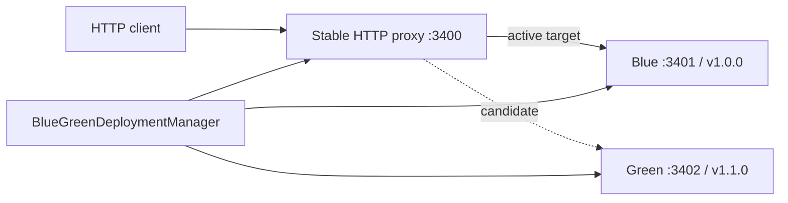

# Phase 7 — Blue/Green HTTP Deployment

## Why this phase exists

Phase 6 uses stop-before-start and cannot avoid an interruption. Phase 7 adds a **stable HTTP proxy** and two managed Node.js processes on different ports. Existing requests continue to the old process after the proxy begins sending new requests to the new process. The old process is stopped only after draining the requests assigned to it.

This is an **opt-in HTTP-only capability**, independent from Phase 6's singleton / Saga APIs.

## Architecture



Once Green passes `GET /health`, the proxy switches **new** requests to Green while its existing Blue requests are allowed to finish. After draining Blue, the Supervisor sends SIGTERM to its verified PID.

## Prerequisites and migration from Phase 1–6

1. Install both `payment-service` versions via Phase 5 `POST /deployments/upload`.
2. The Node application must honor `HOST` and `PORT` environment variables and serve `GET /health` with HTTP 200 only when ready. The Phase 1 payment-service fixture already does this.
3. **Do not enable Phase 7 against a legacy process bound to the same public port.** For the first migration, manually stop the singleton application (once), change clients to use the new public proxy port 3400, and launch the daemon with Phase 7 enabled. Subsequent Blue/Green swaps use the stable proxy port without the old stop-before-start gap.
4. Proxy port, Blue port and Green port must be distinct and free. The public port is bound to `127.0.0.1` only.
5. Current implementation is for **HTTP/1.1 requests**. WebSockets, SSE lasting indefinitely, TCP/UDP and long-lived HTTP streaming are not guaranteed to drain or migrate without interruption.

## Configure daemon

```bash
git switch arm-supervisor
git pull origin arm-supervisor
npm install
npm run build
npm test

export ARM_MANAGEMENT_TOKEN='replace-with-a-long-random-secret'
export ARM_BLUE_GREEN_APP_ID='payment-service'
export ARM_PROXY_PORT=3400
export ARM_BLUE_PORT=3401
export ARM_GREEN_PORT=3402
npm run dev:management
```

Without `ARM_BLUE_GREEN_APP_ID`, the Phase 7 manager does **not** start and existing Phase 6 behavior remains unchanged.

## Deploy v1.0.0 into Blue

```bash
TOKEN='replace-with-a-long-random-secret'
BASE='http://127.0.0.1:3300'

curl -X POST "$BASE/blue-green/deploy" \
  -H "Authorization: Bearer $TOKEN" \
  -H "Content-Type: application/json" \
  -d '{"version":"1.0.0"}'

curl http://127.0.0.1:3400/health
```

At this point the stable client-facing endpoint is **http://127.0.0.1:3400**, not the slot ports.

## Upgrade v1.0.0 → v1.1.0

```bash
curl -X POST "$BASE/blue-green/deploy" \
  -H "Authorization: Bearer $TOKEN" \
  -H "Content-Type: application/json" \
  -d '{"version":"1.1.0"}'

curl -H "Authorization: Bearer $TOKEN" "$BASE/blue-green"
curl http://127.0.0.1:3400/health
```

Deployment sequence:

1. Start candidate on unused slot and distinct port.
2. Confirm candidate PID is verified RUNNING.
3. Poll candidate `GET /health` until HTTP 200 or timeout (8 seconds by default). If unhealthy, keep old active target and stop candidate.
4. Switch proxy's active target for subsequent HTTP requests.
5. Persist active slot and version in `blue-green.json`.
6. Wait for existing old-slot HTTP requests to drain (default 10 seconds).
7. Stop the old process using `ProcessManager.stop()`, if drained. If the drain deadline expires, leave it running and available for later cleanup rather than interrupt in-flight requests.

## Switch back to v1.0.0

```bash
curl -X POST "$BASE/blue-green/deploy" \
  -H "Authorization: Bearer $TOKEN" \
  -H "Content-Type: application/json" \
  -d '{"version":"1.0.0"}'
```

This is a new deployment to the idle slot; it is not Phase 5's `/rollback` operation. The previous release must still be installed.

## Management API

| Method | Route | Purpose |
|---|---|---|
| POST | `/blue-green/deploy` | Deploy version into other slot; health check; switch traffic; drain |
| GET | `/blue-green` | Active slot, versions, slot process status, proxy target |

Both routes use the existing Bearer token and localhost-only administrative API on port 3300.

## Persistence and process ownership

```text
supervisor-data/
  applications/payment-service/
    releases/1.0.0/
    releases/1.1.0/
    blue-green.json
  state/
    processes.json               # Phase 2 singleton process manager
    blue-green-processes.json    # Separate Phase 7 slot process manager
```

The distinct process IDs are `payment-service-blue` and `payment-service-green`. The manager sets `PORT` and `HOST` for each process, enabling both versions to listen simultaneously.

When Supervisor restarts, Phase 7 reloads slot definitions, adopts verified Linux PIDs via `ProcessManager`, probes the saved active target, and only then restores proxy routing. If the saved target cannot be verified or is unhealthy, the proxy responds 503 rather than blindly routing to an unknown PID.

## Boundaries and production caveats

- No port-level zero-downtime conversion from an already-running standalone process. Clients must enter through the stable proxy **before** zero-downtime guarantees apply.
- In-flight **HTTP responses** can drain, but `keep-alive` connections are not pinned to an old release: every new HTTP request chooses the current active target.
- The proxy preserves HTTP method, URL path, request body and upstream response. It does not implement WebSocket upgrades, TLS termination, full reverse-proxy hardening, retry queues, rate limiting, or load balancing between multiple backends.
- App readiness here is a **business HTTP health endpoint** (`/health`), not Phase 6 ARM `/reliability/ready`; a 200 response is required before traffic cutover.
- If a process crashes **after** switching, Phase 7 does not yet automatically revert traffic or integrate Phase 4 restart budgets for slot processes.
- The proxy in this version is in the Supervisor daemon process. Restarting the Supervisor closes/reopens the proxy listener and therefore is **not zero-downtime** for connections.
- After a crash exactly between proxy switch and persisting the active slot, the disk and memory routing state can diverge. Restart restores the **last durable** active slot, not an inferred recent route.
- A drain timeout leaves the inactive process running. The next deployment to its slot attempts safe cleanup. HTTP clients must not access the slot port directly.
- Port availability and application behavior are trusted; untrusted uploads must be sandboxed independently.
- Do not run the Phase 6 singleton manager concurrently for the same application in a way that conflicts with Blue/Green; both use the same installed releases but different process registries.
- The proxy only binds loopback. Exposing an external service requires a correctly configured ingress or network proxy.
- The design does **not** guarantee zero failed requests under OS/network faults, external DB incompatibilities, application crashes, or kernel-level failures.

## Code and tests

- `packages/adapter-process/src/blue-green-http-proxy.ts`: stable front door, per-request routing and in-flight drain tracking.
- `packages/adapter-process/src/blue-green-deployment-manager.ts`: independent slots, process IDs, health probe, cutover, durable slot record.
- `packages/adapter-process/src/application-management-api.ts`: authorized GET/POST Blue/Green endpoints.
- `examples/supervisor/src/management-api.ts`: opt-in runtime configuration.
- `tests/blue-green-phase7.test.ts`: in-flight request draining and live two-release lifecycle.

Run `npm run build && npm test` on the checked-out repository and run repeated HTTP requests through port 3400 during a slot switch to observe stable routing.
