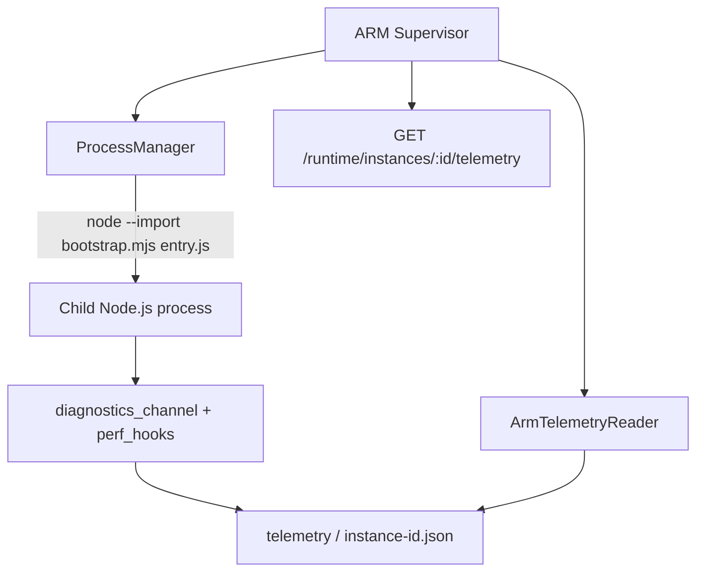

# Phase 8 — Automatic ARM Runtime Injection & Instrumentation

**Branch:** `arm-supervisor`. This is an opt-in Supervisor-owned Node.js runtime adapter. No installed ZIP is modified and no child package needs to depend on `arm-client`.

## Phase Overview

**Why:** Phase 1–7 can install, start, monitor and blue/green-deploy applications but an application that did not integrate ARM SDK itself has limited runtime observability.

**Core problem:** Observe basic Node.js runtime and HTTP behavior **inside** child processes without adding dependencies to their package.json or changing immutable artifacts.

**Root cause:** OS PID monitoring cannot see event-loop delay or JS HTTP response counters. Adding SDK dependencies to every upload would violate artifact immutability and require developer participation.

**Solution:** Use Node.js `--import` to preload a Supervisor-owned **ECMAScript module** before the business entrypoint. The preload subscribes to supported Node.js diagnostic channels and records isolated runtime snapshots. A strict, opt-in injection configuration is passed from Supervisor to its ProcessManager.

This phase **does not embed or reproduce the full arm-client branch API, ARM registration protocol, or business-level readiness**. It is the automatic baseline telemetry path; deeper SDK semantics need a separately versioned runtime bridge. Do not label injected processes as ARM-health `HEALTHY` solely because telemetry files exist.

## Architecture



The same injector instance can be supplied to both the Phase 2 singleton manager and Phase 7 Blue/Green manager. Each process has its own runtime state, metrics counters and instance ID. A shared preload file does **not** mean shared runtime memory.

## Enable

```bash
git switch arm-supervisor
git pull origin arm-supervisor
npm install
npm run build
npm test

export ARM_MANAGEMENT_TOKEN='replace-with-a-long-random-secret'
export ARM_AUTO_INJECT=1
export ARM_TELEMETRY_INTERVAL_MS=1000
npm run dev:management
```

For Phase 7, add `ARM_BLUE_GREEN_APP_ID=payment-service` and port environment variables from Phase 7 before starting the daemon.

**Only newly spawned processes are injected.** A process adopted on restart retains the flags it had at its original launch. To change injection settings, perform a controlled restart or rollout; merely restarting Supervisor does not inject a running child retroactively.

## Observe

Once `payment-service` starts with injection, query:

```bash
TOKEN='replace-with-a-long-random-secret'
curl -H "Authorization: Bearer $TOKEN" \
  http://127.0.0.1:3300/runtime/instances/payment-service-managed/telemetry
```

For Blue/Green:

```bash
curl -H "Authorization: Bearer $TOKEN" \
  http://127.0.0.1:3300/runtime/instances/payment-service-blue/telemetry

curl -H "Authorization: Bearer $TOKEN" \
  http://127.0.0.1:3300/runtime/instances/payment-service-green/telemetry
```

Snapshots are written to `supervisor-data/telemetry/<instanceId>.json` atomically, permission `0600`. The route is protected by the existing loopback-only bearer API. An absent file returns 404. **A snapshot may be stale after exit or after Supervisor restart**; compare timestamp and PID against the process manager before treating it as live.

Example fields:

```json
{
  "schemaVersion": 1,
  "applicationId": "payment-service",
  "instanceId": "payment-service-blue",
  "pid": 12345,
  "timestamp": "2026-11-10T16:00:00.000Z",
  "uptimeSec": 15.5,
  "rssBytes": 30146560,
  "heapUsedBytes": 5214208,
  "eventLoopUtilization": 0.015,
  "eventLoopDelayMeanMs": 20.3,
  "eventLoopDelayMaxMs": 22.1,
  "requestsStarted": 14,
  "responsesFinished": 14,
  "responses5xx": 0,
  "uncaughtExceptions": 0
}
```

## Injection contract

- `ArmRuntimeInjector` validates Supervisor-owned injection settings and builds Node arguments, including the absolute path to `bootstrap.mjs`.
- `ProcessManager` injects those arguments into `spawn(process.execPath, [...])`. Preload goes **before** app entry.
- Environment `ARM_APPLICATION_ID`, `ARM_INSTANCE_ID`, `ARM_TELEMETRY_ROOT` and `ARM_SAMPLE_INTERVAL_MS` is set at spawn, not read from the uploaded manifest.
- `bootstrap.mjs` subscribes to `http.server.request.start` and `http.server.response.finish` diagnostic channels. It measures event-loop delay and event-loop utilization with `node:perf_hooks` and samples memory usage.
- `uncaughtExceptionMonitor` records error types but does not suppress crashes or override application error handling.
- Telemetry writes are best-effort; failures cannot be used as process readiness evidence.

### Runtime and build layout

Source runtime:

`packages/adapter-process/runtime/bootstrap.mjs`

When running `npm run build`, `scripts/copy-runtime.mjs` copies runtime assets under `dist/packages/adapter-process/runtime` so compiled ProcessManager can use a relative absolute preload path. Running via `tsx` loads the source runtime directly.

No `npm install @arm/client` runs inside the uploaded app. Existing Phase 1 install pipeline and ZIP hashes remain untouched.

## Compatibility and limitations

- Node.js must support `--import` and the selected diagnostic channels. Target Node 22+ for this implementation.
- The application must run as a Node.js process. This does not auto-instrument Java/Python apps or native subprocesses.
- `diagnostics_channel` publishes built-in HTTP server events, but does not automatically instrument Express-specific handlers, arbitrary database drivers, gRPC, WebSockets or business transactions.
- Preloads may interact with applications that use additional Node flags, ESM loaders, process forks, workers, sandboxing or own monitoring libraries; test compatibility before enabling globally.
- This implementation does **not** validate full ARM SDK handshake, WebSocket telemetry, `/reliability/ready`, or business readiness. Phase 6 rollout still needs its prior ARM-aware readiness or explicit process-only test mode.
- Runtime telemetry is written to local files. It is not a full high-volume metrics pipeline; there is no retention policy, indexing, historical timeseries, authentication boundary between untrusted child processes and the shared filesystem, or crash-proof fsync protocol.
- Telemetry can be forged by a malicious child process that controls its environment or can write to the telemetry directory. Do not use these files for security policy, billing, or deployment eligibility.
- The current bootstrap is best-effort and does not emit complete diagnostic events to the ARM client protocol. It is a foundation for a future adapter bridging automatic telemetry into the complete `arm-client` registration/event contract.
- Rollout under Phase 7 must still use distinct application ports. Do not confuse telemetry injection with public HTTP reverse proxy.

## Verification

```bash
npm run build
npm test
```

The Phase 8 tests cover disabled mode, bootstrap arguments, config validation, reader validation and a real child Node process emitting telemetry without ARM dependency.

An end-to-end check should also start both payment-service versions under Phase 7 and confirm that `payment-service-blue` and `payment-service-green` emit **different** instance records and PIDs. Test application crashes with injection enabled to ensure its exit code and Phase 4 recovery behavior are preserved.

## Follow-up hardening

Prioritize integrating the real arm-client protocol/metrics server through a Supervisor-owned versioned runtime adapter, authenticating telemetry separately per instance, and improving monitoring of adopted processes and telemetry freshness before treating these metrics as a production-quality health signal.
