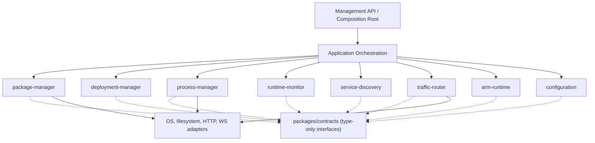
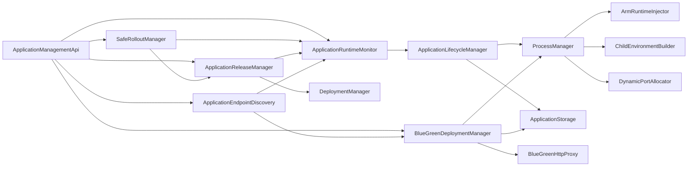

# Phase R1 — Module Boundaries & Contracts

**Status:** Architecture baseline established; behavior-preserving, no file moves or runtime wiring.  
**Base branch:** `arm-supervisor`  
**Reviewed HEAD:** `674c620c59f161bb5882fe3e09aeefa638ae9f0c`  
**Related baseline:** [ARM_SUPERVISOR_ARCHITECTURE_CHECKPOINT.md](./ARM_SUPERVISOR_ARCHITECTURE_CHECKPOINT.md)  
**Standards:** [CODING_STANDARDS.md](./CODING_STANDARDS.md) — Intent-Revealing Methods, Extract Method.

## 1. Why Phase R1 exists

Currently, `packages/adapter-process` hosts deployment orchestration, process spawning, dynamic port allocation, monitoring, HTTP management, registration, rollout, and Blue/Green. A package named after an *adapter* contains numerous independent *domain capabilities*. Many components import one another's concrete classes, increasing the cost and risk of changing process lifecycle and deployment workflows.

**The goal of R1 is explicit boundaries, data ownership, public contracts, an inventory of existing coupling, and an incremental migration path.** Do not move or rewrite implementations in this phase. Current tests and persisted process/release files must retain their behavior.

The interfaces in `packages/contracts/src/index.ts` are **proposed future ports**. They are not automatically implemented by existing classes, are not yet injected into runtime and are not a replacement for the current APIs.

## 2. Target modular monolith



**Not a microservice plan:** These modules execute in one Supervisor deployment at first. Contracts can later support distributed implementations, but process ownership and failure semantics must not be hidden behind a network abstraction prematurely.

## 3. Module ownership table

| Module | Owns (single writer) | Public capability | Existing implementation files (current location) |
|---|---|---|---|
| **package-manager** | Immutable installed release contents / installation receipts | `PackageCatalog` + ZIP installation service | `deployment/deployment-manager.ts`, `application-installer.ts`, `application-package-extractor.ts`, `application-package-validator.ts`, `application-storage.ts`, `deployment-types.ts` |
| **process-manager** | Process PID, start identity, assigned port, signals, process-registry files | `ProcessController` | `process-manager.ts`, `dynamic-port-allocator.ts` |
| **runtime-monitor** | Desired RUNNING/STOPPED, restart attempts, recovery state, last exit | `RuntimeStatusReader`, recovery commands | `application-runtime-monitor.ts`, `runtime-state-store.ts` |
| **deployment-manager** | Active release selection, audit/history, rollback/rollout journal | `ReleaseSelector`, rollout coordinator | `application-lifecycle-manager.ts` (part), `application-release-manager.ts`, `release-history-store.ts`, `safe-rollout-manager.ts`, `rollout-journal.ts`, `deployment-audit-log.ts` |
| **traffic-router** | Public proxy target, traffic switch, draining, route state | `TrafficRouter` | `blue-green-http-proxy.ts`, routing portion of `blue-green-deployment-manager.ts` |
| **service-discovery** | Advertised reachable HTTP endpoints, registration lease/state and peer lookup | `EndpointDirectory` | `application-endpoint-discovery.ts`, `application-registry.ts`, `application-registration-server.ts` (HTTP adapter), `remote-arm-metrics-collector.ts` (telemetry-facing integration) |
| **arm-runtime** | SDK bootstrapping, in-process telemetry, component health/metrics | `TelemetryReader`, runtime bootstrapping | `arm-runtime-injector.ts`, `arm-telemetry-reader.ts`, `runtime/bootstrap.mjs`, `runtime/bridge-bootstrap.mjs`, `packages/library`, `packages/core`, `packages/adapter-http` |
| **configuration** | Operator application config, environment merging/validation, runtime policy | `ApplicationConfigurationReader`, `ChildEnvironmentPolicy` | `application-configuration-store.ts`, `child-environment-builder.ts`, root `.env` |
| **application-orchestration** (host responsibility) | Multi-step application commands and mutual exclusion | Application commands; no resource ownership | Coordination currently split across `application-lifecycle-manager.ts`, `application-management-api.ts`, `safe-rollout-manager.ts`, `blue-green-deployment-manager.ts` |

`ApplicationStorage` currently contains filesystem details used by multiple capabilities. In R2–R4, split it into ports with explicit owners rather than creating a global "storage service" that owns all data.

## 4. Data ownership, cross-module access and invariants

| Durable state | Authorized writer | Readers | Rule |
|---|---|---|---|
| `state/processes.json`, `state/blue-green-processes.json` | Process module | Monitoring, deployment via process port | Never edit PID file from deployment |
| `applications/<id>/active.json` | Deployment/release module | Orchestrator, runtime monitor | Release activation must not implicitly spawn OS process |
| `applications/<id>/rollout.json` | Deployment/rollout module | Orchestrator, operator | Persist before externally visible transition |
| `applications/<id>/blue-green.json` | Traffic/deployment coordinator (single current owner until split) | Discovery, proxy | Route only to verified, healthy target |
| `applications/<id>/application-config.json` | Configuration module / operator | Process/deployment via config reader | Runtime-only reserved env remains Supervisor-owned |
| Runtime desired/recovery JSON | Runtime-monitor module | Application orchestrator | Process liveness and readiness are different |
| `telemetry/<id>.json` | ARM injection | Telemetry reader | Timestamp is not evidence of current liveness |
| ARM SDK registration leases | Service-discovery module | Monitoring/telemetry | Registration cannot control OS PIDs |

**Lock/ownership rule:** Only one high-level operation (manual restart, recovery, rollout, Blue/Green candidate transition) may own a given application command at a time. Current code contains several independent locks; R1 does not claim they form a global transaction. Future application-orchestration must coordinate them.

## 5. Existing concrete dependencies (confirmed from current source imports)



### Coupling hotspots and R2–R5 remedies

| Actual dependency | Why it matters | Planned contract / migration |
|---|---|---|
| `ApplicationManagementApi → ApplicationRuntimeMonitor` concrete | HTTP adapter knows operation implementation | Application command/query port |
| `SafeRolloutManager → RuntimeMonitor + ReleaseManager` concrete | Rollout needs lock coordination, not private class details | `ProcessController`, `ReleaseSelector`, `RuntimeStatusReader` and orchestration gate |
| `ApplicationReleaseManager → RuntimeMonitor` | Release activation tied to process operations | Explicit release selection vs process command boundary |
| `ApplicationEndpointDiscovery → RuntimeMonitor + BlueGreenManager` | Query reads internal deployment/proxy state | `EndpointDirectory` backed by process snapshot + routing snapshot |
| `ProcessManager → ArmRuntimeInjector` | OS process adapter depends on ARM-specific implementation | Preload/launch argument provider interface |
| `BlueGreenManager → ProcessManager + Storage + Proxy` | Deployment strategy couples three resource owners | Coordinated use of `ProcessController`, `PackageCatalog`, `TrafficRouter` |
| `packages/library → core + adapter-http` | SDK has direct workspace source imports | Publish/lock versioned ARM client SDK package in R5 |

**Interpretation:** An arrow above is an *existing import dependency*, not necessarily a desirable runtime network connection.

## 6. Public contracts — R1 source

`packages/contracts/src/index.ts` declares proposed, implementation-free TypeScript interfaces:

| Contract | Module provider | Intended consumers |
|---|---|---|
| `ProcessController` | Process | Orchestrator, rollout, Blue/Green coordinator |
| `PackageCatalog` | Package management | Deployment, release selector |
| `ReleaseSelector` | Deployment | Orchestrator, rollout |
| `RuntimeStatusReader` | Runtime monitoring | API, rollout, operator |
| `EndpointDirectory` | Discovery | Application HTTP adapter, orchestration |
| `TrafficRouter` | Traffic routing | Blue/Green coordinator |
| `ApplicationConfigurationReader` | Configuration | Process specification builder |
| `ChildEnvironmentPolicy` | Configuration | Process adapter |
| `TelemetryReader` | ARM Runtime | API, telemetry processing |
| `DomainEventPublisher` + `DomainEventMap` | Platform event infrastructure | Notifications after state transitions |

**Contract rules:**
1. Contracts expose DTOs, **not** Node `ChildProcess`, `Server`, filesystem handles, concrete manager classes or app ZIP internals.
2. No import from implementation packages in `packages/contracts`.
3. The contract version is additive by default: changing names/semantics requires explicit migration and tests.
4. No implicit business readiness: endpoint `ASSIGNED`, `BOUND`, `READY` are distinct future contract states; **current implementation does not yet report bound confirmation**.
5. Prefer explicit command `Promise` result for operations; domain events are **post-fact notifications**, not command substitutes.
6. A new consumer may depend on contracts, not private imports from another module.
7. Do **not** bulk-implement contract interfaces by casting concrete classes. First write adapters and contract tests that prove semantics match (including process restart/adoption, port changes and failure handling).

## 7. Domain event policy (future)

```mermaid
sequenceDiagram
  participant O as Application Orchestrator
  participant P as ProcessController
  participant DB as Process State Store
  participant E as Domain Event Publisher
  participant D as Endpoint Directory
  O->>P: start(request)
  P->>DB: Persist verified process state
  P-->>O: ProcessInstance
  P->>E: process.started (post-commit)
  E-->>D: Subscriber notification
  Note over E,D: Re-read authoritative state; events may be duplicated or lost
```

Suggested events are declared in `DomainEventMap`: `process.started`, `process.exited`, `endpoint.changed`, `release.activated`, `rollout.finished`.

In-memory event delivery provides neither durable replay nor exactly-once guarantees. Subscribers should reconcile from the authoritative module, not infer truth only from event delivery. A durable outbox may be needed in later phases.

## 8. Dependency rules for new code

**Allowed direction:**

```text
apps/supervisor (composition root) → concrete module entrypoints
HTTP adapters → application command/query ports
orchestration → contracts (module ports)
domain modules → contracts and own internal code
infrastructure adapters → contracts / domain DTOs
contracts → no implementation module
```

Forbidden for **new** code:
- Cross-module `../other-module/src/private-file` imports.
- Importing `ApplicationManagementApi` inside any domain module.
- Importing Node process internals into contracts.
- Domain modules reading/writing another module's durable JSON paths directly.
- Any implementation-to-implementation cycle that bypasses contracts.
- Adding direct singleton `PORT` assumptions to discovery/deployment logic.

**Legacy exemption:** The existing imports illustrated above are grandfathered *only* until their migration milestone; they are not patterns to copy.

## 9. Architectural decision records (R1)

### ADR-R1-001 — Modular Monolith First
**Decision:** one Supervisor deployment, many independent modules with public ports.  
**Reason:** local OS process ownership, durable lifecycle and traffic switching require tight coordination; microservices add failure modes prematurely.  
**Consequence:** strict dependency contracts even before physical package extraction.

### ADR-R1-002 — Single Writer for Durable State
**Decision:** each state group has one authoritative module.  
**Reason:** avoid conflicting writes and restart reconciliation ambiguity.  
**Consequence:** other modules use ports to command/read, not file paths.

### ADR-R1-003 — Contract First, Migrate Incrementally
**Decision:** introduce `packages/contracts/src/index.ts` as a future port catalog without immediately rewiring active code.  
**Reason:** Phase 1–9 state format, API contracts and PID adoption must remain stable.  
**Consequence:** contracts require R2+ adapters before production use.

### ADR-R1-004 — Commands vs Events
**Decision:** explicit typed operations for lifecycle actions; events after authoritative state changes.  
**Reason:** reliable rollback and safety require confirmed execution.  
**Consequence:** events alone cannot switch traffic or mark a process healthy.

## 10. Migration phases and exit criteria

| Phase | Scope | Completion evidence |
|---|---|---|
| **R1 (this checkpoint)** | Ownership, dependency map, contract catalog, ADRs, architecture test | Documentation + type-checkable contracts, legacy code unchanged |
| R2 | Isolate process manager, port allocation, env builder and OS adapter | New process contract adapter + lifecycle/adoption/dynamic port integration tests |
| R3 | Package & release management separation | ZIP, activate, rollback and journal regression tests |
| R4 | Monitoring, service discovery, HTTP routing extraction | Recovery / Blue-Green / discovery integration and contract tests |
| R5 | Versioned ARM SDK + telemetry bridge | Source/build compatibility, SDK startup and WS metrics tests |
| R6 | Composition root, DI, dependency enforcement | No undesired cycles, contract conformance, smoke tests and restart tests |

**R1 acceptance checklist**
- [x] Enumerated module ownership / data owner.
- [x] Mapped high-coupling import edges from current HEAD.
- [x] Introduced proposed public TypeScript contracts.
- [x] Defined allowed import direction and legacy exemptions.
- [x] Recorded four ADRs and migration milestones.
- [ ] `npm run build` and `npm test` executed successfully locally/CI — **not verified**.
- [ ] All target modules extracted — deliberately deferred.

## 11. Change policy for future agents / contributors

1. Read `docs/ARM_SUPERVISOR_ARCHITECTURE_CHECKPOINT.md`, this R1 file and `docs/CODING_STANDARDS.md`.
2. Fetch current HEAD before editing; R1's HEAD is a frozen snapshot, not a claim about future source.
3. State the **owning module** and **affected contracts** in each change.
4. Use Intent-Revealing Methods and Extract Method; avoid orchestrators that hide side effects.
5. For every state transition, specify its authoritative writer, persistence, event and recovery implications.
6. New modules must have isolated unit tests plus cross-boundary contract tests. Do not assume TS structural assignability proves runtime semantics.
7. No renames/changes to public REST routes or persisted formats during an internal refactor without compatibility plan.
8. Document any new dependency arrow and why the chosen boundary is justified.

## 12. Next action

**Proceed to R2** by implementing a `ProcessController` adapter around the current `ProcessManager`, starting with its public API, process identity and dynamic endpoint contract tests. Only after adapter tests pass, move source into a dedicated package and update imports one consumer at a time.

*Phase R1 deliberately does not alter process spawn, recovery, dynamic port allocation, deployment or network routing behavior.*
