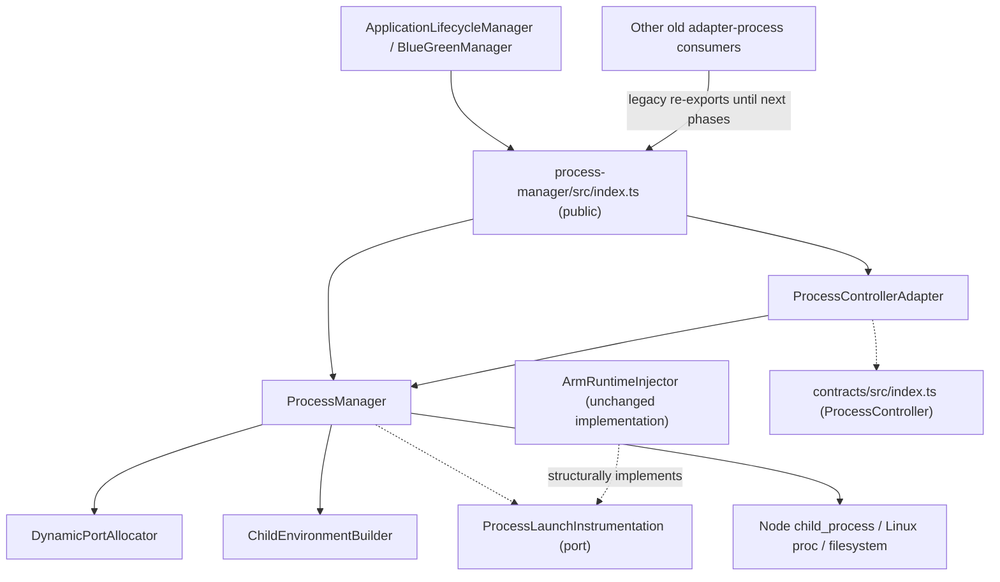

# Phase R2 — Process Management Extraction

**Branch:** `arm-supervisor`  
**Baseline (R1 HEAD):** `146847d370d8eecd82ad65a8849fb36bddb42d4f`  
**Status:** Source extraction + first contract adapter. **Build and test execution not independently verified**.

## 1. Why R2 exists

Phase R1 identified `ProcessManager` as a cross-domain implementation inside the broad `packages/adapter-process` package. The process module must own OS process identity, spawn/stop/restart, detached-process PID adoption, and persistent HTTP port assignments. Deployment orchestration, business health, ARM SDK instrumentation and HTTP routing must not become hard dependencies of the OS process module.

**R2 moves the actual implementation to `packages/process-manager` while preserving the old imports as strict compatibility re-exports.** This is a package boundary, not a new independent process or microservice.

## 2. Directory after extraction

```text
packages/
├── contracts/
│   └── src/index.ts             # R1 ProcessController and ProcessInstance
├── process-manager/
│   ├── package.json             # npm workspace package @arm/process-manager
│   └── src/
│       ├── index.ts             # public package entrypoint
│       ├── process-manager.ts   # durable OS process lifecycle
│       ├── process-controller-adapter.ts
│       ├── process-launch-instrumentation.ts
│       ├── child-environment-builder.ts
│       └── dynamic-port-allocator.ts
└── adapter-process/src/
    ├── process-manager.ts       # compatibility export
    ├── child-environment-builder.ts
    └── dynamic-port-allocator.ts
```

**No duplicate implementation:** Each old adapter-process file re-exports the moved implementation. Legacy tests and imports still resolve to the **same** class object.

## 3. Ownership and dependency direction



**Important:** `ProcessManager` no longer imports concrete `ArmRuntimeInjector`. Its constructor accepts `ProcessLaunchInstrumentation`, a type-only port with `nodeArguments()` and `environment()`. Existing `ArmRuntimeInjector` matches that port structurally. This removes the previously identified process→ARM concrete import without requiring changes to the injection code or SDK module location.

`ChildEnvironmentBuilder` remains physically colocated with process spawn for R2 safety. R1 assigns application configuration policy to the configuration domain; moving the policy behind an independent `ChildEnvironmentPolicy` adapter is a subsequent extraction, not silently completed here.

## 4. ProcessControllerAdapter — R1 contract mapping

The new `ProcessControllerAdapter` implements the R1 interface without changing ProcessManager's original method signatures.

| ProcessController | Legacy implementation | Notes |
|---|---|---|
| `start(ProcessLaunchRequest)` | `registerSpec()` + `start(id)` + `inspect(id)` | Requires initialized ProcessManager |
| `stop(instanceId)` | `stop(id)` | Existing SIGTERM behavior |
| `restart(instanceId)` | `restart(id)` + `inspect(id)` | Existing timeout behavior and port reassignment |
| `inspect(instanceId)` | `inspect(id)` | Uses OS verification and current port |

`ProcessLaunchRequest.applicationId` maps to `ARM_APPLICATION_ID`.
`ProcessLaunchRequest.instanceId` maps to ProcessSpec.id and `ARM_INSTANCE_ID`.
`arguments` maps to `args`; application vs runtime environment is kept separate and process identity always takes precedence.

The adapter only exposes `endpoint.state = "ASSIGNED"` when a port exists. **It does not claim BOUND or READY:** the process module probes a candidate port, but the Node application has not necessarily bound it when `start()` resolves. Actual HTTP readiness is currently handled by other modules.

`ProcessInstance.startedAt` is populated for `start` and `restart`; `inspect` does not currently expose this field because the underlying `ProcessView` omits it. R1 declared this property optional.

## 5. Compatibility rules

- Existing imports through `packages/adapter-process/src/process-manager.js` are preserved.
- `ApplicationLifecycleManager` and `BlueGreenDeploymentManager` now consume the new package's **public index** instead of the legacy path.
- `examples/supervisor/src/index.ts` uses the public entrypoint.
- No migration of the process state file location, PID identity format, dynamic allocation algorithm or signal semantics.
- `ArmRuntimeInjector` remains under `adapter-process` for now; it is injected at the composition site.
- No new error-handling or startup logging behavior is implied by this refactor.

### Runtime compatibility promise

This refactor does not change:
- `ProcessSpec` shape used by existing modules.
- Constructor arguments `new ProcessManager(stateFile, injector?, environmentBuilder?)`.
- `initialize / registerSpec / start / stop / restart / inspect / reconcile / restoreEndpoint / close`.
- The two durable process registry files.
- Linux PID start-time verification and detached child survival during Supervisor restart.
- Allocated `PORT`, `HOST`, `ARM_* `and `applicationEnv` merge precedence.

If behavior changes are needed, implement them in a distinct commit with explicit regression tests.

## 6. Contract and architecture tests

New tests:

- `tests/process-controller-r2.test.ts`: old/new class identity, start/inspect/restart/stop, fixed vs dynamic HTTP port, environment mapping and no management-token inheritance, Linux durable adoption, and structural launch instrumentation.
- `tests/process-module-boundaries-r2.test.ts`: boundary dependency, re-export shims, and public API exports.

Existing relevant regression suites remain unchanged:

- `tests/process-supervisor.test.ts`
- `tests/child-environment-builder.test.ts`
- `tests/dynamic-child-ports.test.ts`
- `tests/dynamic-blue-green.test.ts`
- `tests/arm-runtime-injection-phase8.test.ts`
- `tests/arm-client-bridge-phase9.test.ts`
- `tests/application-runtime-phase3.test.ts`
- `tests/application-runtime-phase4.test.ts`
- `tests/safe-rollout-phase6.test.ts`

### Local verification commands

```bash
git switch arm-supervisor
git pull origin arm-supervisor
npm install
npm run build
npm test
```

**Verification status:** GitHub source changes and push can be verified remotely. The build and tests cannot be claimed as passing without executing them. Test failures should block promotion to a production release.

## 7. Known follow-up work and risks

1. **Port binding race is unchanged:** PortAllocator releases the OS probe socket before child binds. The adapter reports ASSIGNED, not READY.
2. **Process stdout/stderr is ignored** (`stdio: 'ignore'`). Improving diagnostics requires a separate behavior change and tests.
3. **Shared static in-memory port claim set** is a single-runtime guard, not a distributed lease. A multi-Supervisor deployment needs ownership coordination.
4. **ProcessControllerAdapter is opt-in:** legacy callers still use ProcessManager directly; migration to the ProcessController port belongs to later orchestrator phases.
5. **In-process adapter dependency on the public contract types** is compile-time only; it does not add network overhead.
6. **Type-only instrumentation compatibility is structural:** ARM SDK injector integration must be covered by Phase 8/9 regression tests.
7. **No changes to durable file versions**, active release selection or HTTP API shape; old state must remain readable.

## 8. Next steps

After successful local tests, R2 can be considered migration-ready. Proceed to R3 Package & Deployment Extraction with the same pattern: public interfaces, implementation package, temporary legacy re-exports, integration tests, and unchanged persisted state.

**Coding standards:** Keep methods intention-revealing, extract coordination steps when they become nontrivial, and preserve contract behavior during refactors. See [CODING_STANDARDS.md](./CODING_STANDARDS.md).
