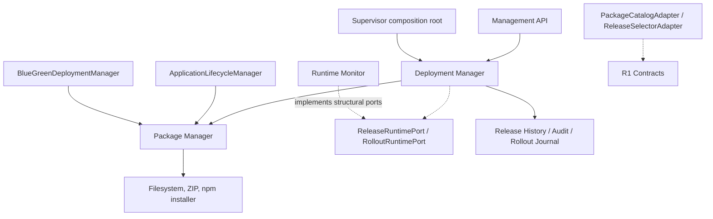
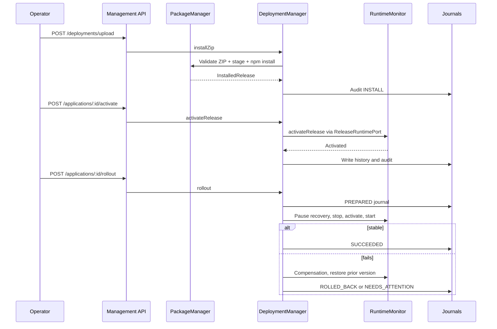

# Phase R3 — Package & Deployment Extraction

**Branch:** `arm-supervisor`  
**Baseline:** Phase R2, commit `69ae60616b0a227b6a31170d838861b7cda277ef`  
**Status:** Source extraction + public contract adapters. Build/tests require execution before acceptance.

## Purpose

Phase R3 separates the **immutable package installation boundary** from the **active release and rollout boundary**. Existing code under `packages/adapter-process` mixed ZIP extraction, npm installation, release history, audit and rollout with runtime coordination.

This is a structural refactor. **Do not change installed ZIP format, release metadata, API paths, rollback semantics, process state or port assignment.**

## New packages

```text
packages/
  package-manager/
    package.json
    src/
      index.ts
      deployment-manager.ts
      deployment-types.ts
      application-storage.ts
      application-package-validator.ts
      application-package-extractor.ts
      application-installer.ts
      package-catalog-adapter.ts
  deployment-manager/
    package.json
    src/
      index.ts
      application-release-manager.ts
      release-history-store.ts
      deployment-audit-log.ts
      rollout-journal.ts
      safe-rollout-manager.ts
      release-selector-adapter.ts
      runtime-ports.ts
  adapter-process/src/
    deployment/*.ts              # backward-compatible re-exports
    application-release-manager.ts
    release-history-store.ts
    deployment-audit-log.ts
    rollout-journal.ts
    safe-rollout-manager.ts      # backward-compatible re-exports
```

## Ownership

| Owner | Owns | Exposed boundary |
|---|---|---|
| Package Management | ZIP validation, staging, `npm ci`, checksum, immutable installed release, `.deployment.json` | `DeploymentManager`, `ApplicationStorage`, `PackageCatalogAdapter` |
| Deployment Management | Active release transition coordination, history, audit, safe rollout compensation and journal | `ApplicationReleaseManager`, `SafeRolloutManager`, `ReleaseSelectorAdapter`, `ReleaseRuntimePort`, `RolloutRuntimePort` |
| Process Management (R2) | OS process and PID identity | Existing `ProcessManager` |
| Runtime Monitor (R4) | Desired RUNNING state, backoff, readiness | Supplied through structural ports, not imported |
| Application Lifecycle (interim) | `active.json` release selection plus process handoff | Remains in `adapter-process` until later orchestration extraction |

**R3 limitation:** `ApplicationLifecycleManager` currently writes `active.json`. Full single-writer consolidation of that file and an orchestrator contract will follow the R4/R6 refactor. We preserve the actual writer now instead of duplicating it in the new package.

## Dependency diagram



The new `package-manager` has **no imports from `deployment-manager`, `adapter-process`, `runtime-monitor` or `process-manager`**. The new `deployment-manager` consumes package-manager and structural runtime ports.

## R1 contract implementations

### PackageCatalogAdapter

Implements `PackageCatalog.getRelease()` and `listReleases()` by reading `ApplicationStorage`. Maps full `InstalledRelease` into `ReleaseDescriptor`; this adapter is read-only and never runs npm/install commands.

### ReleaseSelectorAdapter

Implements `ReleaseSelector.activeRelease()` and `activate()`. Active selection is read from the runtime lifecycle port, and an activation call delegates to `ApplicationReleaseManager.activateRelease()`, preserving its stop-before-switch enforcement and audit/history behavior.

### Runtime ports

`ReleaseRuntimePort` exposes activation and current lifecycle release listings.

`RolloutRuntimePort` exposes pause/resume recovery, inspect, start and stop.

`ReleaseOperationsPort` exposes minimal release lookup, audit append and activation operations used by safe rollout.

These are **structural interfaces**, so the existing `ApplicationRuntimeMonitor` and `ApplicationReleaseManager` satisfy them without needing to import either concrete class into the new module.

No changes to HTTP routes or customer-facing Management API semantics.

## Workflow



## Durable storage — unchanged

```text
supervisor-data/
  applications/<applicationId>/
    active.json
    releases/<version>/.deployment.json
    rollout.json
    blue-green.json
  ...
```

Release history and audit paths remain unchanged as implemented in `ReleaseHistoryStore` and `DeploymentAuditLog`. No schema migrations were performed. The new modules use the same root.

**Backward compatibility:** Every old path now uses `export * from` to the new sole implementation. Existing call sites that depend on prior modules must remain compatible. New code should import `packages/package-manager/src/index.js` or `packages/deployment-manager/src/index.js`.

## Tests and verification

New tests:
- `tests/package-deployment-contracts-r3.test.ts`: old/new class identity, `PackageCatalog`, `ReleaseSelector`, activation/rollback/audit, persistence paths.
- `tests/package-deployment-boundaries-r3.test.ts`: implementation ownership, no direct concrete monitor import, legacy re-exports and public entrypoints.

Existing regression suites retained:
- `tests/deployment-phase1.test.ts` (ZIP safety and immutable versions)
- `tests/application-lifecycle-phase2.test.ts`
- `tests/application-release-phase5.test.ts` (release history, rollback, HTTP upload)
- `tests/safe-rollout-phase6.test.ts` (failure compensation and replay)
- `tests/blue-green-phase7.test.ts` (release/route persistence)

Commands:

```bash
git switch arm-supervisor
git pull origin arm-supervisor
npm install
npm run build
npm test
```

**Verification status:** GitHub file presence and source dependency direction can be checked remotely. Successful build, tests and runtime integration are **not claimed** without execution.

## Open risks and follow-up

1. R3 does not change the existing rollout saga or solve cross-module application command locking.
2. `ApplicationLifecycleManager` still combines active release selection with process handoff; split it after safe inter-module orchestration is established.
3. Package installer still uses Node `spawn('npm')` and inherits Supervisor environment. It is a separate security-hardening task from R3 and should not be misrepresented as solved.
4. File-based history/journal persistence remains independent, not a multi-file transaction.
5. Only R1 `PackageCatalog` and `ReleaseSelector` contracts have adapters. Other R1 contracts migrate in R4–R6.
6. Run all tests before promoting to production and inspect any compilation failures.

## Next checkpoint

**Phase R4 — Monitoring, Discovery & Routing Extraction:** introduce typed runtime/discovery/proxy boundaries, preserve the recovery and Blue/Green state files, and migrate their dependencies incrementally. Keep application orchestration and single-writer active release consolidation as explicit design decisions.
