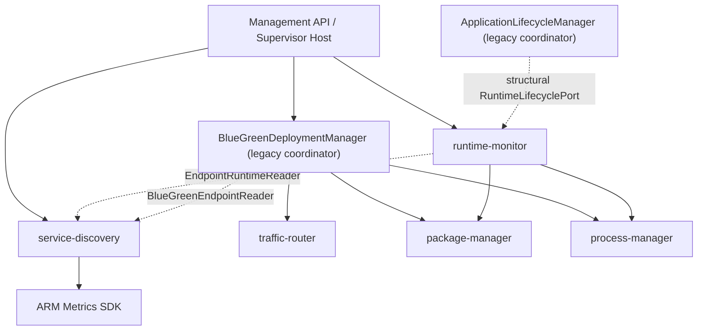
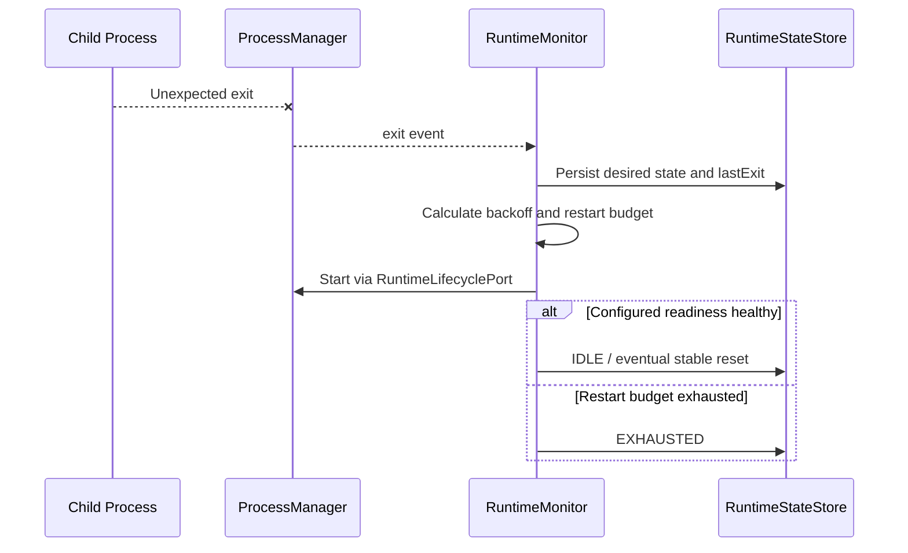
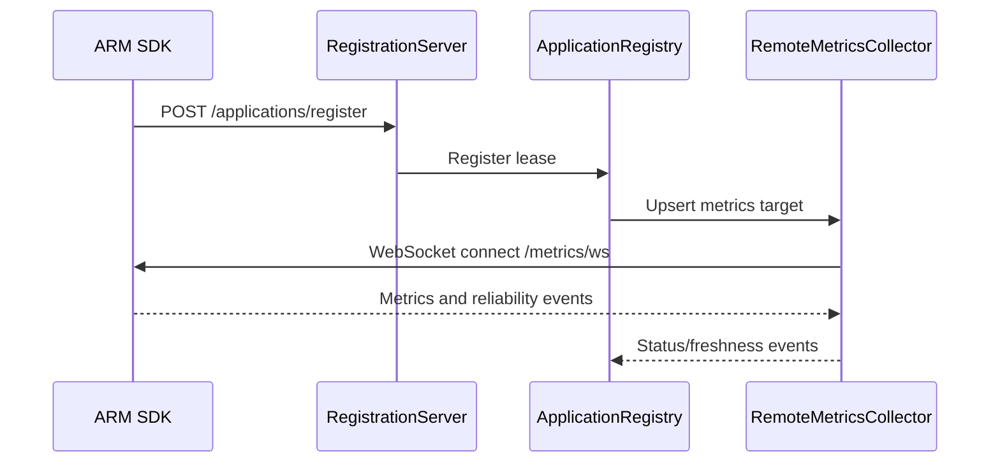
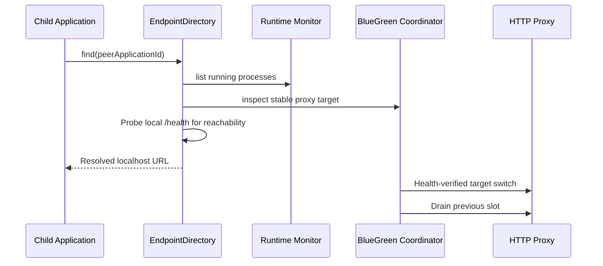

# Phase R4 — Monitoring, Discovery & Routing Extraction

**Branch:** `arm-supervisor`  
**Baseline:** R3 HEAD `b2f0b98976b52944e0fbb3b6864a15883e08c821`  
**Status:** Extracted source and R1 adapters; local `npm run build` and `npm test` not yet verified.

## 1. Goal and boundaries

R4 separates three capabilities that previously lived together in `packages/adapter-process`:

| New package | Owns | Does not own |
|---|---|---|
| `@arm/runtime-monitor` | Desired RUNNING/STOPPED, recovery policy, attempts, persisted runtime state, readiness monitoring | OS PID state, ZIP install, public proxy |
| `@arm/service-discovery` | ARM registration lease, metrics collector, reachable HTTP endpoint lookup | Starting child processes, Blue/Green candidate activation |
| `@arm/traffic-router` | HTTP proxy forwarding, active target selection and request draining | Release selection, PID process state, health-check policy |

The existing `BlueGreenDeploymentManager` stays in `adapter-process` as a **multi-module coordinator** until the R6 application-orchestration extraction. Its HTTP proxy is now imported from `@arm/traffic-router`.

## 2. Package source structure

```text
packages/
  runtime-monitor/
    package.json
    src/
      index.ts
      application-runtime-monitor.ts
      runtime-state-store.ts
      runtime-lifecycle-port.ts
  service-discovery/
    package.json
    src/
      index.ts
      application-endpoint-discovery.ts
      endpoint-reader-ports.ts
      endpoint-directory-adapter.ts
      application-registry.ts
      remote-arm-metrics-collector.ts
      application-registration-server.ts
      application-registration-client.ts
  traffic-router/
    package.json
    src/
      index.ts
      blue-green-http-proxy.ts
      traffic-router-adapter.ts
```

All eight original `adapter-process/src/*.ts` paths remain compatibility re-exports, not duplicate source. Other modules are incrementally updated to import the new public `index.ts` entrypoints.

## 3. Dependencies and ownership



**Structural ports:**
- `RuntimeLifecyclePort`: declared in `runtime-monitor/src/runtime-lifecycle-port.ts`. Existing `ApplicationLifecycleManager` satisfies it without being imported.
- `EndpointRuntimeReader`: minimum status list required by HTTP discovery.
- `BlueGreenEndpointReader`: minimum Blue/Green route/public port metadata needed to publish its stable proxy endpoint.

Contracts are typed read/command boundaries, not event-driven eventual consistency. No request uses a new network hop due to the package extraction.

## 4. R1 adapters implemented

**`EndpointDirectoryAdapter`** implements `EndpointDirectory` with `find` and `list`. It only projects endpoints considered reachable by `ApplicationEndpointDiscovery`. It does not claim service identity, business readiness or cross-host availability.

**`BlueGreenTrafficRouterAdapter`** implements `TrafficRouter` for *one application ID and one proxy*. Its `activate` requires a `blue` or `green` instance ID and a loopback target, its `current` describes the current backend target, and `drain` waits for requests in the **previous slot** following a switch. The orchestrator is responsible for checking candidate health *before* calling `activate`. It does not move `BlueGreenDeploymentManager`'s existing route orchestration to the contract yet.

The R1 `TrafficRouter` contract cannot fully model a post-restart previous-slot drain without separate persisted routing history. The legacy manager continues to own that logic and state.

## 5. Workflows (behavior unchanged)

### Process crash and recovery



### Registration and metrics discovery



### HTTP endpoint lookup and Blue/Green



## 6. Compatibility invariants

- Runtime state: same filenames and `schemaVersion: 1`; preserve desired/recovery/restart semantics.
- Process state: still exclusively owned by R2 `ProcessManager`.
- Registration: same `/applications/register`, `/applications/unregister`, metrics-WS flow and auth handling.
- Discovery API: same `GET /runtime/endpoints`, `GET /runtime/endpoints/:id`.
- Blue/Green: same stable proxy port, slot journal, traffic switching, request draining and restoration.
- Existing `ApplicationManagementApi` paths unchanged.
- Existing `ArmRuntimeInjector` implementation not moved; Phase R5 owns SDK consolidation.
- Compatibility paths remain re-export shims. Do not delete them until migrated callers and regression tests pass.

## 7. Tests and verification

New tests:

- `tests/monitoring-discovery-routing-r4.test.ts`: class identity via legacy imports; desired state persistence using `RuntimeLifecyclePort`; endpoint directory listing; active Blue/Green proxy switching and drain.
- `tests/monitoring-discovery-routing-boundaries-r4.test.ts`: no duplicate implementation; avoid concrete lifecycle/deployment imports; public module exports.

Existing regression suites retained:

- `tests/application-runtime-phase3.test.ts` and `application-runtime-phase4.test.ts`
- `tests/application-discovery.test.ts` and `dynamic-registration.test.ts`
- `tests/endpoint-discovery-auth.test.ts`
- `tests/blue-green-phase7.test.ts` and `dynamic-blue-green.test.ts`
- `tests/safe-rollout-phase6.test.ts`

Commands:

```bash
git switch arm-supervisor
git pull origin arm-supervisor
npm install
npm run build
npm test
```

**Do not mark R4 production-verified until these commands pass.**

## 8. Deliberate deferrals and risks

1. `BlueGreenDeploymentManager` is still a coordinator; relocating it into routing would wrongly conflate deployment and forwarding.
2. `ApplicationRuntimeMonitor` still calls lifecycle commands via a port; true single-writer application-operation arbitration is R6.
3. `EndpointDirectoryAdapter` is a live query mapping, not persistent DNS or service mesh; singleton port can change after restart.
4. HTTP reachability does not prove business readiness or the cryptographic identity of the process that answered.
5. Proxy forwards HTTP/1.1 requests; no automatic WebSocket/SSE migration.
6. Metrics collector uses WebSocket to the child SDK; this must not be interpreted as OS process liveness.
7. No change to Phase 9 fixed metrics-base-port policy.
8. All module changes require full compile/test execution before a release.

## 9. Next phase

**R5 — ARM Runtime & SDK Consolidation:** reconcile `packages/core`, `packages/library`, `packages/adapter-http`, Phase 8 preload and Phase 9 bridge with versioned entrypoints and explicit runtime ownership.

Follow `docs/CODING_STANDARDS.md`: Intent-Revealing Methods, Extract Method, safe type guards and minimal orchestration methods.
