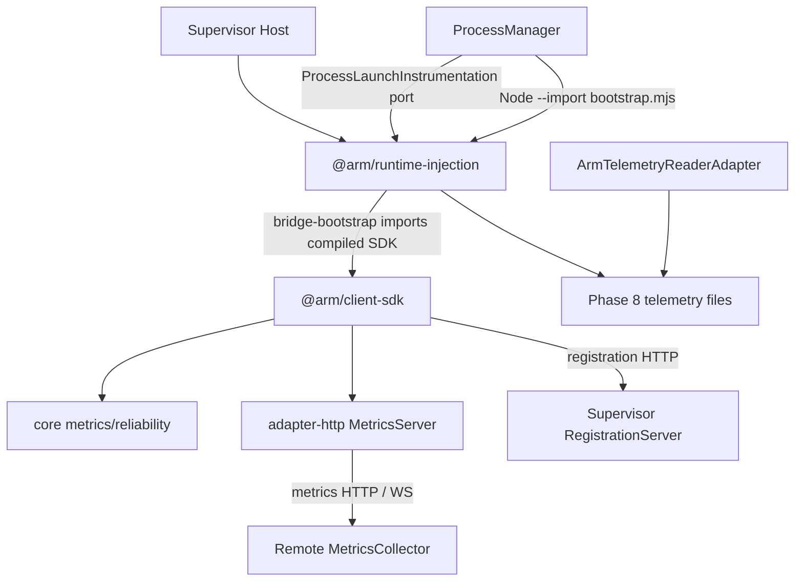
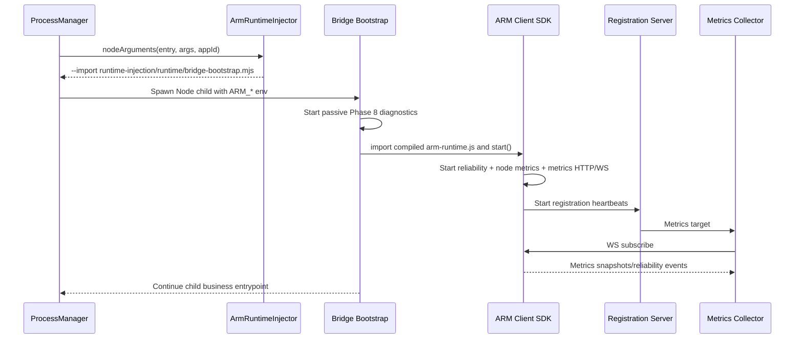
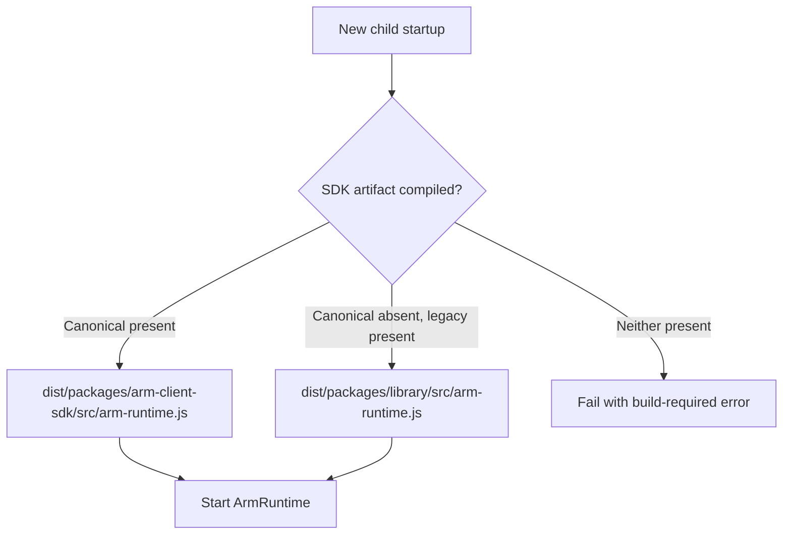

# Phase R5 — ARM Runtime & SDK Consolidation

**Branch:** `arm-supervisor`  
**Source baseline:** R4 fixes, commit `aab329458c0b37f585b959a5b91d5434cf9b3eba`  
**Status:** Source/package extraction implemented; local build and full integration tests not yet executed.

## 1. Why this phase exists

ARM has two separate runtime mechanisms:
1. **ARM Client SDK** is embedded in a Node.js application and manages `ReliabilityManager`, `NodeMetricsCollector`, `MetricsServer` and optional registration to Supervisor.
2. **Supervisor-owned runtime injection** preloads `bootstrap.mjs` for passive telemetry (Phase 8) and `bridge-bootstrap.mjs` for automatic SDK initialization (Phase 9).

Previously the SDK implementation lived in `packages/library`, its metrics/reliability implementations in `packages/core` and `packages/adapter-http`, and injection artifacts in `packages/adapter-process`. These source paths and their dist layout were easy to confuse with stable public APIs.

**Decision:** Make the SDK and injection boundaries explicit using two npm workspace packages. Keep the legacy imports and compiled Phase 9 SDK artifact working during migration.

## 2. New package ownership

| New package | Owns | Does NOT own |
|---|---|---|
| `@arm/client-sdk` | `ArmRuntime`, `createArmRuntime`, registration client, SDK public facade | Supervisor process management, deployment orchestration |
| `@arm/runtime-injection` | `ArmRuntimeInjector`, Phase 8/9 preloads, raw telemetry reader, `TelemetryReader` adapter | Business dependency health, HTTP/WS service discovery |
| `packages/core` (internal) | Metrics/reliability domain primitives consumed by SDK | External public SDK packaging |
| `packages/adapter-http` (internal) | MetricsServer HTTP/WS transport consumed by SDK | ARM runtime lifecycle |
| `packages/library` (compatibility) | Legacy re-exports and legacy compiled artifact path | Duplicate SDK implementation |

This is a **module boundary and source move**, not conversion to standalone services or a published npm library.

## 3. Source layout

```text
packages/
  arm-client-sdk/
    package.json                     # @arm/client-sdk 0.1.0 (private)
    src/
      index.ts                       # canonical public SDK exports
      arm-runtime.ts                 # moved ARM SDK implementation
      application-registration-client.ts

  runtime-injection/
    package.json                     # @arm/runtime-injection 0.1.0 (private)
    src/
      index.ts
      arm-runtime-injector.ts
      arm-telemetry-reader.ts
      telemetry-reader-adapter.ts
    runtime/
      bootstrap.mjs
      bridge-bootstrap.mjs

  core/                               # internal metrics/reliability implementation
  adapter-http/                       # internal MetricsServer
  library/src/                        # compatibility re-exports
  adapter-process/src/                # compatibility injector/telemetry re-exports
  adapter-process/runtime/            # legacy preload artifact retained
```

## 4. Connection topology



**Important:** The SDK never imports concrete Supervisor process/deployment managers. The Supervisor may inject the SDK for one selected application, but the SDK does not gain process-control privileges through registration.

## 5. R1 telemetry contract mapping

`ArmTelemetryReaderAdapter` implements `TelemetryReader`.

- `read(instanceId)` calls the original Phase 8 `ArmTelemetryReader`.
- An absent file yields `undefined`.
- A valid Phase 8 snapshot becomes `TelemetrySnapshot`, with `applicationId`, `instanceId`, `observedAt` and numeric metrics.
- PID, telemetry file timestamp, process liveness and business readiness remain separate concepts. This adapter **does not** assert the child is running or healthy.

## 6. Runtime modes and lifecycle

| Mode | Node arguments | Outcome |
|---|---|---|
| `disabled` | Original app entry | No preload; app runs normally |
| `automatic` | `node --import bootstrap.mjs app.js` | Passive Node/process/HTTP telemetry persisted to local JSON |
| `bridge`, matching app | `node --import bridge-bootstrap.mjs app.js` | Phase 8 telemetry plus real SDK metrics/registration |
| `bridge`, another app | `node --import bootstrap.mjs app.js` | Passive Phase 8 telemetry only |



**Compatibility policy:** An adopted process retains its original `--import` path and injected environment. R5 does not retrofit preload into existing PIDs; only subsequent spawns use the new module path.

## 7. Compiled SDK module resolution

The R5 injector searches in this order:
1. `dist/packages/arm-client-sdk/src/arm-runtime.js` (new canonical compiled SDK).
2. Equivalent compiled-relative path for Supervisor executed from `dist`.
3. `dist/packages/library/src/arm-runtime.js` (Phase 9 compatibility artifact).
4. Equivalent legacy compiled-relative path.

The `packages/library/src/arm-runtime.ts` file now **re-exports** from `@arm/client-sdk`. Building TypeScript continues to produce the legacy module file required by existing pre-R5 children.

The script `scripts/copy-runtime.mjs` copies both:
- `packages/runtime-injection/runtime/` → `dist/packages/runtime-injection/runtime/`
- `packages/adapter-process/runtime/` → `dist/packages/adapter-process/runtime/` (compatibility).

**Deploy both SDK artifacts and both preload directories when upgrading an already-running Supervisor.** Do not delete legacy files while adopted children may reference them.



## 8. Version policy

- New package names: `@arm/client-sdk` and `@arm/runtime-injection`.
- Initial local workspace version: `0.1.0`, private (not published).
- ARM metrics WS protocol remains `arm.metrics.v1`.
- Phase 8 snapshot schema remains `schemaVersion: 1`.
- Registration HTTP request/response and auth remain as before.
- **Package version and wire protocol version are independent.** Any future protocol/schema change requires explicit negotiation/migration, not merely a package version bump.

R5 introduces an explicit package boundary; it does **not** claim a released npm package, external SDK semantic-version guarantee, or multi-major protocol negotiation.

## 9. Regression tests

New tests:
- `tests/arm-runtime-sdk-r5.test.ts`: SDK/injector legacy class identity, runtime start/stop, Phase 8 telemetry projection, new preload path, new/legacy compiled SDK selection.
- `tests/arm-runtime-sdk-boundaries-r5.test.ts`: no duplicate implementation, SDK not importing Supervisor concrete classes, copying legacy/new assets.

Existing important tests:
- `tests/arm-runtime-injection-phase8.test.ts`
- `tests/arm-client-bridge-phase9.test.ts` (updated expectations for new artifact with legacy fallback)
- `tests/metrics.test.ts`
- `tests/reliability.test.ts`
- `tests/integration-reliability.test.ts`
- `tests/application-discovery.test.ts`

```bash
git switch arm-supervisor
git pull origin arm-supervisor
npm install
npm run build
npm test
```

Do **not** mark R5 production verified until build and tests pass.

## 10. Constraints and remaining work

1. Phase 9 bridge remains scoped to one configured app, with base metrics-port offsets; R5 does not implement dynamic ARM MetricsServer port management.
2. The SDK does not know business dependency readiness unless the application explicitly registers managed components.
3. Node `--import` bootstrap remains sensitive to OS process ownership and absolute module paths; deploy all compiled artifacts before spawning.
4. The SDK implementation still uses internal `core` and `adapter-http` packages. R5 standardizes the external SDK entrypoint rather than eliminating those implementation modules.
5. No new global process signal handlers, shutdown hooks for SIGTERM or business application modification have been added.
6. Package `0.1.0` is private; publishing, distributable package manifests and npm-compatible dist exports are a separate milestone.
7. R6 must move composition and cross-module wiring out of the old application coordinator and enforce architectural boundaries.

## 11. Next phase

**R6 — Composition Root & Dependency Enforcement**: introduce explicit Supervisor composition, dependency injection, modules' startup/shutdown order and automated dependency graph checks. Treat `ApplicationLifecycleManager` and `BlueGreenDeploymentManager` as coordinators to be split only with matching behavior and persistence tests.
