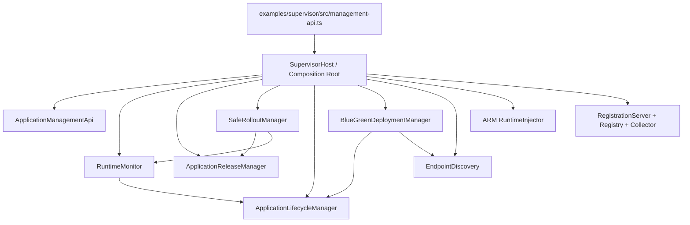
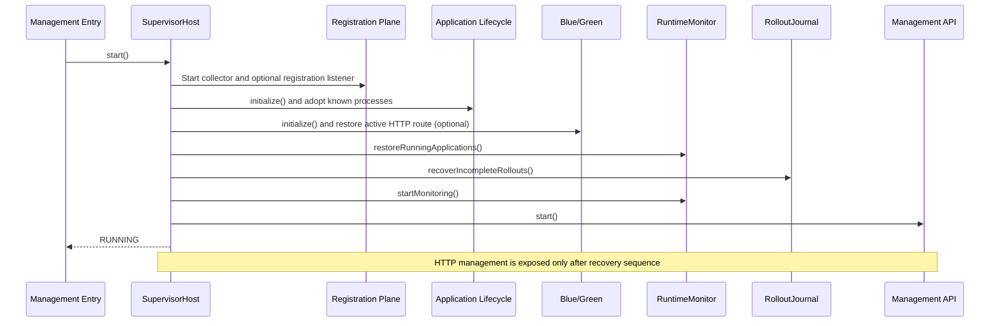
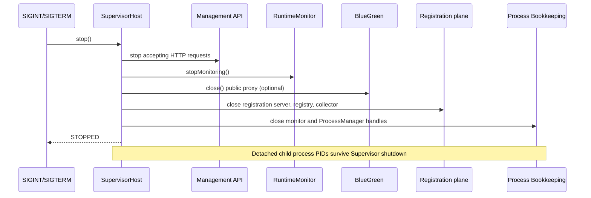

# Phase R6 — Composition Root & Dependency Enforcement

**Branch:** `arm-supervisor`  
**Baseline:** R5 commit `9fce394de31213b5c09c669d1482356b02a14077`  
**Status:** Source implementation + CI rules; build/tests require execution before production acceptance.

## Scope

R6 closes the R1–R5 modular-monolith refactor by:
1. Moving the **Management daemon wiring and lifecycle** out of `examples/supervisor/src/management-api.ts` into `@arm/supervisor-host`.
2. Defining deterministic startup/shutdown and compensating cleanup when startup fails.
3. Protecting package dependency directions with `scripts/check-architecture.mjs` and CI.
4. Leaving process/rollout/Blue-Green ownership within existing modules; not silently replacing their locking semantics.

## Ownership

`SupervisorHost` owns the object graph, socket startup order, monitor activation and teardown.

It **does not** own:
- PID lifecycle, process state, port allocation — `@arm/process-manager`.
- ZIP validation/installed release files — `@arm/package-manager`.
- Release history, audit and rollout state — `@arm/deployment-manager`.
- Desired process state/recovery policy — `@arm/runtime-monitor`.
- Registered ARM SDK instances and reachable HTTP endpoints — `@arm/service-discovery`.
- HTTP proxy forwarding — `@arm/traffic-router`.
- SDK runtime — `@arm/client-sdk`.

The old `ApplicationLifecycleManager` and `BlueGreenDeploymentManager` remain cross-capability coordinators until they can be safely converted to contract-only implementations. R6 makes the host's wiring explicit, but **does not claim all legacy concrete dependencies are eliminated**.

## Topology



The graph illustrates ownership/wiring, not independent network services. Some legacy coordinators use multiple lower-level packages.

## Startup workflow



## Shutdown workflow



If startup fails, the host executes cleanup for services already opened and becomes `FAILED`. Cleanup catches each individual error, attempts the remaining closes and surfaces combined errors. A failed instance cannot be restarted; create a new host after resolving config or port conflicts.

### State machine

`CREATED → STARTING → RUNNING → STOPPING → STOPPED`

`STARTING → FAILED` on failure; `STOPPING → FAILED` on incomplete cleanup.

The host cannot start twice, and `stop()` is idempotent. The Management entrypoint installs signal handlers only **after** successful startup. The host is intentionally independent of Node global signals to remain testable.

## Architecture dependency gate

New command:

```bash
npm run check:architecture
```

`scripts/check-architecture.mjs` inspects static relative TypeScript imports (and literal dynamic imports) inside extracted packages, rejects forbidden module dependencies and detects dependency cycles among protected modules.

| Protected module | Allowed cross-package dependencies |
|---|---|
| contracts | none |
| process-manager | contracts |
| package-manager | contracts |
| deployment-manager | contracts, package-manager |
| runtime-monitor | contracts, process-manager, package-manager |
| service-discovery | contracts, process-manager, core |
| traffic-router | contracts |
| arm-client-sdk | core, adapter-http |
| runtime-injection | contracts |
| supervisor-host | composition root can wire extracted packages and adapter-process |

**Legacy exemptions:** `adapter-process`, `core`, `adapter-http`, `library`, `shared` are not fully extracted modules yet. They retain current imports. This is an enforced *module-to-module direction* check for protected packages, not a complete ban on private source imports in legacy modules.

**Known checker limitation:** The dependency parser is a lightweight Node script, not the TypeScript compiler. Computed imports, tsconfig path aliases and non-literal module loaders are not analyzed. Architecture reviews and contract tests remain necessary.

## Continuous Integration

New GitHub Actions workflow: `.github/workflows/arm-verify.yml`, executed on pushes and PRs targeting `arm-supervisor`.

```text
checkout
  → Node.js 22
  → npm install
  → npm run build
  → npm run check:architecture
  → npm test
```

A lockfile is currently not committed, so CI uses `npm install` rather than `npm ci`. A follow-up should commit a reproducible lockfile and migrate CI to `npm ci`. Node 22 is chosen to match the repository's current TypeScript/Node setup.

Local combined check:

```bash
npm run verify
```

## Tests

`tests/supervisor-host-r6.test.ts` verifies:
- Minimal host starts Management API with ephemeral port, serves authenticated endpoints and stops idempotently.
- Invalid control plane configuration is rejected.
- Port-in-use startup failure cleans up resources and leaves host `FAILED`.
- Module dependency checker runs successfully.

Existing tests remain essential for process PID adoption, dynamic port/SDK bridge behavior, registration/metrics, safe rollout and Blue/Green state.

**Verification status:** Source files, Git commit and dependency wiring can be inspected on GitHub. The TypeScript build and all runtime tests must still be executed on an environment with dependencies.

## Migration strategy

- The original `dev:management` CLI is unchanged; it delegates to `SupervisorHost`.
- The startup order is preserved (registration, lifecycle, BG, runtime restore, rollout recovery, monitor, API).
- All HTTP route paths, auth behavior and durable state schemas stay in their original modules.
- ProcessManager state and adopted child processes are not rewritten during host shutdown.
- No service-to-service network protocol was introduced to achieve modularization.

## Remaining risks / explicitly deferred

1. Cross-module per-app **single writer** is not fully enforced: monitor, safe rollout and BG coordinator still have separate locks and ownership domains. Do not claim their simultaneous operations are globally serializable.
2. HTTP API stop may wait for outstanding active requests. R6 introduces no forced cancellation timeout or request draining protocol.
3. Failed startup after partial BG initialization may require process-/proxy-specific resource reconciliation.
4. Dependency checks are intentionally limited to protected packages and should be expanded with per-module entrypoint and private import policies once legacy consumers migrate.
5. ARM Client SDK remains private; a published versioned SDK needs packaging/semver and artifact testing.
6. Multi-supervisor same-storage high availability needs cross-process distributed leases.

## Completion criteria

- [x] Explicit Supervisor composition root, CLI wiring and documented lifecycle.
- [x] Startup failure cleanup and reverse-order shutdown.
- [x] Dependency direction checking script, npm scripts and CI workflow.
- [x] Tests for host lifecycle and architecture gate.
- [ ] Build and tests pass in real execution.
- [ ] CI workflow actually runs green.
- [ ] Shared application-operation arbitration across all coordinators (separate hardening milestone).

### Next checkpoint

After `npm run verify` passes and GitHub Actions is green, produce a new `ARM_PROJECT_CONVERSATION_HANDOFF.md` checkpoint summarizing R1–R6, outstanding architectural risks and the next functionality phase. Avoid presenting R6 as globally concurrency-safe until unified operation ownership is implemented.
