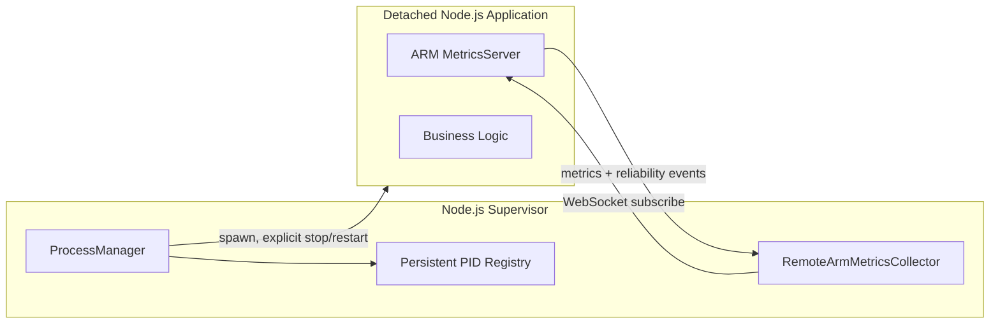

# External Node.js Process Supervisor

This is an additive feature; existing ARM Core and `ManagedComponent` behavior are unchanged.

## Modules

- `packages/adapter-process/src/process-manager.ts`
  - `ProcessManager.initialize(specs)`: load the durable PID registry and reconcile existing applications
  - `start(id)`: launch a detached child or return the verified existing process
  - `inspect(id)`: check OS identity and process state
  - `list()`: quick (PID-only) overview; use `inspect()` for trustworthy status
  - `stop(id)`: explicitly send SIGTERM and wait for exit
  - `restart(id)`: explicit stop followed by launch under the same per-app lock
  - `reconcile()`: reconcile registry with running processes
  - `close()`: release supervisor listeners **without stopping children**
- `packages/adapter-process/src/remote-arm-metrics-collector.ts`
  - `RemoteArmMetricsCollector.start()`: connect to app ARM WebSocket at `/metrics/ws`
  - `get(id)` / `list()`: current last-known remote snapshot
  - `isFresh(id)`: connection is open and a recent metrics snapshot was received
  - `stop()`: close monitoring connections, not app processes

## Architecture



The child must run its own ARM MetricsServer and listen on the URL configured for
that process. The existing protocol supports `{ "action": "subscribe" }`
and `{ "action": "subscribe_events" }`.

## Local demo

```bash
npm install
npm run build
node dist/examples/supervisor/src/index.js
```

The Supervisor launches the existing `examples/nodejs-api` demo with metrics port 3210.

From another terminal:

```bash
curl http://127.0.0.1:3210/metrics
curl http://127.0.0.1:3210/reliability/ready
```

Stop the **Supervisor only** with Ctrl+C. The child process keeps running.
Restart the Supervisor using the same command: it loads
`.arm-state/processes.json`, adopts the verified PID, and reconnects
to ARM over WebSocket without starting another instance.

To explicitly stop the app, use `ProcessManager.stop('example-app')` in a
supervisor process that has called `initialize()`. Example:

```ts
const manager = new ProcessManager('.arm-state/processes.json');
await manager.initialize([appSpec]);
await manager.stop('example-app');
```

## Important guarantees and limits

1. **Detached lifecycle:** `spawn(..., { detached: true, stdio: 'ignore' })`
   plus `child.unref()` separates child lifetime from Supervisor lifetime.
   This does not protect the child from host shutdown, container termination,
   job-object policies on Windows, or external service manager cleanup.
2. **Reconciliation:** persistent registry stores PID and, on Linux,
   `/proc/PID/stat` starttime to reduce PID reuse mistakes. A previous
   Supervisor does not need to be alive for adoption.
3. **Fail closed:** on Windows/macOS, a previously detached PID cannot be
   safely re-adopted for stop/restart using this adapter alone. Such a PID
   is not signalled; stronger OS process identity is a future enhancement.
4. **Single writer:** one Supervisor instance must own the registry file.
   Cross-process locking, multi-host discovery, and HA leader election are
   not implemented. Atomic rename protects against partial writes but does
   not provide multi-process concurrency control.
5. **Metrics:** ARM WebSocket exposes app-reported runtime and reliability
   metrics. Supervisor does **not** confuse its own `process.cpuUsage()`
   with child CPU usage. No OS CPU sampler is implemented in this phase.
6. **Readiness:** successful `spawn` is not a readiness guarantee. Use
   `collector.isFresh(id)` and the child ARM readiness endpoint if needed.
7. **Recovery:** no automatic process restart is triggered by WebSocket
   disconnect alone. Network loss must not cause destructive restart loops.
   Explicit `restart(id)` is provided; policy-based automatic restart can
   be added via a `ManagedComponent` adapter with appropriate safeguards.
8. **Security:** keep the app metrics endpoint on localhost for same-host
   usage. Use `ARM_METRICS_TOKEN` and `metricsToken` for auth; never
   expose the endpoint unauthenticated on untrusted networks. Avoid saving
   tokens to the PID registry; only PID records are persisted.
9. **Safety:** `stop()` sends SIGTERM and fails after the timeout; it does
   not send SIGKILL automatically. A process identity mismatch never gets
   signalled.
10. **No process ownership transfer at OS level:** an adopted PID is
    observable and signalable (on verified Linux PIDs), but is no longer
    an OS `ChildProcess` object of the new Supervisor.
