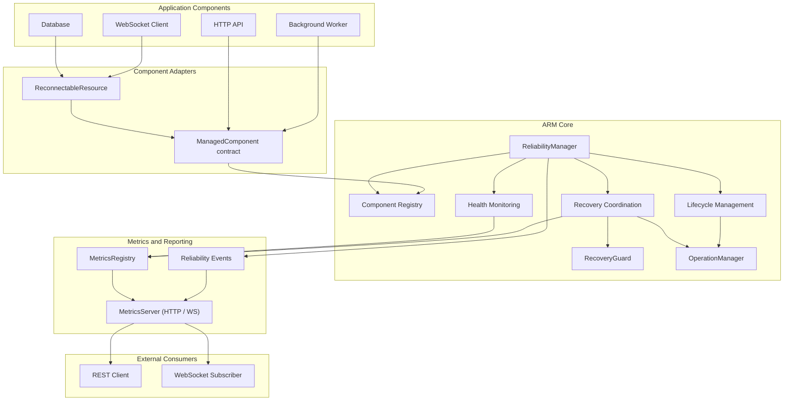

# ARM — System Architecture

Sơ đồ biểu diễn các nhóm thành phần, adapter, ARM core và luồng metrics/reporting.

## Source mapping

| Thành phần | Source |
|---|---|
| Reliability Manager, Registry, Health, Lifecycle, Recovery | `packages/core/src/reliability.ts` |
| RecoveryGuard | `packages/core/src/recovery-policy.ts` |
| OperationManager | `packages/core/src/operations.ts` |
| MetricsRegistry | `packages/core/src/metrics.ts` |
| ReconnectableResource | `packages/adapters/src/reconnectable-resource.ts` |
| MetricsServer | `packages/adapter-http/src/server.ts` |

**Lưu ý:** Mũi tên là quan hệ kiến trúc/tích hợp, không phải quan hệ import. Application Components là ví dụ, không nhất thiết có implementation production sẵn trong repo.
