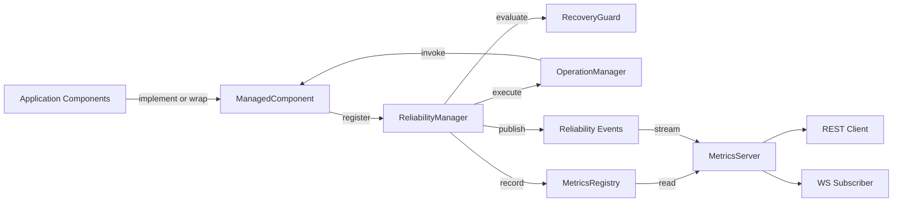

# ARM — Component Relationships

## Các loại liên kết

| Loại | Nguồn | Đích | Vai trò |
|---|---|---|---|
| Control Flow | ReliabilityManager | Registry / Health / Lifecycle / Recovery | Điều phối component |
| Policy | Recovery Coordination | RecoveryGuard | Retry budget / Circuit breaker |
| Execution | ReliabilityManager | OperationManager | Timeout, cancellation, fencing |
| Integration | ManagedComponent | Application Dependencies | Adapter-specific logic |
| Observability | ReliabilityManager | MetricsRegistry / Events | Ghi nhận trạng thái |
| Reporting | MetricsServer | HTTP / WS Client | Phân phối snapshot và event |

## Boundary rules

- ARM Core không import driver Database/WebSocket cụ thể.
- ReconnectableResource là một adapter dùng ManagedComponent contract.
- MetricsServer phục vụ read-only reporting, không điều khiển recovery.
- MetricsRegistry là registry trong bộ nhớ, không phải time-series database.
- Generation fencing trong process không thay thế fencing ở tài nguyên ngoài process.
