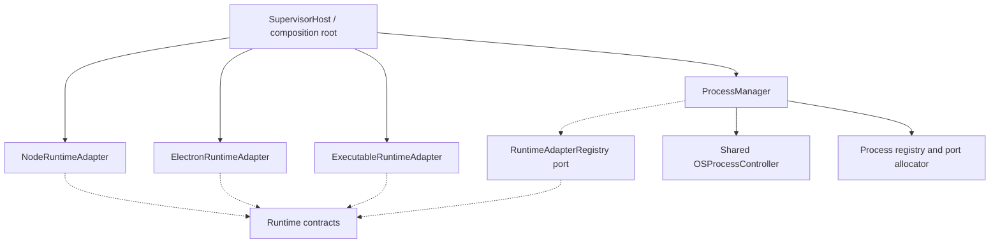

# ADR-R7-001 — Runtime Adapter Preparation and Shared OS Process Ownership

- **Status:** Proposed for acceptance (foundational choices approved by project owner)
- **Date:** 2026-11-12
- **Branch / inspected HEAD:** `arm-supervisor` / `dbe499a78b51543bcef6f6473791812cb34b66f7`
- **Scope:** R7.1 contract architecture; no source changes

## Context

R2 `ProcessManager` owns PID registry, spawn/stop/restart, Linux PID verification, adoption, dynamic port allocation and child environment assembly. Yet its `launch()` uses `spawn(process.execPath, [node args...])`, making Node runtime selection inseparable from process lifecycle. R5 instrumentation implements `nodeArguments()` and `environment()`. Electron and generic executables cannot be safely added by branching inside OS lifecycle or by giving each runtime its own process registry.

The R1 `ProcessController` interface and legacy `ProcessSpec`, persisted PID records, Blue/Green processes and ARM SDK injection require compatibility. R6 `SupervisorHost` is the composition root. R6 does not guarantee a global per-application lock across recovery/rollout/Blue-Green.

## Decision

1. Define `RuntimeAdapter.prepareLaunch(request, context)` as a **pure-from-the-process-lifecycle perspective** operation. It can perform trusted resolution and validation but never launches, stops, inspects, adopts or persists a process.
2. `RuntimeAdapterRegistry.resolve(type)` locates registered adapters; composition root registers built-ins. The process-manager consumes an interface and does not import concrete adapters.
3. A single shared `OSProcessController` abstraction owns OS spawn, process identity verification, adopted PID handling, termination and future process-group/tree support. `ProcessManager` retains lifecycle orchestration, locks, ports and durable state.
4. Runtime adapters return an immutable runtime-specific launch template (executable, argv, cwd, runtime env hints); an execution policy inside the process ownership boundary produces the **final** validated `LaunchPlan` with sanitized env, `shell: false` and fixed OS options.
5. Preserve `ProcessSpec` existing fields, add optional `runtime`; absence means **exact current Node.js behavior** using Supervisor `process.execPath`, current instrumentation and policies. Legacy `ProcessController` signatures remain unchanged.
6. Retain R5 `ProcessLaunchInstrumentation` structural port/legacy import compatibility. A Node runtime adapter may wrap it without modifying preload paths or launch timing for old Node processes.
7. No runtime adapter may install packages, select releases, trigger recovery or implement Blue/Green routing. Existing module owners keep those responsibilities.

## Logical dependency graph

This is in-process injection, not microservices. The architecture dependency checker must forbid adapter/process reverse dependencies and cycles.

## Invariants

- No source/API breaking changes to `ProcessController`, legacy `ProcessSpec` or `ProcessManager` methods/constructor without adapters preserving existing call sites.
- Launch plan contains no PID/status and is not written to durable registries. No credentials in process logs or persisted plan.
- A running/adopted process retains original executable/preload/env/port; changes apply only to future safe spawns.
- Existing child `close()` behavior is preserved: detached children survive Supervisor shutdown.
- `RUNNING` != `READY`; `ASSIGNED` port != socket bound. No unconditional HTTP requirement on new runtimes.
- Refuse unsafe signals to unverified PID or process group; new group termination policy cannot retroactively change Node legacy termination semantics.
- No `shell: true`, arbitrary runtime-selected privileged env, arbitrary host executable paths or untrusted preload paths.

## Alternatives evaluated

| Alternative | Reason rejected |
|---|---|
| Runtime adapter owns `start/stop/inspect` | Duplicates PID/adoption/state/recovery across runtimes and breaks R2 ownership |
| `switch (runtime.type)` scattered in `ProcessManager.launch()` | Grows coupling and violates extensibility as runtime count increases |
| Separate Supervisor microservice per runtime | Adds network/distributed complexity not justified by current modular monolith |
| Require runtime type on every existing ProcessSpec | Breaks consumers, tests and legacy persisted release flow |

## Consequences and migration

**Benefits:** clear extension point, centralized OS lifecycle security, non-breaking Node default, easier runtime-specific contract tests and future OS-specific process tree support.

**Costs:** extra registry/translation layers and careful coordination of environment, release-to-process mapping and durable identity. OS stop semantics differ by platform; cannot promise process-tree control until platform implementation/tested. Cross-coordinator per-app locks remain a separate open issue.

First implementation milestone should extract Node-specific plan creation while preserving byte-equivalent executable/argv/cwd/env/options, then add OS layer behind current behavior. Do not move release selection into runtime adapters.

## Validation / acceptance

Contract shape agreed; dependency gate updated; legacy Node launch with/without injection, adoption, dynamic ports, rollback, Blue/Green and SDK regression tests pass; untrusted executable/manifest tests fail closed. Current full CI baseline is NOT green (run 43055376989 cancelled with Blue/Green error), and must be resolved separately.

## References

- `docs/CODING_STANDARDS.md`
- `docs/PHASE_R2_PROCESS_MANAGEMENT_EXTRACTION.md`
- `docs/PHASE_R5_ARM_RUNTIME_SDK_CONSOLIDATION.md`
- `docs/PHASE_R6_COMPOSITION_ROOT_AND_ENFORCEMENT.md`
- `packages/process-manager/src/process-manager.ts`
- `packages/process-manager/src/process-launch-instrumentation.ts`